# Passwort-Sicherheit: Wie Angreifer Hashes knacken – und wie man sich schützt

> **Thema:** Passwort-Sicherheit – Angriffe auf Hashing und mögliche Verteidigungsstrategien (Salt, moderne Verfahren wie bcrypt und Argon2, Passwort-Policy, Rate-Limiting, 2FA)

| | |
|---|---|
| **Autoren** | Thasleem Aakib, Schubert Diago |
| **Klasse** | PE23F |
| **Modul** | M182 – Systemsicherheit implementieren |
| **Lehrperson** | Kemper Stefan |
| **Art der Arbeit** | LB2 – Projektarbeit (Dokumentation) |

---

## Worum geht es?

Fast jeder Dienst, bei dem wir uns anmelden, speichert unser Passwort – hoffentlich nicht im Klartext, sondern als **Hash**. Doch was passiert, wenn eine solche Datenbank gestohlen wird? Wie schnell kann ein Angreifer aus einem Hash wieder das ursprüngliche Passwort machen? Und was können Entwickler, Administratoren und wir selbst dagegen tun?

In dieser Dokumentation haben wir genau das **praktisch ausprobiert**: Wir haben selbst erstellte Test-Passwörter mit verschiedenen Verfahren gehasht (MD5, SHA-1, SHA-1 mit Salt, bcrypt, Argon2) und sie danach mit echten Werkzeugen wie **Hashcat** angegriffen. Anschliessend haben wir die wichtigsten Verteidigungsmassnahmen umgesetzt und getestet – vom eigenen Python-Skript bis zu Werkzeugen, die auch in Unternehmen eingesetzt werden (**Fail2Ban, Vaultwarden, Keycloak, testssl.sh**).

> [!IMPORTANT]
> Alle Angriffe in dieser Dokumentation wurden ausschliesslich gegen **selbst erstellte Test-Passwörter** in einer **eigenen, isolierten Testumgebung** durchgeführt. Das Knacken fremder Passwörter oder Angriffe auf fremde Systeme sind in der Schweiz strafbar (u. a. Art. 143<sup>bis</sup> StGB, unbefugtes Eindringen in ein Datenverarbeitungssystem).

## Lernziele

Nach dem Durcharbeiten dieser Dokumentation kannst du …

- erklären, was ein Hash ist und warum schnelle Hash-Funktionen (MD5, SHA-1) für Passwörter ungeeignet sind,
- die drei wichtigsten Offline-Angriffe (Dictionary, Brute-Force, Rainbow Table) unterscheiden und ihre Wirkung einschätzen,
- begründen, warum **Salt**, **bcrypt** und **Argon2** diese Angriffe ausbremsen,
- erklären, wie **Rate-Limiting**, **2FA (TOTP)**, **Passwort-Manager** und **Leak-Prüfungen** Online-Angriffe verhindern,
- eine sinnvolle **Passwort-Policy** nach aktuellem Stand (NIST, OWASP) formulieren.

## Inhaltsverzeichnis

| Kapitel | Inhalt |
|---|---|
| [Kapitel 1 – Grundlagen](#kapitel-1--grundlagen-hashing-salt-bcrypt-argon2-und-passwort-policy) | Hashing, Salt, Pepper, bcrypt, Argon2, Online- vs. Offline-Angriffe, Passwort-Policy |
| [Kapitel 2 – Testumgebung](#kapitel-2--testumgebung-werkzeuge-aufbau-und-testpasswörter) | Werkzeuge, Aufbau, Testpasswörter, Hash-Generierung, Server-Infrastruktur |
| [Kapitel 3 – Angriffe](#kapitel-3--angriffe-dictionary-brute-force-und-rainbow-tables) | Dictionary-Attacke, Brute-Force, Angriffe auf bcrypt/Argon2, Geschwindigkeitsvergleich, Rainbow Table |
| [Kapitel 4 – Verteidigung](#kapitel-4--verteidigung-von-salt-bis-zum-security-audit) | Salting-Nachweis, Rate-Limiting, Fail2Ban, TOTP, Vaultwarden, HIBP, Keycloak, testssl.sh |
| [Kapitel 5 – Reflexion und Fazit](#kapitel-5--reflexion-und-fazit) | Angriff-Verteidigung-Matrix, Restrisiken, Sicherheitsprinzipien, Checkliste, Fazit |
| [Kapitel 6 – Quellenverzeichnis](#kapitel-6--quellenverzeichnis) | Alle Quellen mit Link und Zugriffsdatum |
| [Kapitel 7 – Glossar](#kapitel-7--glossar) | Fachbegriffe kurz erklärt |

## So liest du diese Dokumentation

- Jedes Kapitel endet mit einem kurzen **Selbsttest**. Klappe die Antworten erst auf, wenn du selbst überlegt hast.
- Quellen werden im Text als **[Q1]**, **[Q2]** usw. angegeben und sind im [Quellenverzeichnis](#kapitel-6--quellenverzeichnis) mit Link und Zugriffsdatum aufgeführt.
- Fachbegriffe, die du nicht kennst, findest du im [Glossar](#kapitel-7--glossar).
- Alle Skripte, die wir geschrieben haben, sind vollständig abgedruckt und liegen zusätzlich im Ordner [`scripts/`](../scripts/) des Repositorys. Du kannst sie in deiner eigenen Testumgebung nachbauen.

## Die wichtigsten Ergebnisse auf einen Blick

| Test | Ergebnis |
|---|---|
| MD5-Hash von `123456` (Dictionary-Attacke) | in **unter 1 Sekunde** geknackt |
| MD5-Hash von `K7#mPx9!qLz2` (Dictionary-Attacke) | **nicht** geknackt – Passwort steht in keiner Liste |
| Brute-Force gegen MD5 | ca. **400 Millionen** Versuche pro Sekunde |
| Gleiches Passwort `123456`, aber mit **Salt** | **nicht** geknackt – ganze Wordlist (14,3 Mio. Einträge) erfolglos |
| bcrypt / Argon2 | nur noch **39 bzw. 10** Versuche pro Sekunde |
| Rate-Limiting / Fail2Ban / Keycloak | Angreifer nach **3 Fehlversuchen** gesperrt |
| 2FA mit TOTP | gestohlenes Passwort allein reicht nicht mehr |
| HIBP-Check | `Stefan123!` wurde **2511-mal** in Datenlecks gefunden |

---

## Kapitel 1 – Grundlagen: Hashing, Salt, bcrypt, Argon2 und Passwort-Policy

---

### 1. Warum Passwörter nicht im Klartext gespeichert werden

Ein Login funktioniert vereinfacht so: Der Benutzer gibt sein Passwort ein, und der Server prüft, ob es mit dem gespeicherten Wert übereinstimmt. Würde der Server die Passwörter im Klartext speichern, hätte jeder, der die Datenbank in die Hände bekommt (Angreifer, unehrlicher Administrator, falsch konfiguriertes Backup), sofort alle Passwörter. Da viele Menschen dasselbe Passwort bei mehreren Diensten verwenden, wären damit auch deren andere Konten in Gefahr (**Credential Stuffing**).

Deshalb speichert ein Server das Passwort nicht selbst, sondern nur einen **Hash** davon. Beim Login wird das eingegebene Passwort erneut gehasht und nur die Hashes werden verglichen [Q1].

### 2. Was ist ein Hash?

Eine **kryptografische Hash-Funktion** macht aus einer beliebig langen Eingabe einen Wert mit fester Länge. Sie hat drei Eigenschaften, die für Passwörter entscheidend sind:

| Eigenschaft | Bedeutung | Beispiel |
|---|---|---|
| **Deterministisch** | Gleiche Eingabe → immer gleicher Hash | `123456` → MD5 immer `e10adc3949ba59abbe56e057f20f883e` |
| **Einwegfunktion** | Aus dem Hash kann man das Passwort nicht zurückrechnen | Es gibt keine «Entschlüsselung» eines Hashes |
| **Lawineneffekt** | Kleinste Änderung der Eingabe → völlig anderer Hash | `123456` und `123457` haben komplett verschiedene Hashes |

> [!NOTE]
> **Hashing ist keine Verschlüsselung.** Eine Verschlüsselung lässt sich mit dem richtigen Schlüssel wieder rückgängig machen. Ein Hash nicht. Ein Angreifer kann einen Hash deshalb nur «knacken», indem er **Passwörter rät**, sie selbst hasht und schaut, ob der gleiche Hash herauskommt. Genau das machen Werkzeuge wie Hashcat (siehe [Kapitel 03](#kapitel-3--angriffe-dictionary-brute-force-und-rainbow-tables)).

### 3. Das Problem: schnelle Hash-Funktionen (MD5, SHA-1)

**MD5** (1992, [Q3]) und **SHA-1** wurden ursprünglich entwickelt, um Daten **schnell** auf Integrität zu prüfen, zum Beispiel ob eine heruntergeladene Datei unverändert ist. Für diesen Zweck ist Geschwindigkeit gut. Für Passwörter ist sie ein Problem: Je schneller ein Hash berechnet werden kann, desto mehr Passwörter kann ein Angreifer pro Sekunde ausprobieren.

Zusätzlich gelten beide Verfahren heute auch kryptografisch als gebrochen:

- **MD5:** Kollisionen (zwei verschiedene Eingaben mit gleichem Hash) lassen sich seit Mitte der 2000er-Jahre praktisch erzeugen. Die IETF rät von MD5 für Sicherheitszwecke ab [Q4].
- **SHA-1:** 2017 wurde mit dem Projekt *SHAttered* die erste praktische SHA-1-Kollision veröffentlicht [Q5].

In unseren eigenen Tests hat ein normaler Laptop (nur mit der CPU, ohne Grafikkarte) beim Brute-Force-Angriff rund **400 Millionen MD5-Hashes pro Sekunde** berechnet (siehe [Kapitel 03](#2-brute-force-attacke-gegen-md5)). Mit Grafikkarten sind es ein Vielfaches davon.

**Fazit:** OWASP empfiehlt, MD5, SHA-1 und auch SHA-256 **nicht direkt** für Passwörter zu verwenden, sondern spezielle, absichtlich langsame Passwort-Hash-Verfahren [Q1].

### 4. Salt und Pepper

#### Salt

Ein **Salt** ist ein zufälliger Wert, der **für jedes Passwort einzeln** erzeugt und vor dem Hashen an das Passwort angehängt wird. Der Salt wird zusammen mit dem Hash gespeichert – er ist also nicht geheim.

```
ohne Salt:  SHA-1("123456")              → immer derselbe Hash
mit Salt:   SHA-1(Salt + "123456")        → bei jedem Benutzer ein anderer Hash
```

Was bringt das?

1. **Gleiche Passwörter ergeben verschiedene Hashes.** Haben 1000 Benutzer das Passwort `123456`, sieht der Angreifer trotzdem 1000 verschiedene Hashes.
2. **Vorberechnete Tabellen werden nutzlos.** Rainbow Tables und Lookup-Tabellen funktionieren nur, wenn man den Hash schon im Voraus berechnen kann. Mit einem zufälligen Salt müsste der Angreifer für **jeden einzelnen Salt-Wert** eine eigene Tabelle berechnen [Q1].
3. **Jeder Hash muss einzeln angegriffen werden.** Der Angreifer kann nicht mehr einen Rateversuch gegen alle Hashes gleichzeitig prüfen.

In unserer Testumgebung haben wir einen Salt von **16 Byte** (128 Bit) mit `os.urandom(16)` erzeugt. Wie stark der Effekt ist, zeigt der Salting-Nachweis in [Kapitel 04](#1-salting-nachweis).

> [!WARNING]
> Ein Salt schützt **nicht** vor einer Dictionary-Attacke auf einen einzelnen Hash, wenn der Angreifer den Salt kennt (er steht ja neben dem Hash in der Datenbank). Der Salt verhindert vorberechnete Tabellen und Massenangriffe – die eigentliche Bremse gegen das Raten ist ein **langsames** Hash-Verfahren.

#### Pepper

Ein **Pepper** ist ein zusätzlicher geheimer Wert, der für **alle** Passwörter gleich ist und – anders als der Salt – **nicht** in der Datenbank gespeichert wird, sondern zum Beispiel in einem Secrets-Vault oder einem Hardware-Sicherheitsmodul (HSM). Wird nur die Datenbank gestohlen, fehlt dem Angreifer der Pepper und er kann die Hashes nicht knacken. Ein Pepper ist eine zusätzliche Schutzschicht (Defense in Depth), ersetzt aber kein gutes Hash-Verfahren [Q1].

### 5. Langsame Passwort-Hashes: bcrypt und Argon2

Die Idee hinter modernen Passwort-Hashes: **Für den Server ist ein einzelner Login egal**, ob die Berechnung 1 Mikrosekunde oder 100 Millisekunden dauert – der Benutzer merkt das kaum. **Für den Angreifer**, der Milliarden Passwörter ausprobieren will, ist es ein riesiger Unterschied.

#### bcrypt

**bcrypt** wurde 1999 von Niels Provos und David Mazières vorgestellt und basiert auf der Blockchiffre Blowfish [Q6]. Wichtige Merkmale:

- **Eingebauter Salt:** bcrypt erzeugt den Salt automatisch und speichert ihn im Hash-String.
- **Anpassbarer Work-Factor (Cost):** Der Cost-Wert ist ein Exponent. Jede Erhöhung um 1 **verdoppelt** den Rechenaufwand. So kann man bcrypt an schnellere Hardware anpassen, ohne das Verfahren zu wechseln.
- **Längenbegrenzung:** Die meisten Implementierungen verarbeiten nur die ersten **72 Byte** des Passworts [Q1]. Das sieht man auch in unserem Hashcat-Test («Maximum password length supported by kernel: 72»).

Aufbau eines bcrypt-Hashes aus unserer Testumgebung:

```
$2b$12$TAYvVbzz6mP9R9tCyiMXLOHASdwupjQZv/2n9UCmchNeWzdbefCNS
 │   │  └──────── Salt (22 Zeichen) ────┘└──────── Hash (31 Zeichen) ─────┘
 │   └─ Cost-Faktor 12 → 2^12 = 4096 Runden
 └─ Version 2b
```

OWASP empfiehlt bcrypt nur noch für bestehende Systeme, mit einem Work-Factor von **mindestens 10** [Q1].

#### Argon2

**Argon2** hat 2015 die *Password Hashing Competition* gewonnen [Q8] und ist seit 2021 im **RFC 9106** standardisiert [Q7]. Der grosse Unterschied zu bcrypt: Argon2 ist nicht nur rechenintensiv, sondern auch **speicherintensiv (memory-hard)**. Jede einzelne Berechnung braucht eine festgelegte Menge Arbeitsspeicher. Grafikkarten und Spezial-Hardware (ASICs), die Angreifer für massenhaftes Raten einsetzen, haben zwar sehr viele Recheneinheiten, aber pro Recheneinheit nur wenig Speicher – genau das bremst sie bei Argon2 aus.

Es gibt drei Varianten: **Argon2d**, **Argon2i** und **Argon2id**. Für Passwörter wird **Argon2id** empfohlen, eine Kombination aus beiden [Q7].

Aufbau eines Argon2-Hashes aus unserer Testumgebung (erzeugt mit der Python-Bibliothek `argon2-cffi`):

```
$argon2id$v=19$m=65536,t=3,p=4$luvgcEvucAbyg0gI55SEBQ$ca+KKDymxm/E85+pgcjbxPGk1SvXcR/Vy4RUa78x1wg
 │        │    │       │   │   └──────── Salt ──────┘└──────────────── Hash ─────────────────┘
 │        │    │       │   └─ p=4: 4 parallele Threads
 │        │    │       └─ t=3: 3 Durchläufe (Iterationen)
 │        │    └─ m=65536: 64 MiB Arbeitsspeicher pro Berechnung
 │        └─ Version 19 (0x13)
 └─ Variante Argon2id
```

#### Empfohlene Parameter (OWASP)

| Verfahren | Empfehlung laut OWASP [Q1] | Einsatz |
|---|---|---|
| **Argon2id** | mind. 19 MiB Speicher, 2 Iterationen, Parallelität 1 | **erste Wahl** |
| **scrypt** | N = 2<sup>17</sup> (128 MiB), r = 8, p = 1 | wenn Argon2id nicht verfügbar ist |
| **bcrypt** | Work-Factor mind. 10, max. 72 Byte Passwortlänge | nur für bestehende Systeme |
| **PBKDF2** | 600 000 Iterationen mit HMAC-SHA-256 | wenn FIPS-140-Konformität nötig ist |
| MD5, SHA-1, SHA-256 (direkt) | ❌ nicht verwenden | – |

Unsere Argon2-Hashes (64 MiB, t=3, p=4) liegen deutlich über diesen Mindestwerten.

### 6. Online- vs. Offline-Angriffe

Für das Verständnis der Verteidigung ist eine Unterscheidung wichtig:

| | **Online-Angriff** | **Offline-Angriff** |
|---|---|---|
| **Was macht der Angreifer?** | Probiert Passwörter direkt am Login aus (Webseite, SSH, App) | Hat die Hash-Datenbank gestohlen und rät auf dem eigenen Rechner |
| **Geschwindigkeit** | langsam (Netzwerk, Server-Antwortzeit) | extrem schnell (Millionen bis Milliarden Versuche pro Sekunde) |
| **Wird bemerkt?** | ja, in den Logs des Servers | nein, der Server merkt nichts |
| **Wirksame Verteidigung** | Rate-Limiting, Account-Lockout, Fail2Ban, 2FA | Salt, langsame Hash-Verfahren (bcrypt, Argon2), lange Passwörter |
| **In dieser Doku** | [Kapitel 04](#kapitel-4--verteidigung-von-salt-bis-zum-security-audit) | [Kapitel 03](#kapitel-3--angriffe-dictionary-brute-force-und-rainbow-tables) |

Gegen Offline-Angriffe helfen Rate-Limiting und Account-Sperren **nicht**, weil der Angreifer gar nicht mehr mit dem Server spricht. Deshalb braucht es **beide** Arten von Schutz.

### 7. Passwort-Policy nach aktuellem Stand

Viele Firmen verlangen immer noch Regeln wie «mindestens 8 Zeichen, ein Grossbuchstabe, eine Zahl, ein Sonderzeichen, alle 90 Tage ändern». Das führt in der Praxis zu Passwörtern wie `Sommer2024!` – das erfüllt alle Regeln, steht aber in jeder Wordlist. Das US-amerikanische **NIST** hat seine Richtlinie **SP 800-63B** (Revision 4, 2025) deshalb grundlegend überarbeitet [Q2]:

| Regel | Empfehlung NIST SP 800-63B-4 [Q2] |
|---|---|
| **Mindestlänge** | **15 Zeichen**, wenn das Passwort allein schützt; **8 Zeichen**, wenn es nur als Teil einer Mehr-Faktor-Authentifizierung genutzt wird |
| **Maximallänge** | mindestens **64 Zeichen** müssen erlaubt sein |
| **Komplexitätsregeln** (Gross/Klein/Zahl/Sonderzeichen) | **dürfen nicht** verlangt werden |
| **Erlaubte Zeichen** | Leerzeichen und Unicode sollen akzeptiert werden (Passphrasen!) |
| **Regelmässiger Wechsel** | **nicht** verlangen – nur bei Hinweis auf Kompromittierung |
| **Blocklist** | neue Passwörter **müssen** gegen bekannte, geleakte und häufige Passwörter geprüft werden |
| **Fehlversuche** | müssen begrenzt werden (Rate-Limiting) |

Warum **Länge** wichtiger ist als Komplexität, haben wir in unserem Brute-Force-Test selbst gemessen: Jedes zusätzliche Zeichen vervielfacht den Suchraum um den Faktor 95 (siehe [Kapitel 03](#2-brute-force-attacke-gegen-md5)). Wie man die Blocklist-Prüfung praktisch umsetzt, zeigt unser HIBP-Skript in [Kapitel 04](#6-abgleich-mit-have-i-been-pwned-hibp), und wie ein Unternehmen Passwort-Policies zentral durchsetzt, zeigt Keycloak in [Kapitel 04](#7-keycloak-alles-zentral-in-einem-system).

**Unsere Empfehlung für eine Passwort-Policy:**

1. Lange Passphrasen statt kurzer, komplizierter Passwörter (z. B. vier zufällige Wörter).
2. Für jeden Dienst ein **eigenes** Passwort – am einfachsten mit einem **Passwort-Manager**.
3. Neue Passwörter automatisch gegen Leak-Datenbanken prüfen.
4. Wo immer möglich **2FA** aktivieren.
5. Serverseitig: Argon2id, Salt, Rate-Limiting.

---

### Selbsttest Kapitel 1

<details>
<summary><b>1. Warum ist MD5 für Passwörter ungeeignet, obwohl man einen Hash nicht «zurückrechnen» kann?</b></summary>

Weil MD5 extrem schnell ist. Ein Angreifer muss den Hash nicht zurückrechnen, sondern kann einfach sehr viele Passwörter raten, hashen und vergleichen. Bei MD5 schafft schon ein Laptop Hunderte Millionen Versuche pro Sekunde.
</details>

<details>
<summary><b>2. Der Salt steht neben dem Hash in der Datenbank. Warum bringt er trotzdem etwas?</b></summary>

Weil er vorberechnete Tabellen (Rainbow Tables) nutzlos macht und gleiche Passwörter zu verschiedenen Hashes führt. Der Angreifer muss jeden Hash einzeln angreifen und kann nichts im Voraus berechnen.
</details>

<details>
<summary><b>3. Was unterscheidet Argon2 von bcrypt?</b></summary>

Argon2 ist zusätzlich **speicherintensiv** (memory-hard). Dadurch werden Grafikkarten und Spezial-Hardware, die viele Recheneinheiten, aber wenig Speicher pro Einheit haben, stark ausgebremst. Ausserdem ist der Speicherbedarf als Parameter einstellbar.
</details>

<details>
<summary><b>4. Hilft ein Account-Lockout nach 3 Fehlversuchen gegen einen Angreifer, der die Hash-Datenbank gestohlen hat?</b></summary>

Nein. Das ist ein Offline-Angriff. Der Angreifer spricht gar nicht mehr mit dem Server. Hier helfen nur ein langsames Hash-Verfahren, Salt und lange Passwörter.
</details>

<details>
<summary><b>5. Ist «Sommer2024!» nach NIST SP 800-63B-4 ein gutes Passwort?</b></summary>

Nein. Es ist zu kurz (11 statt 15 Zeichen für ein alleiniges Passwort) und folgt einem typischen Muster (Jahreszeit + Jahr + Sonderzeichen), das in Wordlists und Blocklists vorkommt.
</details>

---

## Kapitel 2 – Testumgebung: Werkzeuge, Aufbau und Testpasswörter

---

### 1. Überblick über die Umgebung

Alle Tests liefen lokal auf einem Windows-Laptop in **WSL2 (Windows Subsystem for Linux) mit Ubuntu 24.04**. Es wurde **keine** Grafikkarte zum Knacken verwendet, alle Hashcat-Werte stammen von der CPU (Intel Core i9-12900HK). Echte Angreifer mit Grafikkarten wären also noch deutlich schneller – unsere Zahlen sind eher eine **untere Grenze**.

```
┌────────────────────────── Windows-Laptop ──────────────────────────┐
│                                                                    │
│   ┌───────────────────────── WSL2 / Ubuntu 24.04 ───────────────┐  │
│   │                                                             │  │
│   │  Python-venv           Angriffswerkzeuge     Docker          │  │
│   │  ├─ generate_hashes    ├─ Hashcat 6.2.6      ├─ Vaultwarden  │  │
│   │  ├─ crack_argon2       ├─ Hashcat 7.0.0      ├─ Caddy (TLS)  │  │
│   │  ├─ rainbow_demo       ├─ John the Ripper    ├─ Keycloak     │  │
│   │  ├─ rate_limit         └─ rockyou.txt        └─ PostgreSQL   │  │
│   │  ├─ totp_*                                                  │  │
│   │  └─ hibp_check         Fail2Ban + OpenSSH     testssl.sh     │  │
│   └─────────────────────────────────────────────────────────────┘  │
│                                                                    │
│   Browser (Firefox) ──► https://127.0.0.1:8443  (Vaultwarden)      │
│                     ──► https://127.0.0.1:8543  (Keycloak)         │
│   Smartphone: Microsoft Authenticator (TOTP)                       │
└────────────────────────────────────────────────────────────────────┘
```

### 2. Eingesetzte Werkzeuge

| Werkzeug | Zweck | Kapitel |
|---|---|---|
| **Python 3.12** mit `hashlib`, `bcrypt`, `argon2-cffi` | Test-Hashes erzeugen | 2 |
| **Hashcat** 6.2.6 und 7.0.0 [Q9][Q10] | Hashes knacken (Dictionary, Brute-Force) | 3 |
| **John the Ripper** [Q11] | alternatives Cracking-Werkzeug | 3 |
| **rockyou.txt** [Q14] | Wordlist mit 14,3 Mio. echten, geleakten Passwörtern | 3 |
| **Eigene Python-Skripte** | Argon2-Cracking, Rainbow-Table-Prinzip, Rate-Limiting, TOTP, HIBP | 3, 4 |
| **OpenSSH + Fail2Ban** [Q15] | Brute-Force-Schutz auf Systemebene | 4 |
| **pyotp, qrcode** [Q18] | 2FA mit TOTP | 4 |
| **Microsoft Authenticator** | Authenticator-App auf dem Smartphone | 4 |
| **Docker** | Container für Vaultwarden, Caddy, Keycloak, PostgreSQL | 4 |
| **Vaultwarden** [Q20] | selbst gehosteter Passwort-Manager | 4 |
| **Caddy** [Q23] | Reverse-Proxy für HTTPS | 4 |
| **Keycloak** + PostgreSQL [Q26] | Identity and Access Management (IAM) | 4 |
| **testssl.sh** [Q27] | Security-Audit der TLS-Konfiguration | 4 |
| **Have I Been Pwned API** [Q24] | Abgleich mit geleakten Passwörtern | 4 |

### 3. Die drei Testpasswörter

Wir haben bewusst drei Passwörter in unterschiedlicher Stärke gewählt:

| Kategorie | Passwort | Warum gewählt? |
|---|---|---|
| **schwach** | `123456` | Eines der häufigsten Passwörter der Welt, steht ganz oben in jeder Wordlist |
| **mittel** | `Sommer2024` | Typisches «Regel-Passwort»: Gross-/Kleinbuchstaben und Zahlen, aber vorhersehbares Muster |
| **stark** | `K7#mPx9!qLz2` | 12 Zeichen, zufällig, alle Zeichenklassen, in keiner Wordlist |

Jedes Passwort wurde mit fünf Verfahren gehasht: **MD5**, **SHA-1**, **SHA-1 mit Salt**, **bcrypt** und **Argon2**.

### 4. Python-Umgebung und Hash-Generierung

#### Virtuelle Umgebung (venv)

> [!TIP]
> **Warum venv?** Ubuntu blockiert ab Version 23 (auch in WSL) `pip install` systemweit (PEP 668 – «externally-managed-environment»). Eine **venv** ist eine isolierte «Sandbox» für Python-Pakete, die genau dieses Problem umgeht, ohne das System zu gefährden. Man aktiviert sie mit `source venv/bin/activate` – danach kann man `pip install` normal nutzen.

```bash
cd /mnt/c/Users/thasleema/git/M182-LB2/scripts
sudo apt install python3-venv -y
python3 -m venv venv
source venv/bin/activate
pip install bcrypt argon2-cffi
python3 generate_hashes.py
```

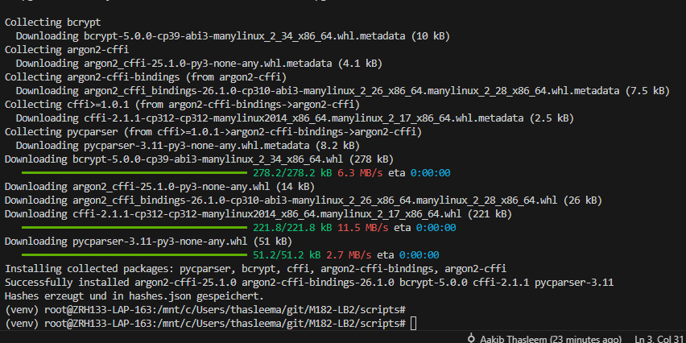

*Abbildung 2.1: Die Pakete `bcrypt` und `argon2-cffi` werden in der venv installiert, anschliessend meldet das Skript «Hashes erzeugt und in hashes.json gespeichert.»*

#### Skript `generate_hashes.py`

Dieses Skript erzeugt für jedes Testpasswort alle fünf Hash-Varianten und speichert sie in der Datei `hashes.json`. Für den gesalzenen SHA-1-Hash wird pro Passwort ein zufälliger Salt von 16 Byte erzeugt (`os.urandom(16)`). bcrypt und Argon2 erzeugen ihren Salt automatisch selbst.

```python
import hashlib
import bcrypt
from argon2 import PasswordHasher
import os
import json

test_passwords = {
    "schwach": "123456",
    "mittel": "Sommer2024",
    "stark": "K7#mPx9!qLz2",
}

ph = PasswordHasher()
results = {}

for label, pw in test_passwords.items():
    pw_bytes = pw.encode()
    salt = os.urandom(16)

    md5_hash = hashlib.md5(pw_bytes).hexdigest()
    sha1_hash = hashlib.sha1(pw_bytes).hexdigest()
    sha1_salted = hashlib.sha1(salt + pw_bytes).hexdigest()
    bcrypt_hash = bcrypt.hashpw(pw_bytes, bcrypt.gensalt()).decode()
    argon2_hash = ph.hash(pw)

    results[label] = {
        "passwort": pw,
        "md5": md5_hash,
        "sha1": sha1_hash,
        "sha1_gesalzen": sha1_salted,
        "salt_hex": salt.hex(),
        "bcrypt": bcrypt_hash,
        "argon2": argon2_hash,
    }

with open("hashes.json", "w") as f:
    json.dump(results, f, indent=2)

print("Hashes erzeugt und in hashes.json gespeichert.")
```

Nun zeigt `cat hashes.json` alle erzeugten Hashes erfolgreich an:

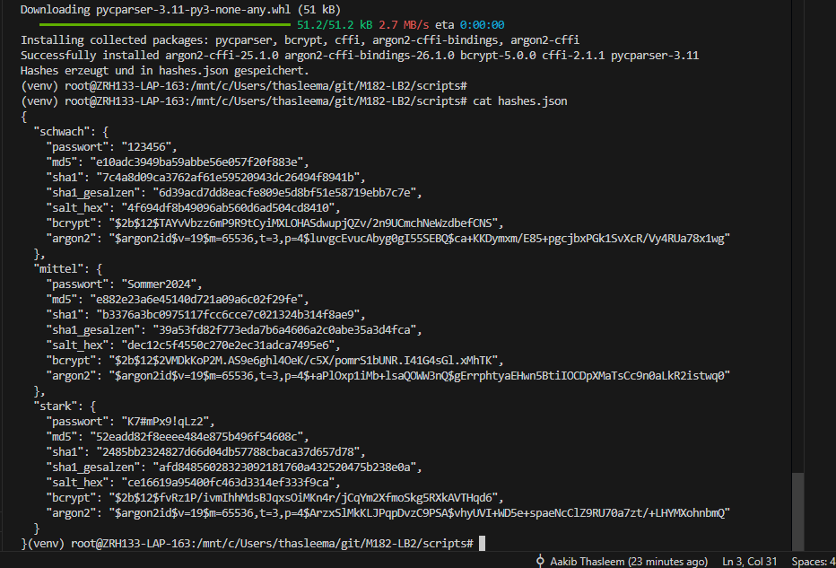

*Abbildung 2.2: Inhalt von `hashes.json`. Man sieht gut, wie unterschiedlich die Hashes desselben Passworts je nach Verfahren aussehen: MD5 (32 Hex-Zeichen), SHA-1 (40 Hex-Zeichen), bcrypt (beginnt mit `$2b$12$`) und Argon2 (beginnt mit `$argon2id$`).*

Die wichtigsten Werte für die folgenden Angriffe:

| Passwort | Verfahren | Hash |
|---|---|---|
| `123456` | MD5 | `e10adc3949ba59abbe56e057f20f883e` |
| `123456` | SHA-1 | `7c4a8d09ca3762af61e59520943dc26494f8941b` |
| `123456` | SHA-1 + Salt | `6d39acd7dd8eacfe809e5d8bf51e58719ebb7c7e` (Salt: `4f694df8b49096ab560d6ad504cd8410`) |
| `K7#mPx9!qLz2` | MD5 | `52eadd82f8eeee484e875b496f54608c` |

### 5. Angriffswerkzeuge: Hashcat, John the Ripper und rockyou.txt

#### Hashcat und John installieren

```bash
sudo apt update
sudo apt install hashcat john -y
```

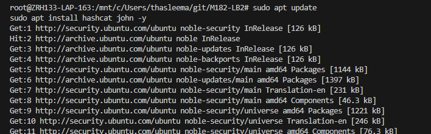

*Abbildung 2.3: Installation von Hashcat und John the Ripper.*

#### Wordlist besorgen (rockyou.txt)

Die Wordlist **rockyou.txt** stammt aus einem echten Datenleck der Firma RockYou aus dem Jahr 2009, bei dem über 32 Millionen Passwörter im Klartext gestohlen wurden [Q14]. Sie ist heute die Standard-Wordlist für Passwort-Tests und enthält **14 344 384** eindeutige Passwörter (ca. 133 MB). Wir haben sie mit `wget` heruntergeladen:

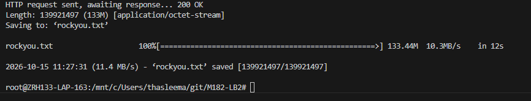

*Abbildung 2.4: Download der Wordlist rockyou.txt (139 921 497 Bytes).*

#### Hashcat-Version prüfen

```bash
sudo apt install hashcat -y
```

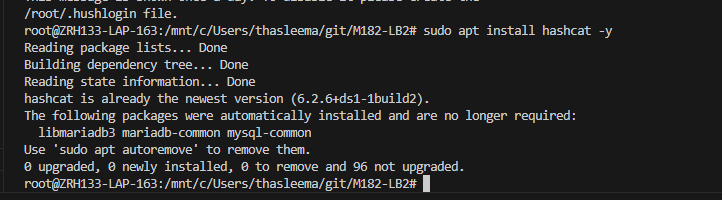

*Abbildung 2.5: Hashcat ist in Version 6.2.6 installiert.*

> [!NOTE]
> Die über `apt` installierte Version Hashcat 6.2.6 und John the Ripper (Version 6.x aus den Ubuntu-Paketen) unterstützen **Argon2 noch nicht**. Für den Argon2-Test haben wir deshalb **Hashcat 7.0.0** verwendet:
> - **Hashcat:** Unterstützt Argon2 nativ ab Version 7.0.0 über den Hash-Modus `-m 34000` (optimiert für GPUs) [Q9][Q10].
> - **John the Ripper:** Unterstützt Argon2 in der Jumbo-Version über das Format `--format=argon2` (optimiert für CPUs) [Q11].

#### Vorbereitung für die Angriffe

In den `scripts`-Ordner wechseln und die venv aktivieren:

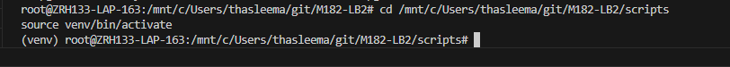

*Abbildung 2.6: Wechsel in den Ordner `scripts` und Aktivierung der venv.*

Hashcat erwartet die zu knackenden Hashes in einer Datei. Deshalb haben wir jeden Hash in eine eigene Datei gepackt, zum Beispiel den MD5-Hash des schwachen Passworts:

```bash
echo "e10adc3949ba59abbe56e057f20f883e" > md5_schwach.txt
```

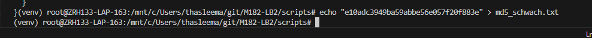

*Abbildung 2.7: Der MD5-Hash von `123456` wird in die Datei `md5_schwach.txt` geschrieben.*

#### Die wichtigsten Hashcat-Parameter

| Parameter | Bedeutung |
|---|---|
| `-m 0` | Hash-Modus MD5 |
| `-m 100` | Hash-Modus SHA-1 |
| `-m 120` | Hash-Modus SHA-1 mit Salt: `sha1($salt.$pass)` |
| `-m 3200` | Hash-Modus bcrypt |
| `-m 34000` | Hash-Modus Argon2 (ab Hashcat 7.0.0) |
| `-a 0` | Angriffsmodus «Straight» = Dictionary-Attacke mit Wordlist |
| `-a 3` | Angriffsmodus «Mask» = Brute-Force |
| `--increment` | Länge schrittweise erhöhen (1, 2, 3 … Zeichen) |
| `--show` | Bereits geknackte Hashes im Klartext anzeigen |

Die vollständige Liste aller Hash-Modi findet man im Hashcat-Wiki [Q9].

### 6. Infrastruktur für die Verteidigungstests

Für die praxisnahen Verteidigungstests in [Kapitel 04](#kapitel-4--verteidigung-von-salt-bis-zum-security-audit) haben wir zusätzlich eine kleine Server-Infrastruktur mit **Docker** aufgebaut. Hier ist das Setup kurz zusammengefasst, damit man es nachbauen kann.

#### Docker installieren

```bash
sudo apt install docker.io -y
sudo service docker start
```

#### Vaultwarden (Passwort-Manager)

Vaultwarden ist eine schlanke Open-Source-Implementierung des Bitwarden-Servers [Q20]. Erster Start im Container:

```bash
sudo docker run -d --name vaultwarden -p 8080:80 -v vw-data:/data vaultwarden/server:latest
```

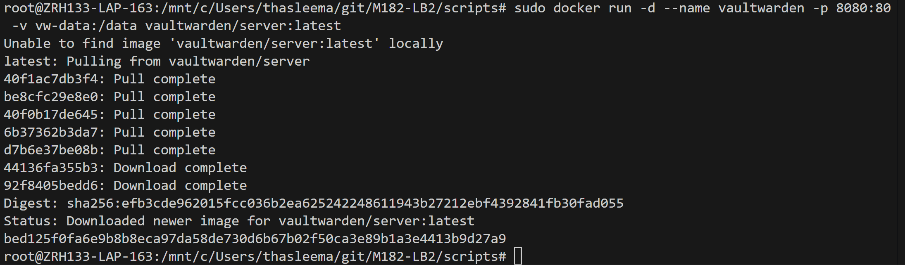

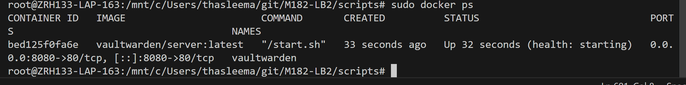

*Abbildung 2.8 und 2.9: Das Vaultwarden-Image wird heruntergeladen und der Container gestartet.*

Nun kann man Vaultwarden lokal unter `localhost:8080` öffnen:

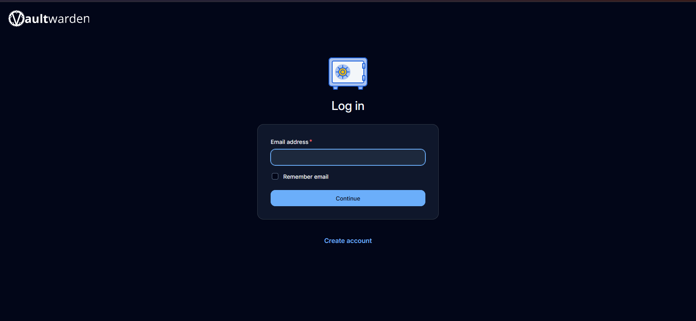

*Abbildung 2.10: Die Login-Seite von Vaultwarden.*

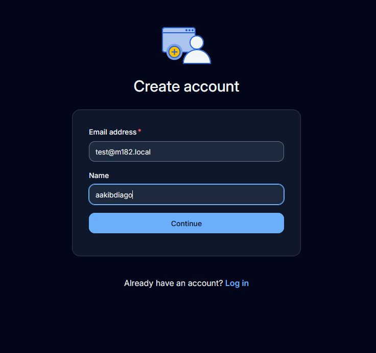

*Abbildung 2.11: Erstellen eines Test-Accounts in Vaultwarden.*

> [!IMPORTANT]
> **Ohne HTTPS geht es nicht.** Vaultwarden verschlüsselt den Tresor direkt im Browser mit der **Web Crypto API**. Browser stellen diese Funktion aus Sicherheitsgründen nur in einem **sicheren Kontext** (HTTPS) zur Verfügung [Q22]. Für den Betrieb braucht Vaultwarden deshalb ein TLS-Zertifikat und einen Reverse-Proxy.

#### HTTPS mit eigenem Zertifikat und Caddy

Da es sich um eine lokale Testumgebung handelt, haben wir ein **selbstsigniertes Zertifikat** erstellt. Damit moderne Browser das Zertifikat akzeptieren, muss der Hostname nicht nur im *Common Name* (CN), sondern auch im **Subject Alternative Name (SAN)** stehen [Q31]. Dafür haben wir eine OpenSSL-Konfigurationsdatei verwendet:

```bash
mkdir -p ~/vaultwarden-ssl
cd ~/vaultwarden-ssl
cat > san.cnf << 'EOF'
[req]
distinguished_name = req_distinguished_name
x509_extensions = v3_req
prompt = no
[req_distinguished_name]
CN = localhost
[v3_req]
subjectAltName = @alt_names
[alt_names]
DNS.1 = localhost
IP.1 = 127.0.0.1
EOF

openssl genrsa -traditional -out key.pem 4096
openssl req -x509 -new -key key.pem -out cert.pem -days 7 -config san.cnf -extensions v3_req
openssl x509 -in cert.pem -text -noout | grep -A1 "Subject Alternative Name"
```

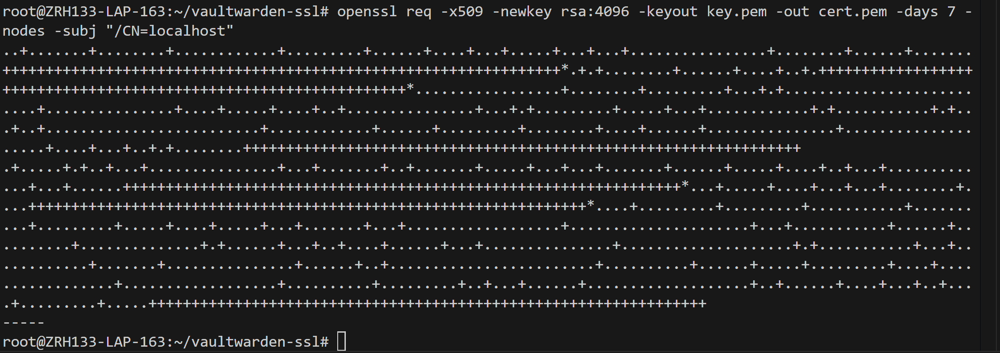

*Abbildung 2.12: Erstellung des Zertifikats mit OpenSSL.*

Das fertige Zertifikat im Browser: RSA mit 4096 Bit, SHA-256-Signatur, gültig für 7 Tage, mit SAN-Einträgen für `localhost` und `127.0.0.1`:

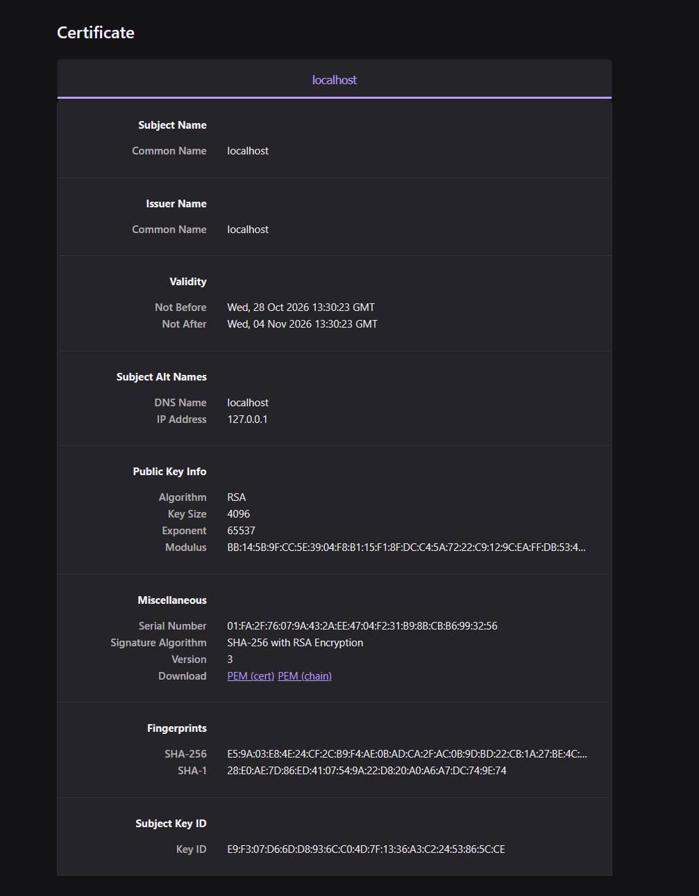

*Abbildung 2.13: Das Zertifikat im Browser. Unter «Subject Alt Names» stehen `localhost` und `127.0.0.1`.*

Vor Vaultwarden läuft **Caddy** als HTTPS-Frontend (Reverse-Proxy). Caddy nimmt die verschlüsselten Verbindungen auf Port 8443 entgegen und leitet sie intern an Vaultwarden weiter. Die finale Konfiguration:

```bash
sudo docker run -d --name vaultwarden -v vw-data:/data vaultwarden/server:latest

cat > ~/vaultwarden-ssl/Caddyfile << 'EOF'
{
    servers {
        protocols h1 h2
    }
}

:8443 {
    tls /data/cert.pem /data/key.pem
    reverse_proxy vaultwarden:80
}
EOF

sudo docker run -d --name caddy \
  --link vaultwarden:vaultwarden \
  -p 8443:8443 \
  -v ~/vaultwarden-ssl/Caddyfile:/etc/caddy/Caddyfile \
  -v ~/vaultwarden-ssl/cert.pem:/data/cert.pem \
  -v ~/vaultwarden-ssl/key.pem:/data/key.pem \
  caddy:latest
```

| Zeile | Bedeutung |
|---|---|
| `protocols h1 h2` | Nur HTTP/1.1 und HTTP/2 verwenden (HTTP/3 über QUIC ist in WSL2 unzuverlässig) |
| `:8443` | Caddy reagiert auf alle Anfragen an Port 8443, egal ob über `localhost` oder `127.0.0.1` |
| `tls … cert.pem key.pem` | Eigenes Zertifikat statt automatischem Let's-Encrypt-Zertifikat |
| `reverse_proxy vaultwarden:80` | Weiterleitung an den Vaultwarden-Container |

Vaultwarden ist danach unter **https://127.0.0.1:8443** erreichbar.

#### Keycloak mit PostgreSQL

Keycloak benötigt für den Produktionsmodus eine Datenbank. Wir haben dafür ein eigenes Docker-Netzwerk und einen PostgreSQL-Container erstellt:

```bash
sudo docker network create keycloak-net

sudo docker run -d --name keycloak-db \
  --network keycloak-net \
  -e POSTGRES_DB=keycloak \
  -e POSTGRES_USER=keycloak \
  -e POSTGRES_PASSWORD=keycloak_secure_pw \
  postgres:16
```

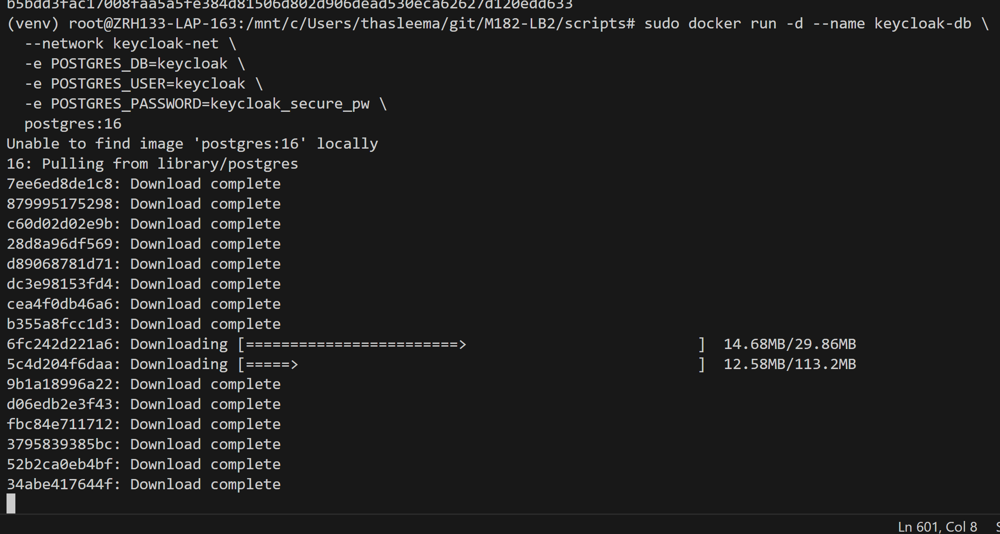

*Abbildung 2.14: Das Docker-Netzwerk `keycloak-net` und die PostgreSQL-Datenbank werden gestartet.*

Danach wird Keycloak im **Produktionsmodus mit TLS** gestartet. Wir verwenden dasselbe Zertifikat wie bei Vaultwarden. Die Zertifikatsdateien werden schreibgeschützt (`:ro`) in den Container eingebunden und müssen für den Container lesbar sein (`chmod 644`):

```bash
chmod 644 ~/vaultwarden-ssl/cert.pem ~/vaultwarden-ssl/key.pem

sudo docker run -d --name keycloak \
  --network keycloak-net \
  -p 8543:8443 \
  -e KEYCLOAK_ADMIN=admin \
  -e KEYCLOAK_ADMIN_PASSWORD=admin \
  -e KC_DB=postgres \
  -e KC_DB_URL=jdbc:postgresql://keycloak-db:5432/keycloak \
  -e KC_DB_USERNAME=keycloak \
  -e KC_DB_PASSWORD=keycloak_secure_pw \
  -e KC_HOSTNAME=localhost \
  -v ~/vaultwarden-ssl/cert.pem:/opt/keycloak/conf/server.crt.pem:ro \
  -v ~/vaultwarden-ssl/key.pem:/opt/keycloak/conf/server.key.pem:ro \
  quay.io/keycloak/keycloak:latest start \
  --https-certificate-file=/opt/keycloak/conf/server.crt.pem \
  --https-certificate-key-file=/opt/keycloak/conf/server.key.pem
```

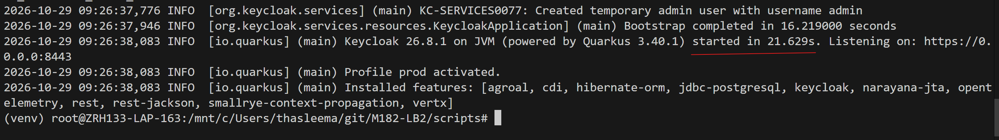

*Abbildung 2.15: Keycloak 26.8.1 ist nach ca. 21,6 Sekunden gestartet («Listening on: https://0.0.0.0:8443» und «Profile prod activated»).*

Keycloak ist danach unter **https://127.0.0.1:8543** erreichbar.

> [!WARNING]
> Das Admin-Passwort `admin` ist nur für den allerersten Start gedacht. Keycloak markiert diesen Benutzer selbst als **temporären Admin**. Wie wir ihn durch einen sicheren, permanenten Admin ersetzt haben, steht in [Kapitel 04](#7-keycloak-alles-zentral-in-einem-system).

#### Python-Pakete für die Verteidigungsskripte

```bash
cd /mnt/c/Users/thasleema/git/M182-LB2/scripts
source venv/bin/activate
pip install pyotp qrcode
pip install qrcode[pil]
pip install requests
```

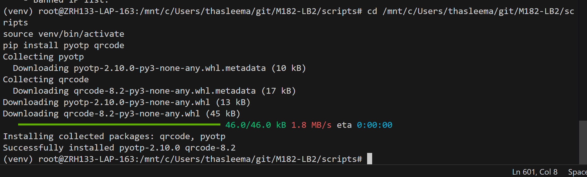

*Abbildung 2.16: Installation von `pyotp` und `qrcode` für die 2FA-Skripte.*

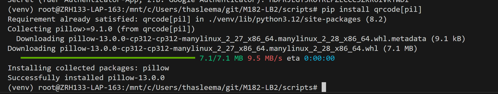

*Abbildung 2.17: Installation von `qrcode[pil]` für die QR-Code-Erzeugung.*

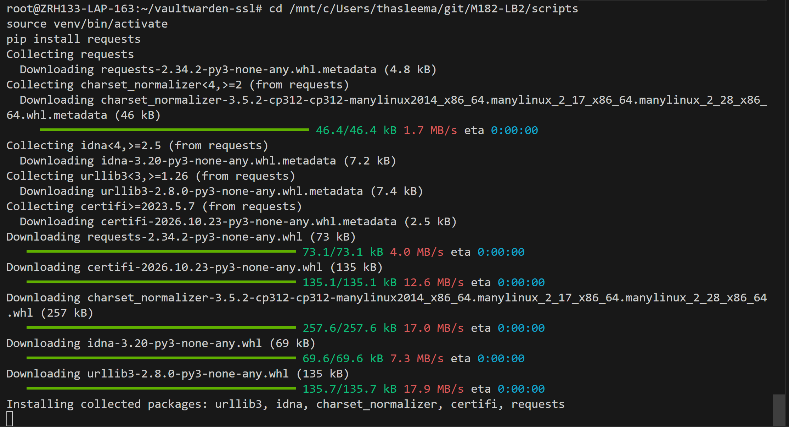

*Abbildung 2.18: Installation von `requests` für die Abfrage der Have-I-Been-Pwned-API.*

#### testssl.sh

```bash
sudo apt install testssl.sh -y
cd ~
git clone --depth 1 https://github.com/drwetter/testssl.sh.git
cd testssl.sh
```

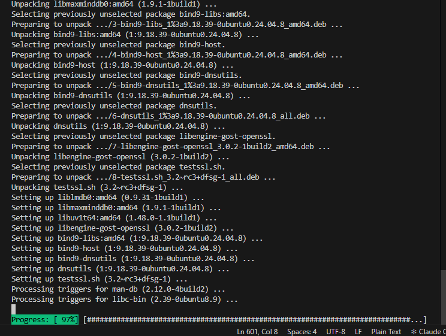

*Abbildung 2.19: Installation von testssl.sh.*

---

### Selbsttest Kapitel 2

<details>
<summary><b>1. Warum sind unsere gemessenen Hashcat-Geschwindigkeiten eher eine «untere Grenze»?</b></summary>

Weil wir nur mit der CPU eines Laptops gearbeitet haben. Echte Angreifer verwenden Grafikkarten oder ganze GPU-Cluster, die bei schnellen Hashes wie MD5 um ein Vielfaches schneller sind.
</details>

<details>
<summary><b>2. Was ist rockyou.txt und warum ist sie für Angreifer so wertvoll?</b></summary>

Eine Wordlist mit über 14 Millionen echten Passwörtern aus einem Datenleck von 2009. Sie zeigt, welche Passwörter Menschen tatsächlich verwenden – deshalb findet man damit viele schwache Passwörter sehr schnell.
</details>

<details>
<summary><b>3. Warum braucht Vaultwarden zwingend HTTPS?</b></summary>

Weil der Tresor im Browser mit der Web Crypto API verschlüsselt wird. Diese steht nur in einem «sicheren Kontext» zur Verfügung, also über HTTPS (oder direkt über localhost).
</details>

---

## Kapitel 3 – Angriffe: Dictionary, Brute-Force und Rainbow Tables

---

> [!IMPORTANT]
> Alle Angriffe richten sich ausschliesslich gegen unsere **eigenen Test-Hashes** aus [Kapitel 02](#3-die-drei-testpasswörter).

### 1. Dictionary-Attacke gegen MD5

Bei einer **Dictionary-Attacke** (Wörterbuchangriff) probiert der Angreifer nicht alle möglichen Kombinationen aus, sondern nur Passwörter aus einer Liste – in unserem Fall die 14,3 Millionen echten Passwörter aus **rockyou.txt**. Das ist sehr effizient, weil viele Menschen genau solche Passwörter verwenden.

#### Test 1: schwaches Passwort `123456`

Nun starten wir den ersten Cracking-Versuch:

```bash
hashcat -m 0 -a 0 md5_schwach.txt ../rockyou.txt
```

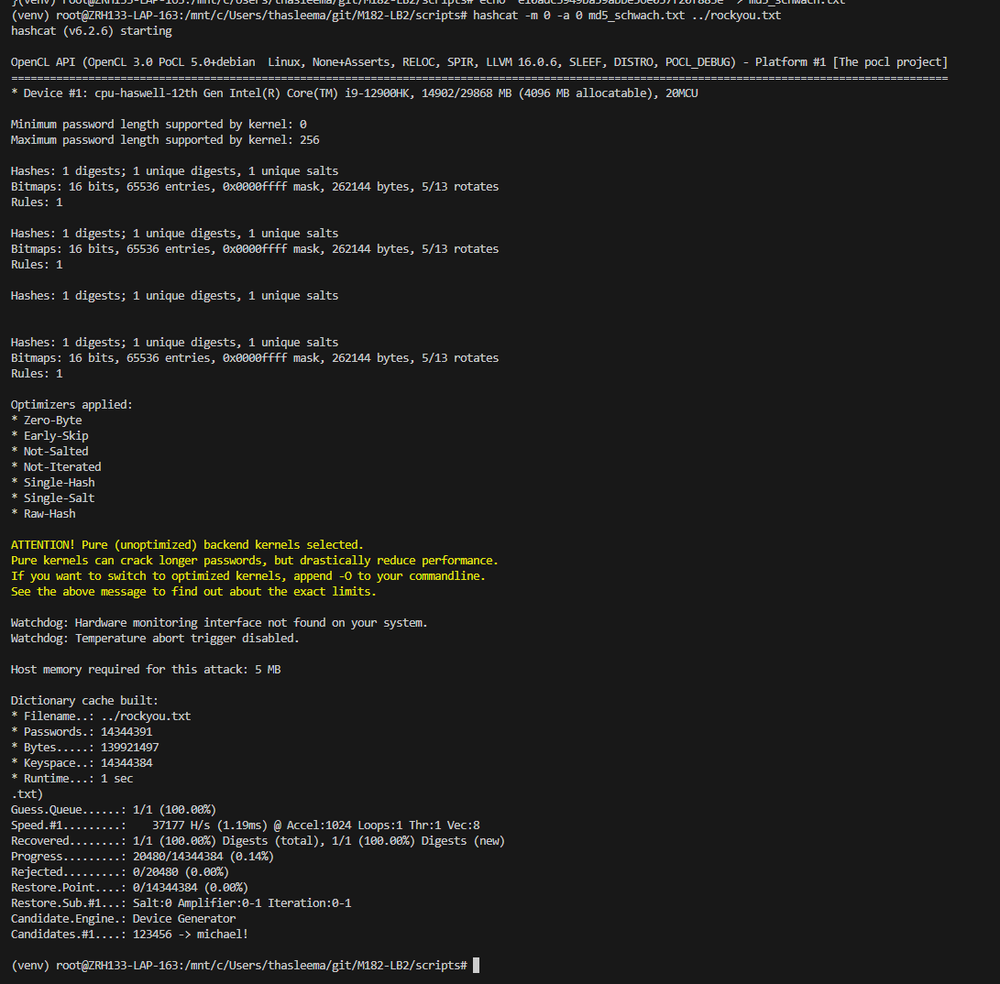

*Abbildung 3.1: Hashcat knackt den MD5-Hash des schwachen Passworts.*

**Geknackt – sehr schnell** (Recovered: 1/1 (100.00%) nach nur 0.14 % der Wordlist durchsucht, Zeit unter einer Sekunde). Genau das erwartete Ergebnis: **MD5 + schwaches Passwort = praktisch keine Hürde.**

| Algorithmus | Passwort | Dauer | Status |
|---|---|---|---|
| MD5 (ungesalzen) | `123456` (schwach) | < 1 Sekunde | ✅ geknackt |

Mit `--show` zeigt Hashcat den gefundenen Klartext an:

```bash
hashcat -m 0 md5_schwach.txt --show
```

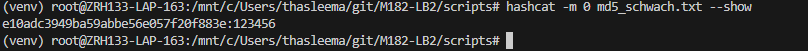

*Abbildung 3.2: Ausgabe von `--show`: Hash und Klartext `123456`.*

#### Test 2: starkes Passwort `K7#mPx9!qLz2`

Gleicher Test mit dem starken Passwort als MD5 – der **Algorithmus ist unsicher, aber das Passwort stark**:

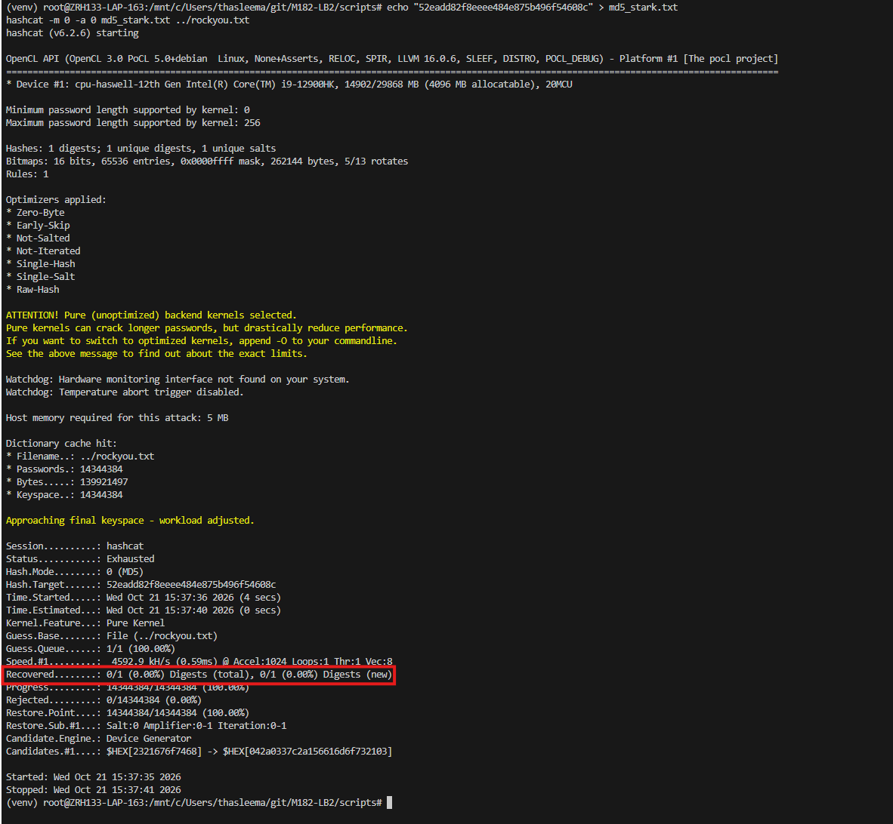

*Abbildung 3.3: Hashcat durchsucht die komplette Wordlist in ca. 4 Sekunden, findet das starke Passwort aber nicht (Status: Exhausted).*

MD5 selbst ist technisch unsicher (es ist extrem schnell zu berechnen – hier **4,59 Millionen Hashes pro Sekunde** im Wordlist-Modus), aber eine Dictionary-Attacke kann nur Passwörter finden, **die in der Liste stehen**. Das starke Passwort widersteht hier nicht wegen MD5, sondern weil es nicht erraten werden konnte.

| Algorithmus | Passwort | Dauer | Status |
|---|---|---|---|
| MD5 (ungesalzen) | `123456` (schwach) | < 1 Sek. | ✅ geknackt |
| MD5 (ungesalzen) | `K7#mPx9!qLz2` (stark) | ~4 Sek. (komplette Liste durchsucht) | ❌ nicht geknackt |

Das motiviert den nächsten Schritt: **Brute-Force**, um zu zeigen, ob MD5 auch bei komplexen Passwörtern irgendwann fällt – und wie lange das dauert.

### 2. Brute-Force-Attacke gegen MD5

Bei einer **Brute-Force-Attacke** werden systematisch **alle** möglichen Zeichenkombinationen ausprobiert: a, b, c … aa, ab, ac … Damit findet man jedes Passwort – die Frage ist nur, **wann**.

Um die Wirksamkeit einer Brute-Force-Attacke zu testen, wurde der MD5-Hash des starken Testpassworts (`K7#mPx9!qLz2`) mit Hashcat angegriffen. Der Zeichensatz umfasste Klein- und Grossbuchstaben, Ziffern und Sonderzeichen (**95 mögliche Zeichen pro Position**). Die Länge wurde schrittweise von 1 bis 6 Zeichen erhöht (`--increment`).

| Hashcat-Einstellung | Wert |
|---|---|
| Hash-Modus | `-m 0` (MD5) |
| Angriffsmodus | `-a 3` (Maske / Brute-Force) |
| Benutzerdefinierter Zeichensatz | `-1 ?l?u?d?s` (Klein, Gross, Ziffern, Sonderzeichen) |
| Maske | `?1?1?1?1?1?1` (bis 6 Zeichen) mit `--increment` |

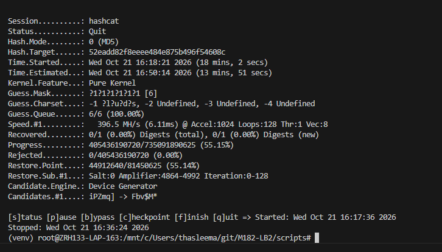

*Abbildung 3.4: Hashcat-Status bei Länge 6. Geschwindigkeit 396,5 Millionen Hashes pro Sekunde, nach 18 Minuten bei 55,15 % abgebrochen.*

| Länge | Keyspace (Kombinationen) | Geschwindigkeit | Dauer | Ergebnis |
|---|---|---|---|---|
| 1 | 95 | 160 H/s | < 1 Sek. | nicht gefunden |
| 2 | 9'025 | 9,6 MH/s | < 1 Sek. | nicht gefunden |
| 3 | 857'375 | 105,5 MH/s | < 1 Sek. | nicht gefunden |
| 4 | 81'450'625 | 278,9 MH/s | < 1 Sek. | nicht gefunden |
| 5 | 7'737'809'375 | 293,9 MH/s | 27 Sek. | nicht gefunden |
| 6 | 735'091'890'625 | ~396 MH/s | abgebrochen bei 55 % (ca. 18 Min.) | nicht gefunden |

Bereits bei 6 Zeichen dauert ein vollständiger Durchlauf trotz hoher Rechenleistung (ca. 400 Millionen Hashes pro Sekunde) rund eine halbe Stunde. Der Test wurde nach 55 % des Suchraums abgebrochen, da keine vollständige Prüfung für diese Arbeit notwendig war.

> [!NOTE]
> Die Geschwindigkeit steigt bei den kurzen Längen an, weil Hashcat bei sehr kleinen Suchräumen fertig ist, bevor die CPU voll ausgelastet ist. Erst ab Länge 5 und 6 sieht man die tatsächliche Leistung von rund **400 MH/s**.

#### Hochrechnung auf das tatsächliche Passwort (12 Zeichen)

Bei 95 möglichen Zeichen pro Position ergibt sich ein Suchraum von

$$95^{12} \approx 5{,}4 \times 10^{23} \text{ Kombinationen}$$

Bei einer Rechengeschwindigkeit von ca. 400 Millionen Hashes pro Sekunde:

$$\frac{5{,}4 \times 10^{23}}{4 \times 10^{8}\ \text{H/s}} \approx 1{,}35 \times 10^{15}\ \text{s} \approx 4{,}3 \times 10^{7}\ \text{Jahre}$$

Die vollständige Suche würde also rund **43 Millionen Jahre** dauern (im Durchschnitt findet man das Passwort nach der Hälfte, also nach ca. 21 Millionen Jahren). Selbst mit 1000-mal schnellerer Hardware wären es noch Zehntausende Jahre.

| Passwortlänge | Kombinationen (95 Zeichen) | Dauer bei 400 MH/s (MD5) |
|---|---|---|
| 6 | 7,4 × 10<sup>11</sup> | ca. 31 Minuten |
| 8 | 6,6 × 10<sup>15</sup> | ca. 6 Monate |
| 10 | 6,0 × 10<sup>19</sup> | ca. 4800 Jahre |
| 12 | 5,4 × 10<sup>23</sup> | ca. 43 Millionen Jahre |
| 15 | 4,6 × 10<sup>29</sup> | ca. 3,7 × 10<sup>13</sup> Jahre |

**Erkenntnis:** Der Suchraum wächst **exponentiell** mit jeder zusätzlichen Zeichenposition (Faktor 95 pro Zeichen). Das zeigt, dass die **Passwortlänge der entscheidende Schutzfaktor gegen Brute-Force-Angriffe** ist – unabhängig vom verwendeten Hashing-Algorithmus. Selbst ein unsicherer Algorithmus wie MD5 bietet bei ausreichend langen, zufälligen Passwörtern praktisch keinen Angriffspunkt für Brute-Force. Genau deshalb setzt NIST bei der Passwort-Policy auf **Länge statt Komplexitätsregeln** (siehe [Kapitel 01](#7-passwort-policy-nach-aktuellem-stand)).

> [!WARNING]
> Das gilt nur für **zufällige** Passwörter. Ein langes Passwort wie `Passwort12345` ist trotz 13 Zeichen schnell geknackt, weil Angreifer zuerst Wordlists und Regeln (Wort + Zahlen, Gross am Anfang …) ausprobieren, bevor sie zu reinem Brute-Force greifen.

### 3. Angriff auf bcrypt

Als Nächstes haben wir den bcrypt-Hash des schwachen Passworts in eine Datei gepackt und mit derselben Wordlist angegriffen:

```bash
echo '$2b$12$TAYvVbzz6mP9R9tCyiMXLOHASdwupjQZv/2n9UCmchNeWzdbefCNS' > bcrypt_schwach.txt
hashcat -m 3200 -a 0 bcrypt_schwach.txt ../rockyou.txt
```

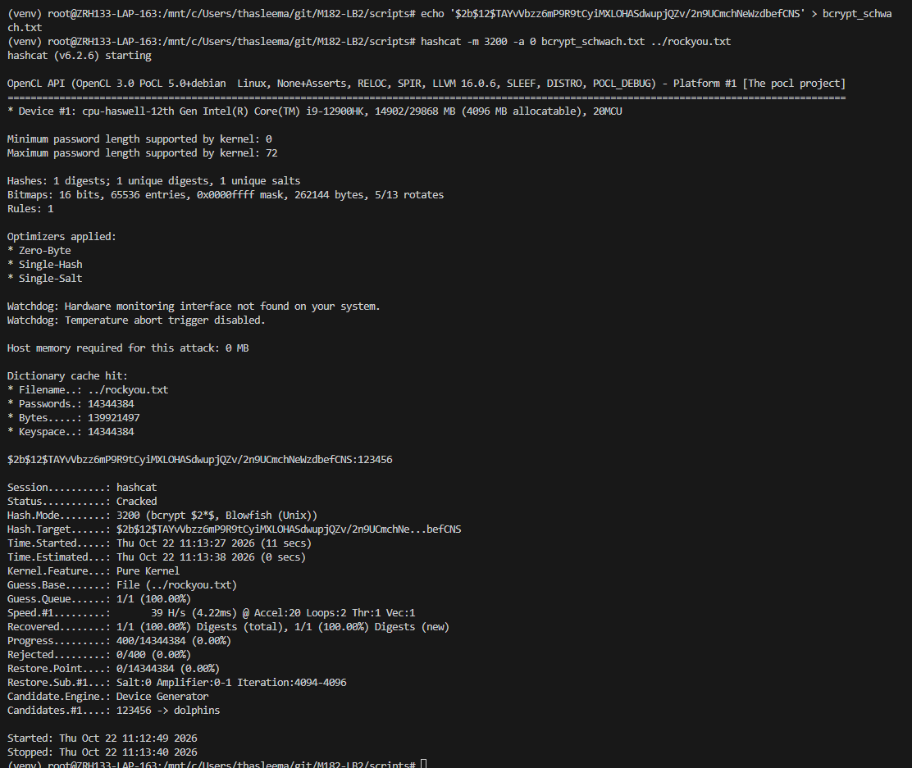

*Abbildung 3.5: Hashcat knackt den bcrypt-Hash – allerdings mit nur **39 Hashes pro Sekunde**.*

Obwohl das schwache Testpasswort (`123456`) auch beim bcrypt-Hash in der Wordlist enthalten war und somit geknackt wurde, zeigt sich der **entscheidende Unterschied in der Angriffsgeschwindigkeit**: Hashcat schafft bei bcrypt mit Cost-Faktor 12 nur noch **39 Versuche pro Sekunde**. Auffällig ist auch die Zeile «Maximum password length supported by kernel: 72» – das ist die bekannte 72-Byte-Grenze von bcrypt (siehe [Kapitel 01](#bcrypt)).

**Erkenntnis:** bcrypt ist absichtlich rechenintensiv gestaltet (adaptiver Work-Factor), um Brute-Force- und Dictionary-Angriffe massiv zu verlangsamen. Während ein Angreifer mit MD5 Millionen Passwörter pro Sekunde testen kann, schafft er bei bcrypt nur wenige Dutzend. Bei einem starken, nicht in Wordlists vorhandenen Passwort würde dieser Geschwindigkeitsunterschied den Unterschied zwischen «in Sekunden geknackt» und «praktisch nie geknackt» ausmachen – selbst ein schwaches Passwort wird durch bcrypt erheblich besser geschützt als durch MD5 oder SHA-1.

### 4. Angriff auf Argon2

Für Argon2 haben wir Hashcat in Version **7.0.0** verwendet, da ältere Versionen dieses Verfahren nicht unterstützen (siehe [Kapitel 02](#hashcat-version-prüfen)):

```bash
./hashcat.bin -m 34000 -a 0 /mnt/c/Users/thasleema/git/M182-LB2/scripts/argon2_schwach.txt /mnt/c/Users/thasleema/git/M182-LB2/rockyou.txt
```

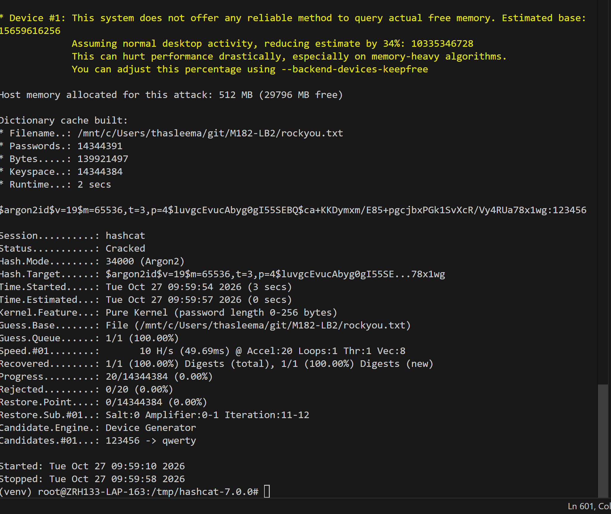

*Abbildung 3.6: Hashcat 7.0.0 knackt den Argon2id-Hash von `123456` – mit nur **10 Hashes pro Sekunde**. Für den Angriff werden 512 MB Arbeitsspeicher reserviert.*

Auch hier wurde `123456` gefunden, weil es ganz am Anfang der Wordlist steht (Progress: 20 von 14 344 384). Doch die Geschwindigkeit ist mit **10 H/s** noch einmal fast viermal tiefer als bei bcrypt. Gut sichtbar ist auch der **Speicherbedarf**: Hashcat reserviert für den Angriff 512 MB Arbeitsspeicher, weil jede einzelne Argon2-Berechnung 64 MiB benötigt (Parameter `m=65536`). Genau diese Eigenschaft (memory-hard) macht Argon2 für Angreifer mit Grafikkarten so teuer.

#### Eigenes Python-Skript für eine Dictionary-Attacke gegen Argon2

Um das Prinzip einer Dictionary-Attacke selbst nachzuvollziehen, haben wir zusätzlich ein eigenes Skript geschrieben. Es liest die Wordlist Zeile für Zeile, prüft jedes Passwort mit `ph.verify()` gegen den Argon2-Hash und misst die Geschwindigkeit. Weil Argon2 so langsam ist, wird die Suche auf die ersten 5000 Einträge begrenzt.

```python
from argon2 import PasswordHasher
from argon2.exceptions import VerifyMismatchError
import time

ph = PasswordHasher()

target_hash = "$argon2id$v=19$m=65536,t=3,p=4$luvgcEvucAbyg0gI55SEBQ$ca+KKDymxm/E85+pgcjbxPGk1SvXcR/Vy4RUa78x1wg"

# Kleinere Wordlist nehmen (Argon2 ist langsam, volle rockyou.txt würde ewig dauern)
wordlist_path = "../rockyou.txt"
max_attempts = 5000  # reicht, da "123456" meist in den ersten Zeilen steht

start = time.time()
found = False
attempts = 0

with open(wordlist_path, "r", encoding="latin-1") as f:
    for line in f:
        attempts += 1
        if attempts > max_attempts:
            break
        password = line.strip()
        try:
            ph.verify(target_hash, password)
            print(f"GEKNACKT: '{password}' nach {attempts} Versuchen")
            found = True
            break
        except VerifyMismatchError:
            continue

elapsed = time.time() - start

if not found:
    print(f"Nicht geknackt nach {attempts} Versuchen.")

print(f"Dauer: {elapsed:.2f} Sekunden")
print(f"Geschwindigkeit: {attempts/elapsed:.2f} Versuche/Sekunde")
```

> [!TIP]
> Das Skript zeigt sehr anschaulich, was Hashcat intern macht: **raten → hashen → vergleichen**. Der einzige Unterschied ist, dass Hashcat das hochoptimiert und parallel auf CPU oder GPU erledigt.

### 5. Geschwindigkeitsvergleich aller Verfahren

| Algorithmus | Geschwindigkeit (Dictionary-Attacke) | Tool | Verhältnis zu MD5 |
|---|---|---|---|
| MD5 | 37'177 H/s | Hashcat 6.2.6 | 1x (Referenz) |
| SHA-1 | 1'184'100 H/s | Hashcat 6.2.6 | ~32x schneller |
| bcrypt | 39 H/s | Hashcat 6.2.6 | ~950x langsamer |
| **Argon2** | **10 H/s** | **Hashcat 7.0.0** | **~3700x langsamer** |

> [!IMPORTANT]
> **Einordnung der Messwerte:** Die Werte in dieser Tabelle stammen aus den Dictionary-Läufen gegen `123456`. Dort war Hashcat (besonders bei MD5) schon nach einem Bruchteil der Wordlist fertig, bevor die volle Geschwindigkeit erreicht war. Der MD5-Wert ist deshalb **viel zu tief**. Unter Volllast (Brute-Force, Abschnitt 2) hat MD5 auf demselben Laptop rund **396 Millionen H/s** erreicht. Realistisch verglichen ist bcrypt damit etwa **10 Millionen Mal** und Argon2 etwa **40 Millionen Mal** langsamer als MD5.

Was das für unser starkes 12-Zeichen-Passwort bedeutet:

| Verfahren | Geschwindigkeit | Brute-Force-Dauer für 95<sup>12</sup> Kombinationen |
|---|---|---|
| MD5 | ~396 MH/s | ca. 43 Millionen Jahre |
| bcrypt (Cost 12) | 39 H/s | ca. 4,4 × 10<sup>14</sup> Jahre – über 30 000-mal das Alter des Universums |
| Argon2id (64 MiB) | 10 H/s | ca. 1,7 × 10<sup>15</sup> Jahre |

**Erkenntnis:** Ein langes, zufälliges Passwort ist schon mit MD5 kaum zu knacken. Ein modernes Hash-Verfahren macht aber auch **mittelmässige** Passwörter, die nicht in einer Wordlist stehen, praktisch unknackbar – und genau das ist im Alltag entscheidend, weil nicht jeder Benutzer ein perfektes Passwort wählt.

### 6. Rainbow-Table-Angriff

#### Was ist eine Rainbow Table?

Bei Dictionary- und Brute-Force-Angriffen berechnet der Angreifer jeden Hash **während** des Angriffs. Bei einer **vorberechneten Tabelle** dreht er das um: Er berechnet die Hashes von Millionen Passwörtern **einmal im Voraus**, speichert sie und muss bei einem gestohlenen Hash nur noch nachschlagen. Öffentliche Dienste wie **CrackStation** funktionieren genau so: Man fügt einen ungesalzenen Hash ein und bekommt sofort den Klartext, falls er in der Datenbank steht [Q13].

Eine echte **Rainbow Table** ist eine platzsparende Weiterentwicklung davon: Statt jedes Paar «Hash → Passwort» zu speichern, werden Ketten aus abwechselnden Hash- und Reduktionsfunktionen gebildet, von denen nur Anfang und Ende gespeichert werden. So tauscht man Speicherplatz gegen Rechenzeit (*Time-Memory-Trade-off*) [Q12].

#### Eigene Demonstration

Das Rainbow-Table-Prinzip haben wir selbst in WSL mit einem Python-Skript simuliert:

```bash
cd /mnt/c/Users/thasleema/git/M182-LB2/scripts
nano rainbow_demo.py
```

```python
import hashlib

# Kleine "Rainbow Table" aus den ersten 10000 Passwörtern von rockyou.txt vorberechnen
lookup = {}
with open("../rockyou.txt", "r", encoding="latin-1") as f:
    for i, line in enumerate(f):
        if i >= 10000:
            break
        pw = line.strip()
        md5_hash = hashlib.md5(pw.encode()).hexdigest()
        lookup[md5_hash] = pw

print(f"Lookup-Tabelle mit {len(lookup)} vorberechneten Hashes erstellt.\n")

# Test 1: ungesalzener MD5-Hash von "123456"
target_md5 = "e10adc3949ba59abbe56e057f20f883e"
if target_md5 in lookup:
    print(f"GEFUNDEN (ungesalzen): {target_md5} -> {lookup[target_md5]}")
else:
    print(f"NICHT GEFUNDEN (ungesalzen): {target_md5}")

# Test 2: gesalzener SHA1-Hash (kann hier nie gefunden werden, da Salt die Tabelle nutzlos macht)
target_salted = "6d39acd7dd8eacfe809e5d8bf51e58719ebb7c7e"
if target_salted in lookup:
    print(f"GEFUNDEN (gesalzen): {target_salted} -> {lookup[target_salted]}")
else:
    print(f"NICHT GEFUNDEN (gesalzen): {target_salted} - Salt verhindert Treffer in vorberechneter Tabelle")
```

```bash
python3 rainbow_demo.py
```

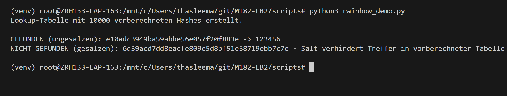

*Abbildung 3.7: Der ungesalzene MD5-Hash wird sofort gefunden, der gesalzene Hash nicht.*

Um das Prinzip von Rainbow-Table-Angriffen zu demonstrieren, wurde eine eigene Lookup-Tabelle erstellt: Die ersten 10'000 Passwörter aus rockyou.txt wurden vorab mit MD5 gehasht und in einer Python-Dictionary-Struktur (Hash → Klartext) gespeichert. Dies simuliert das Kernprinzip von Rainbow Tables – Angreifer berechnen Hashes im Voraus, um bei einem späteren Angriff nur noch nachzuschlagen, statt jeden Hash live zu berechnen.

Der ungesalzene MD5-Hash von `123456` wurde **sofort in der Tabelle gefunden** (`e10adc3949ba59abbe56e057f20f883e -> 123456`). Der gesalzene SHA-1-Hash des identischen Passworts wurde dagegen **nicht gefunden**, da der individuelle Salt den resultierenden Hash einzigartig macht – er kann folglich nie in einer allgemein vorberechneten Tabelle vorkommen.

> [!NOTE]
> Unsere Demo-Tabelle enthält nur MD5-Hashes. Ein SHA-1-Hash kann darin also schon wegen des anderen Algorithmus nicht vorkommen. Das Prinzip bleibt aber genau gleich: Auch eine riesige SHA-1-Tabelle mit allen Passwörtern aus rockyou.txt würde den gesalzenen Hash nicht enthalten, weil der zufällige 16-Byte-Salt bei der Vorberechnung unbekannt war.

**Erkenntnis:** Salting macht Rainbow-Table-Angriffe wirkungslos, da ein Angreifer für jeden einzelnen Salt-Wert eine eigene Tabelle vorberechnen müsste. Bei zufälligen, ausreichend langen Salts (wie den hier verwendeten 16 Byte = 2<sup>128</sup> mögliche Werte) ist das praktisch nicht durchführbar.

### 7. Zusammenfassung der Angriffe

| Angriff | Funktionsweise | Gefährlich bei | Wird gestoppt durch |
|---|---|---|---|
| **Dictionary** | Passwörter aus einer Liste ausprobieren | häufigen, geleakten, vorhersehbaren Passwörtern | einzigartige, zufällige Passwörter; langsame Hashes; Blocklist |
| **Brute-Force** | alle Kombinationen ausprobieren | kurzen Passwörtern und schnellen Hashes | lange Passwörter; bcrypt / Argon2 |
| **Rainbow Table** | vorberechnete Hashes nachschlagen | ungesalzenen Hashes | Salt |
| **Online-Raten** (am Login) | Passwörter direkt am Server ausprobieren | fehlender Begrenzung von Fehlversuchen | Rate-Limiting, Lockout, 2FA → [Kapitel 04](#kapitel-4--verteidigung-von-salt-bis-zum-security-audit) |

---

### Selbsttest Kapitel 3

<details>
<summary><b>1. Warum wurde das starke Passwort bei der Dictionary-Attacke trotz MD5 nicht gefunden?</b></summary>

Weil eine Dictionary-Attacke nur Passwörter finden kann, die in der Wordlist stehen. `K7#mPx9!qLz2` ist zufällig und steht in keiner Liste. Die Schwäche von MD5 (Geschwindigkeit) spielt hier keine Rolle.
</details>

<details>
<summary><b>2. Um welchen Faktor wächst der Suchraum mit jedem zusätzlichen Zeichen, wenn 95 Zeichen erlaubt sind?</b></summary>

Um den Faktor 95. Ein 13-Zeichen-Passwort hat 95-mal so viele Kombinationen wie ein 12-Zeichen-Passwort.
</details>

<details>
<summary><b>3. Warum hat Hashcat beim Argon2-Angriff 512 MB Arbeitsspeicher reserviert?</b></summary>

Weil Argon2 memory-hard ist: Jede einzelne Berechnung braucht hier 64 MiB Speicher (`m=65536`). Wer viele Passwörter parallel testen will, braucht entsprechend viel Speicher – das bremst Grafikkarten und Spezial-Hardware aus.
</details>

<details>
<summary><b>4. Gegen welchen Angriff hilft ein Salt am meisten?</b></summary>

Gegen vorberechnete Tabellen (Rainbow Tables, Lookup-Dienste wie CrackStation). Gegen das gezielte Raten eines einzelnen Hashes hilft vor allem ein langsames Verfahren wie bcrypt oder Argon2.
</details>

---

## Kapitel 4 – Verteidigung: Von Salt bis zum Security-Audit

---

In [Kapitel 03](#kapitel-3--angriffe-dictionary-brute-force-und-rainbow-tables) haben wir gesehen, wie schnell schwache Passwörter und schnelle Hashes fallen. In diesem Kapitel setzen wir die Gegenmassnahmen um – zuerst als eigene, kleine Skripte, damit man das Prinzip versteht, und danach mit Werkzeugen, die auch in echten Unternehmen eingesetzt werden.

| Abschnitt | Schützt gegen | Ebene |
|---|---|---|
| Salt | Rainbow Tables, Massenangriffe auf Hash-Datenbanken | Offline |
| Rate-Limiting (Skript, Fail2Ban, Keycloak) | Online-Brute-Force am Login | Online |
| 2FA mit TOTP | gestohlene oder erratene Passwörter | Online |
| Passwort-Manager | schwache und wiederverwendete Passwörter | Benutzer |
| HIBP-Check | bereits geleakte Passwörter | Benutzer / Policy |
| testssl.sh | Mitlesen der Passwörter auf dem Transportweg | Netzwerk |

---

### 1. Salting-Nachweis

Um den Effekt von Salt praktisch zu zeigen, haben wir **dasselbe schwache Passwort `123456`** einmal ohne und einmal mit Salt als SHA-1-Hash angegriffen.

#### SHA-1 ungesalzen

SHA-1 ungesalzen (schwaches Passwort) in eine Datei packen und danach die Dictionary-Attacke starten (Modus 100 = SHA-1):

```bash
echo "7c4a8d09ca3762af61e59520943dc26494f8941b" > sha1_ungesalzen.txt
hashcat -m 100 -a 0 sha1_ungesalzen.txt ../rockyou.txt
```

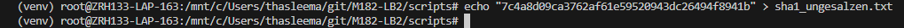

*Abbildung 4.1: Der ungesalzene SHA-1-Hash von `123456` wird in eine Datei geschrieben.*

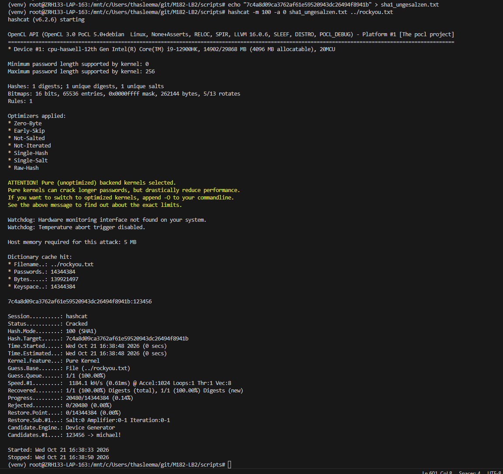

*Abbildung 4.2: Hashcat knackt den ungesalzenen SHA-1-Hash sofort (Status: Cracked, 0 Sekunden, 1,18 Millionen Hashes pro Sekunde).*

#### SHA-1 gesalzen

Nun das gleiche Passwort, aber mit Salt. Hashcat erwartet für den Modus 120 (`sha1($salt.$pass)`) das Format `Hash:Salt`:

```bash
echo "6d39acd7dd8eacfe809e5d8bf51e58719ebb7c7e:4f694df8b49096ab560d6ad504cd8410" > sha1_gesalzen.txt
hashcat -m 120 -a 0 sha1_gesalzen.txt ../rockyou.txt
```

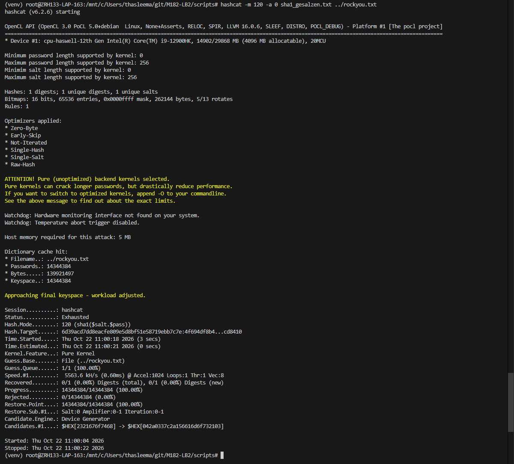

*Abbildung 4.3: Beim gesalzenen Hash endet Hashcat mit «Status: Exhausted» und «Recovered: 0/1».*

**Status: Exhausted, Recovered: 0/1** – die komplette Wordlist (14,3 Mio. Einträge) wurde durchsucht, aber **nicht geknackt**, obwohl das Passwort `123456` dasselbe ist wie beim ungesalzenen Test, der in 0 Sekunden fiel.

| Hash | Passwort | Ergebnis |
|---|---|---|
| SHA-1 ungesalzen | `123456` | ✅ geknackt in 0 Sekunden |
| SHA-1 mit 16-Byte-Salt | `123456` | ❌ nicht geknackt (ganze Wordlist durchsucht) |

> [!IMPORTANT]
> **Was dieser Test genau zeigt:** Unser Salt besteht aus 16 zufälligen **Bytes**, die wir in der Datei als Hex-Text angegeben haben. Hashcat hat diesen Text ohne die Option `--hex-salt` als normale Zeichen interpretiert und damit mit einem «falschen» Salt gerechnet. Das entspricht der Situation eines Angreifers, der den Salt bzw. das genaue Salt-Verfahren **nicht** kennt – dann ist der Hash selbst für `123456` nicht zu knacken.
>
> Kennt der Angreifer Salt **und** Verfahren (was nach einem Datenbank-Diebstahl meist der Fall ist), findet er ein Passwort wie `123456` trotzdem, weil er es einfach mit dem richtigen Salt hasht. Der Salt verhindert also **vorberechnete Tabellen** (siehe [Rainbow-Table-Demo](#6-rainbow-table-angriff)) und zwingt den Angreifer, jeden Hash **einzeln** anzugreifen. Gegen das gezielte Raten schwacher Passwörter hilft nur ein **langsames** Verfahren wie bcrypt oder Argon2 – darum haben diese den Salt bereits eingebaut.

### 2. Rate-Limiting mit eigenem Skript

Gegen **Online-Angriffe** (der Angreifer probiert Passwörter direkt am Login aus) hilft **Rate-Limiting**: Nach einer bestimmten Anzahl Fehlversuchen wird das Konto oder die Quelle für eine gewisse Zeit gesperrt. OWASP empfiehlt solche Mechanismen ausdrücklich, um Brute-Force- und Credential-Stuffing-Angriffe zu bremsen [Q32].

Um das Prinzip zu zeigen, haben wir ein kleines interaktives Login-Skript geschrieben. Nach **3 Fehlversuchen** wird der Login für **10 Sekunden** gesperrt:

```bash
nano rate_limit_interactive.py
```

```python
import time
from datetime import datetime

correct_password = "MeinSicheresPasswort123"
MAX_ATTEMPTS = 3
LOCKOUT_SECONDS = 10

failed_attempts = 0
locked_until = 0

def timestamp():
    return datetime.now().strftime("%H:%M:%S")

def login(password_input):
    global failed_attempts, locked_until
    now = time.time()

    if now < locked_until:
        remaining = int(locked_until - now)
        print(f"[{timestamp()}] GESPERRT - noch {remaining}s warten")
        return False

    if password_input == correct_password:
        print(f"[{timestamp()}] LOGIN ERFOLGREICH")
        failed_attempts = 0
        return True
    else:
        failed_attempts += 1
        print(f"[{timestamp()}] Falsches Passwort - Versuch {failed_attempts}/{MAX_ATTEMPTS}")
        if failed_attempts >= MAX_ATTEMPTS:
            locked_until = now + LOCKOUT_SECONDS
            print(f"[{timestamp()}] >>> SPERRE AKTIVIERT fuer {LOCKOUT_SECONDS} Sekunden <<<")
        return False

print("Gib Passwoerter ein")
while True:
    pw = input("Passwort: ")
    login(pw)
```

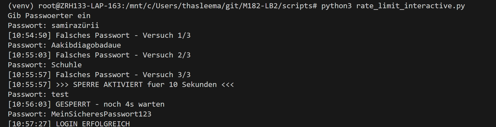

*Abbildung 4.4: Nach drei falschen Passwörtern wird die Sperre aktiviert. Während der Sperre wird jede Eingabe abgelehnt («GESPERRT – noch 4s warten»). Nach Ablauf der Sperre funktioniert der Login mit dem korrekten Passwort wieder.*

| Zeit | Eingabe | Reaktion |
|---|---|---|
| 10:54:50 | falsches Passwort | Versuch 1/3 |
| 10:55:03 | falsches Passwort | Versuch 2/3 |
| 10:55:57 | falsches Passwort | Versuch 3/3 → **Sperre für 10 Sekunden** |
| 10:56:03 | `test` | **GESPERRT** – noch 4 s warten |
| 10:57:27 | `MeinSicheresPasswort123` | **LOGIN ERFOLGREICH** |

> [!NOTE]
> **Wichtig:** Während der Sperre wird **jede** Eingabe abgelehnt – auch das richtige Passwort. Sonst könnte ein Angreifer einfach weiterraten und würde bei einem Treffer trotzdem eingelassen. Genau dieses Verhalten sehen wir später auch bei Keycloak.

Zum automatisierten Testen gibt es im Repository zusätzlich das Skript `rate_limit_demo.py`, das drei Fehlversuche, einen Login-Versuch während der Sperre und einen Login nach Ablauf der Sperre automatisch hintereinander ausführt.

### 3. Rate-Limiting auf Systemebene mit Fail2Ban

Unser Skript schützt nur sich selbst. In der Praxis setzt man Werkzeuge ein, die **alle** Dienste eines Servers schützen. Das bekannteste ist **Fail2Ban** [Q15]: Es liest laufend die Log-Dateien (z. B. `/var/log/auth.log` für SSH), erkennt wiederholte Fehlversuche von derselben IP-Adresse und **sperrt diese IP automatisch in der Firewall**.

Konfiguration in `/etc/fail2ban/jail.local`:

```ini
[DEFAULT]
ignoreself = false
banaction = nftables-multiport

[sshd]
enabled = true
backend = polling
logpath = /var/log/auth.log
maxretry = 3
bantime = 60
findtime = 60
```

| Einstellung | Bedeutung |
|---|---|
| `ignoreself = false` | Auch Fehlversuche vom eigenen Rechner (127.0.0.1) zählen – nötig, weil wir uns lokal selbst angreifen. In Produktion bleibt das auf `true`, damit man sich nicht selbst aussperrt. |
| `banaction = nftables-multiport` | Die Sperre wird über die Firewall `nftables` umgesetzt |
| `backend = polling` | Fail2Ban liest die Log-Datei regelmässig neu ein |
| `logpath` | Welche Log-Datei überwacht wird |
| `maxretry = 3` | Nach 3 Fehlversuchen wird gesperrt |
| `findtime = 60` | … wenn diese 3 Fehlversuche innerhalb von 60 Sekunden passieren |
| `bantime = 60` | Die IP bleibt 60 Sekunden gesperrt |

Fail2Ban starten und den Status prüfen:

```bash
sudo service fail2ban start
sudo fail2ban-client status
sudo fail2ban-client status sshd
```

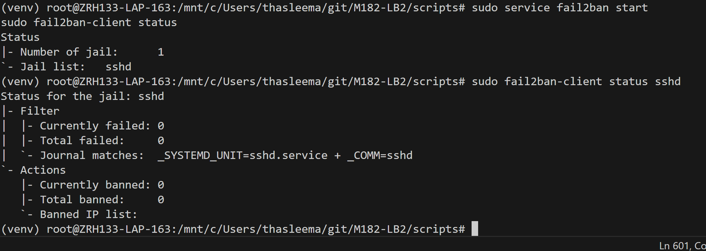

*Abbildung 4.5: Fail2Ban ist gestartet, das Jail `sshd` ist aktiv. Noch keine Fehlversuche und keine gesperrten IPs.*

#### Angriff simulieren

Nun simulieren wir einen Angriff: In einem **zweiten Terminal-Fenster** loggen wir uns mehrfach mit falschem Passwort beim eigenen SSH-Server ein.

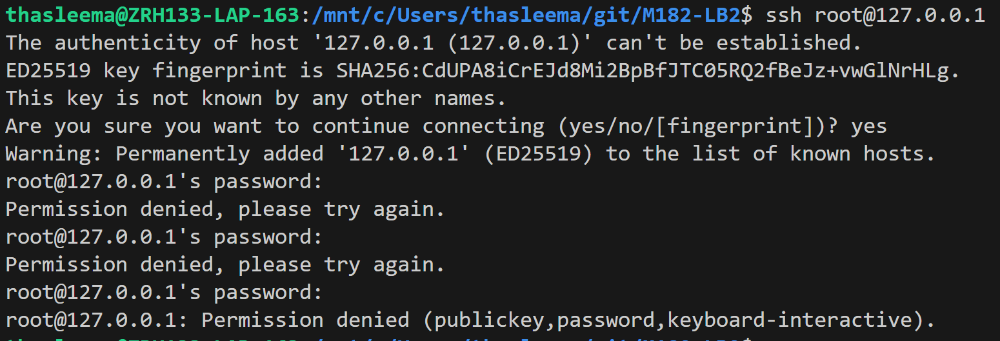

*Abbildung 4.6: Drei falsche Passwörter beim SSH-Login auf `root@127.0.0.1` – jedes Mal «Permission denied».*

Nun sehen wir im ersten Terminal, dass Fail2Ban einen Fehlversuch registriert hat (*Currently failed: 1*):

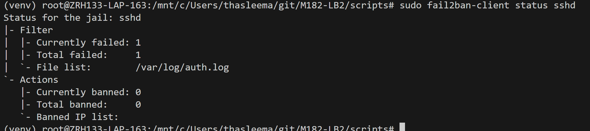

*Abbildung 4.7: Fail2Ban zählt den ersten Fehlversuch.*

Das ist nun 1 Fehlversuch – wir brauchen 3, damit die IP gebannt wird. Deshalb geben wir das Passwort noch einige Male falsch ein:

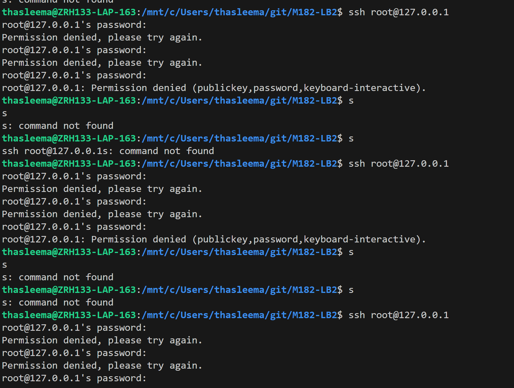

*Abbildung 4.8: Vorher/Nachher-Vergleich. «Total failed» steigt von 1 auf 5 und «Total banned» von 0 auf 1 – die IP wurde gesperrt.*

Nun sehen wir, dass die IP gebannt ist:

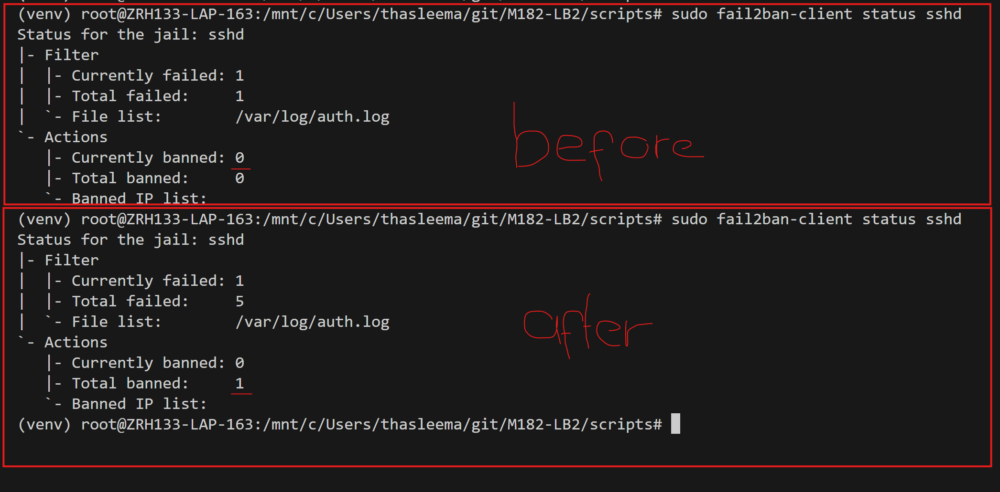

*Abbildung 4.9: Die angreifende IP-Adresse steht in der Liste der gesperrten IPs.*

**Erkenntnis:** Fail2Ban setzt dasselbe Prinzip wie unser Skript um, aber auf **Netzwerkebene**: Der Angreifer wird nicht nur vom Login abgewiesen, sondern seine IP wird in der Firewall komplett blockiert. Das schützt den Server auch vor automatisierten Massen-Angriffen aus dem Internet, wie sie auf jeden öffentlich erreichbaren SSH-Port täglich stattfinden.

> [!WARNING]
> Fail2Ban sperrt **IP-Adressen**. Ein Angreifer mit einem Botnetz aus Tausenden IPs kann pro IP nur wenige Versuche machen und so trotzdem weiterraten («low and slow»). Deshalb braucht es zusätzlich Sperren auf **Konto-Ebene** (siehe [Keycloak](#7-keycloak-alles-zentral-in-einem-system)) und vor allem **2FA**.

### 4. Zwei-Faktor-Authentifizierung mit TOTP

#### Wie funktioniert TOTP?

Bei der **Zwei-Faktor-Authentifizierung (2FA)** braucht man zum Einloggen zwei verschiedene Faktoren: etwas, das man **weiss** (Passwort), und etwas, das man **besitzt** (Smartphone). Selbst wenn ein Angreifer das Passwort knackt oder in einem Leak findet, kommt er ohne das Smartphone nicht hinein.

Das verbreitetste Verfahren ist **TOTP (Time-based One-Time Password)** nach **RFC 6238** [Q16]:

1. Beim Einrichten erzeugt der Server einen geheimen Schlüssel (**Secret**) und teilt ihn einmalig mit der Authenticator-App – meistens über einen QR-Code.
2. Server und App berechnen danach unabhängig voneinander aus **Secret + aktueller Uhrzeit** einen 6-stelligen Code (HMAC-SHA1 über die Anzahl 30-Sekunden-Intervalle seit 1970, siehe auch HOTP, RFC 4226 [Q17]).
3. Weil beide dasselbe Secret und dieselbe Uhrzeit haben, kommt derselbe Code heraus. Der Code ist nur **30 Sekunden** gültig.

```
           Secret (einmalig per QR-Code geteilt)
          ┌─────────────────┴─────────────────┐
          ▼                                   ▼
   Authenticator-App                       Server
   HMAC(Secret, Zeit/30s)              HMAC(Secret, Zeit/30s)
          │                                   │
          ▼                                   ▼
       "743340"  ──── Benutzer tippt ein ──►  "743340"  →  ✅ gleich → Login
```

#### Erste Demo mit `totp_demo.py`

```bash
cd /mnt/c/Users/thasleema/git/M182-LB2/scripts
source venv/bin/activate
pip install pyotp qrcode
nano totp_demo.py
```

```python
import pyotp
import time

# Geheimer Schlüssel wird einmalig generiert (würde normalerweise beim Setup
# zwischen Server und App geteilt, z. B. per QR-Code)
secret = pyotp.random_base32()
print(f"Geheimer Schluessel (Secret): {secret}")

totp = pyotp.TOTP(secret)

# Aktuellen gueltigen Code anzeigen
current_code = totp.now()
print(f"Aktuell gueltiger TOTP-Code: {current_code}")

# Simulierter Login: Benutzer gibt Passwort UND TOTP-Code ein
print("\n=== Simulierter Login ===")
user_code = input("Gib den aktuellen TOTP-Code ein: ")

if totp.verify(user_code):
    print("2FA erfolgreich verifiziert - Login erlaubt.")
else:
    print("2FA fehlgeschlagen - falscher oder abgelaufener Code.")

# Demonstration: Code ist nur fuer ein kurzes Zeitfenster gueltig (Standard 30s)
print(f"\nDieser Code ist nur fuer {totp.interval} Sekunden gueltig.")
```

```bash
python3 totp_demo.py
```

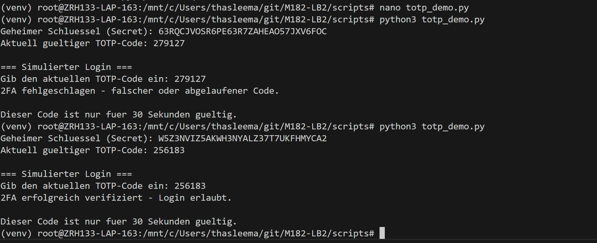

*Abbildung 4.10: Zwei Testläufe des TOTP-Skripts.*

- **Testlauf 1:** Der Code 279127 wurde angezeigt und exakt eingegeben, die Verifizierung schlug jedoch fehl («falscher oder abgelaufener Code»). Grund: Zwischen Codeanzeige und Eingabe verstrich mehr Zeit, als das 30-Sekunden-Gültigkeitsfenster erlaubt.
- **Testlauf 2:** Der Code 256183 wurde innerhalb des Zeitfensters eingegeben und erfolgreich verifiziert.

> [!TIP]
> `pyotp` akzeptiert mit `totp.verify(code)` standardmässig **nur** den Code des aktuellen 30-Sekunden-Fensters. Mit `totp.verify(code, valid_window=1)` würde zusätzlich je ein Fenster davor und danach akzeptiert – das gleicht kleine Zeitabweichungen zwischen Server und Smartphone aus [Q18]. RFC 6238 empfiehlt, höchstens einen solchen Zeitschritt Toleranz zuzulassen [Q16].

#### Erweiterung: echte Authenticator-App auf dem Smartphone

Nun haben wir das Setup erweitert und lassen den Code von einer **echten Authenticator-App** (Microsoft Authenticator) erzeugen. Dazu speichert ein erstes Setup-Skript das Secret in einer Datei:

```bash
nano totp_setup.py
python3 totp_setup.py
```

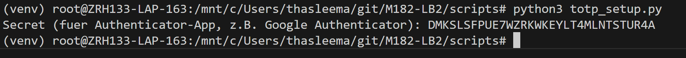

*Abbildung 4.11: Das Skript liefert ein Secret.*

Durch einen Input von Aakib Thasleem ist uns aufgefallen, dass das Secret zu lang ist, um es bequem in Microsoft Authenticator einzutippen. Deshalb haben wir das Skript erweitert, sodass es einen **QR-Code** anzeigt, den man scannen und hinzufügen kann:

```bash
pip install qrcode[pil]
nano totp_setup.py
```

```python
import pyotp
import qrcode

secret = pyotp.random_base32()
print(f"Secret (fuer Authenticator-App): {secret}")

with open("totp_secret.txt", "w") as f:
    f.write(secret)

totp = pyotp.TOTP(secret)
uri = totp.provisioning_uri(name="aakibdiago@m182-lb2", issuer_name="M182-LB2-PasswortSicherheit")

print(f"\nURI: {uri}\n")

qr = qrcode.QRCode()
qr.add_data(uri)
qr.print_ascii(invert=True)
```

#### QR-Code-Generierung für die Authenticator-App

Um den Secret-Key praxisnah an eine Authenticator-App zu übergeben (statt ihn manuell abzutippen), wurde er in eine standardisierte `otpauth://`-URI eingebettet und als QR-Code dargestellt. Dafür wurde die Python-Bibliothek `qrcode` verwendet.

Die Funktion `provisioning_uri()` erzeugt eine URI im Format `otpauth://totp/...`, die neben dem Secret auch den Kontonamen und den Dienstnamen (Issuer) enthält – genau das Format, das Authenticator-Apps zum automatischen Einrichten eines Kontos erwarten [Q19]. Statt den QR-Code als Bilddatei zu speichern, wurde er mit `qr.print_ascii()` direkt als ASCII-Grafik im Terminal dargestellt und konnte so unmittelbar mit dem Smartphone gescannt werden.

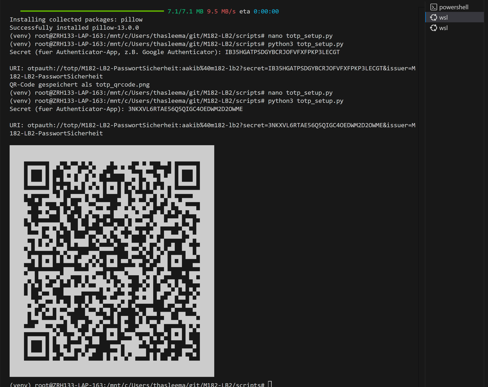

*Abbildung 4.12: Der QR-Code mit der `otpauth://`-URI im Terminal.*

<table>
<tr>
<td>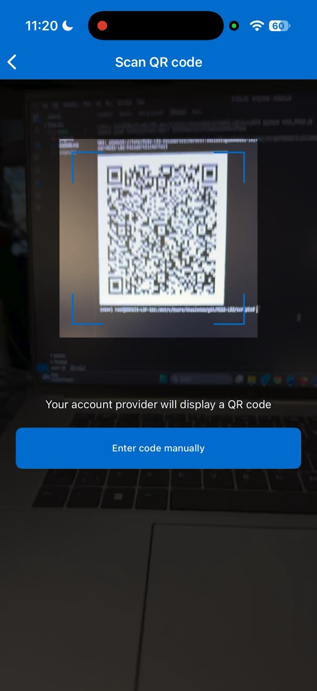</td>
<td>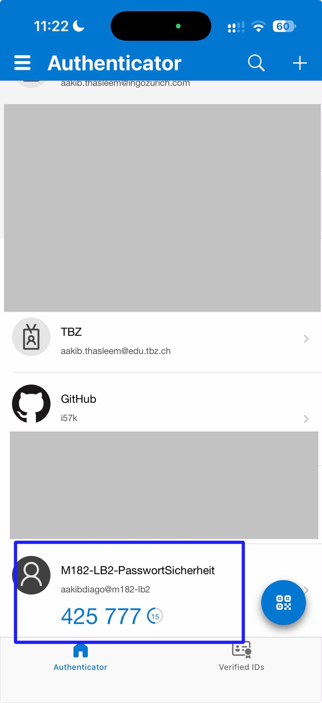</td>
</tr>
<tr>
<td><i>Abbildung 4.13: Scannen des QR-Codes mit der App.</i></td>
<td><i>Abbildung 4.14: Wie man sieht, wird das Konto nach dem Scannen in der App angezeigt.</i></td>
</tr>
</table>

#### Login mit dem Code aus der App

Das Login-Skript liest das gespeicherte Secret und prüft den eingegebenen Code:

```python
import pyotp

with open("totp_secret.txt", "r") as f:
    secret = f.read().strip()

totp = pyotp.TOTP(secret)

print("=== Login ===")
user_code = input("Gib den Code aus deiner Authenticator-App ein: ")

if totp.verify(user_code):
    print("2FA erfolgreich verifiziert - Login erlaubt.")
else:
    print("2FA fehlgeschlagen.")
```

```bash
python3 totp_login.py
```

Ich habe das Skript laufen lassen, den OTP aus der App eingegeben, und es hat geklappt:

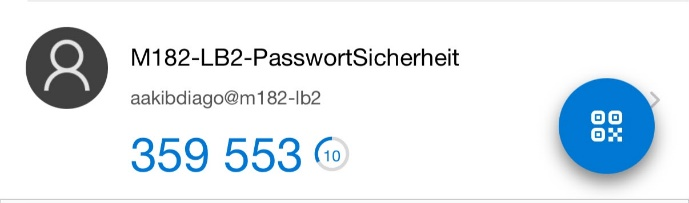

*Abbildung 4.15: Der aktuelle Code in der Authenticator-App.*

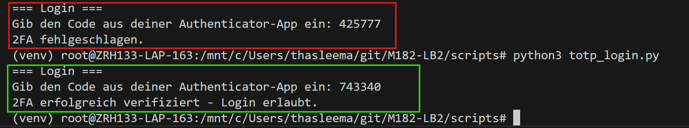

*Abbildung 4.16: Dieses Bild zeigt, wie ich einen abgelaufenen Code (425777) und einen falschen Code eingebe – beide schlagen fehl. Daraufhin habe ich einen gültigen OTP eingegeben, und es hat geklappt.*

#### Nachweis mit echter Authenticator-App

Der generierte Secret-Key wurde als QR-Code dargestellt und mit einer unabhängigen Authenticator-App auf dem Smartphone gescannt. Beim Testen der Login-Verifizierung zeigte sich die **Zeitbindung des TOTP-Verfahrens** praktisch: Ein von der App abgelesener Code (425777) wurde abgelehnt, da zwischen Ablesen und Eingabe mehr Zeit verstrich, als das 30-Sekunden-Gültigkeitsfenster erlaubt. Ein nachfolgender, aktueller Code (743340) wurde hingegen erfolgreich verifiziert.

**Erkenntnis:** Dieser Testfall demonstriert eindrücklich, wie eng das Zeitfenster bei TOTP-Codes bemessen ist – selbst eine kurze Verzögerung zwischen Codeanzeige und Eingabe kann zum Fehlschlag führen. Genau das macht TOTP sicher: Ein abgefangener Code ist nach kurzer Zeit wertlos.

> [!WARNING]
> **Das Secret ist das eigentliche Geheimnis.** Wer die Datei `totp_secret.txt` oder den QR-Code hat, kann selbst gültige Codes erzeugen. Auf einem echten Server muss das Secret deshalb genauso geschützt werden wie ein Passwort. Ausserdem schützt TOTP nicht gegen Echtzeit-Phishing, bei dem eine gefälschte Seite den Code sofort weiterleitet – dagegen helfen nur phishing-resistente Verfahren wie Passkeys/FIDO2.

### 5. Passwort-Manager: Vaultwarden selbst hosten

> [!NOTE]
> **Über das Minimum hinaus:** Dieser Teil war nicht Pflicht. Wir wollten die erarbeiteten Konzepte in einem **realen Werkzeug** verorten und haben dafür einen eigenen Passwort-Manager-Server mit HTTPS aufgesetzt.

Um die erarbeiteten Konzepte in einem realen Werkzeug zu verorten, wurde **Vaultwarden** – eine Open-Source-Implementierung des Bitwarden-Servers [Q20] – über Docker lokal aufgesetzt und über einen **Caddy-Reverse-Proxy mit HTTPS** (selbstsigniertes Zertifikat) abgesichert. Das Setup ist in [Kapitel 02](#6-infrastruktur-für-die-verteidigungstests) beschrieben.

Nun können wir über **https://127.0.0.1:8443** einen Account erstellen:

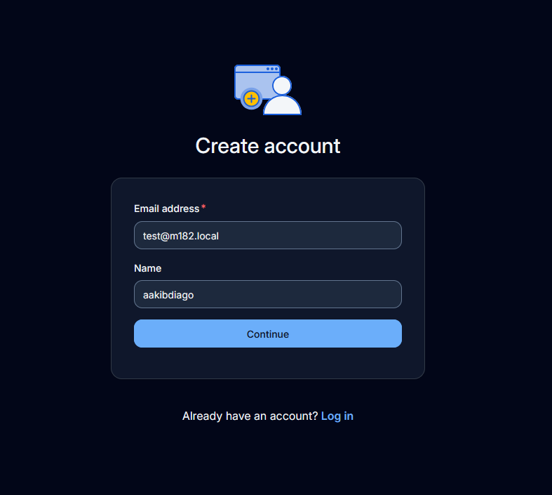

*Abbildung 4.17: Account-Erstellung in Vaultwarden.*

Nun müssen wir ein sicheres **Master-Passwort** setzen. Vaultwarden zeigt dabei direkt an, wie stark das gewählte Passwort ist:

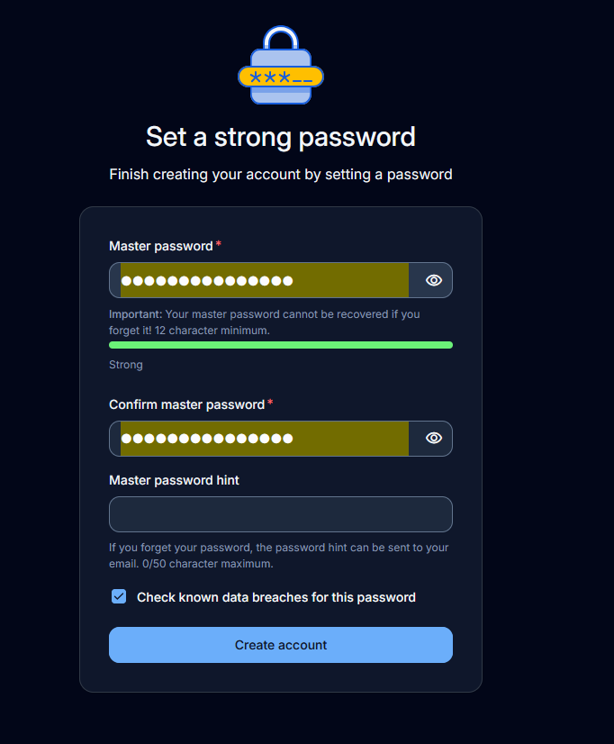

*Abbildung 4.18: Festlegen des Master-Passworts.*

Nun sind wir drin:

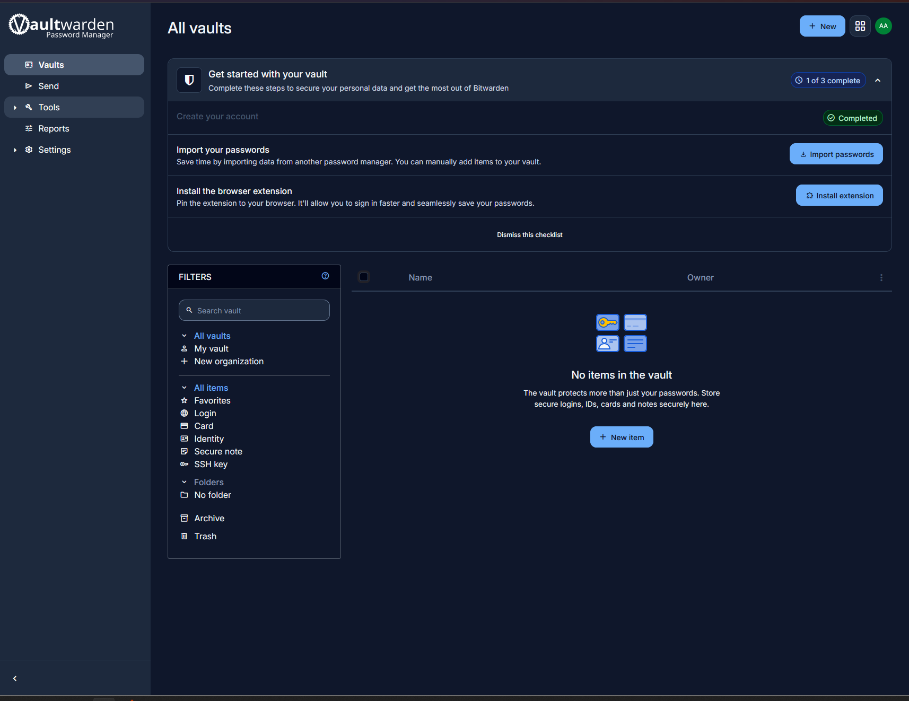

*Abbildung 4.19: Der Tresor nach dem ersten Login.*

Jetzt machen wir einen neuen Eintrag:

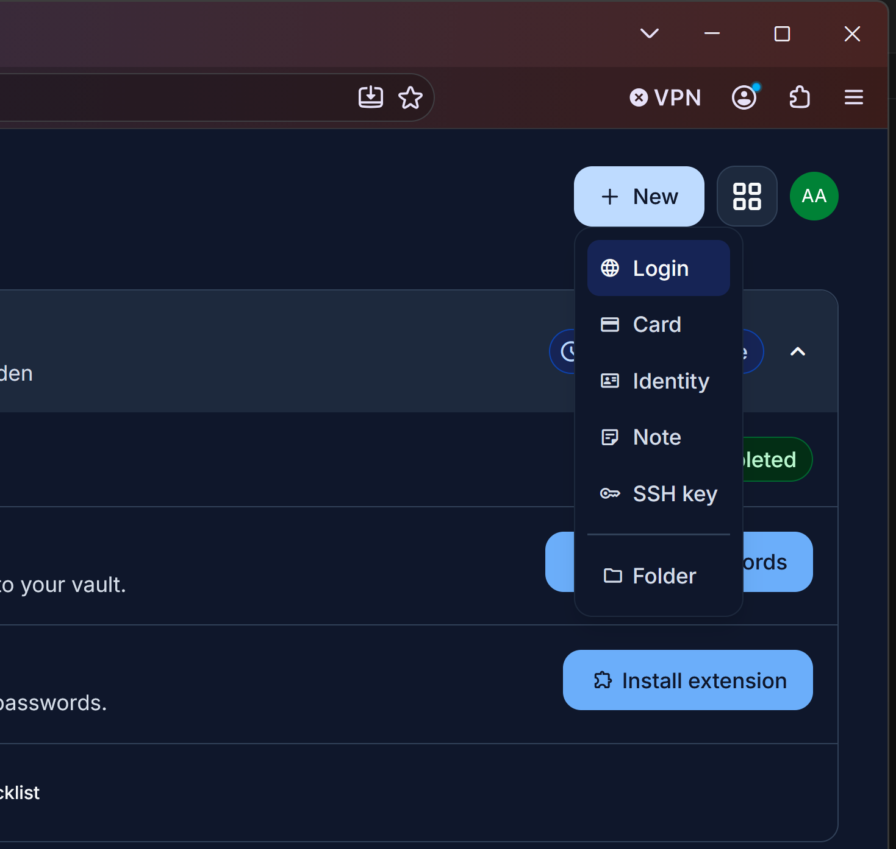

*Abbildung 4.20: Ein neuer Eintrag wird angelegt.*

Hier können wir den **Passwort-Generator** anpassen: Länge einstellen (z. B. 20) und die Checkboxen für Gross-/Kleinbuchstaben, Zahlen und Sonderzeichen aktivieren.

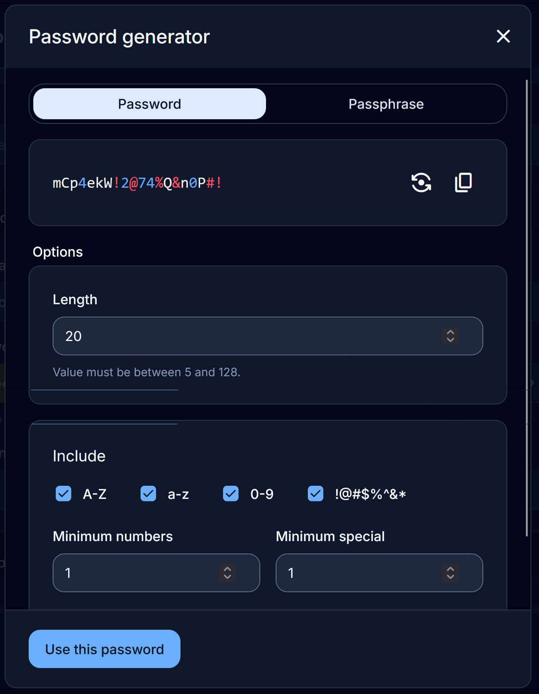

*Abbildung 4.21: Der integrierte Passwort-Generator erzeugt ein zufälliges, 20 Zeichen langes Passwort.*

Item added – der Eintrag ist gespeichert:

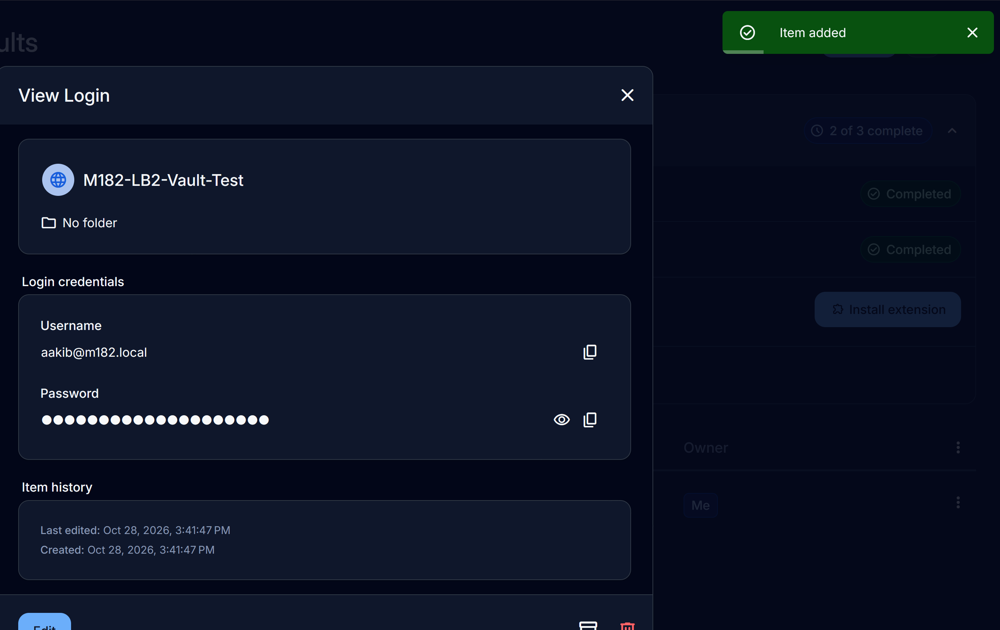

*Abbildung 4.22: Der Eintrag wurde gespeichert.*

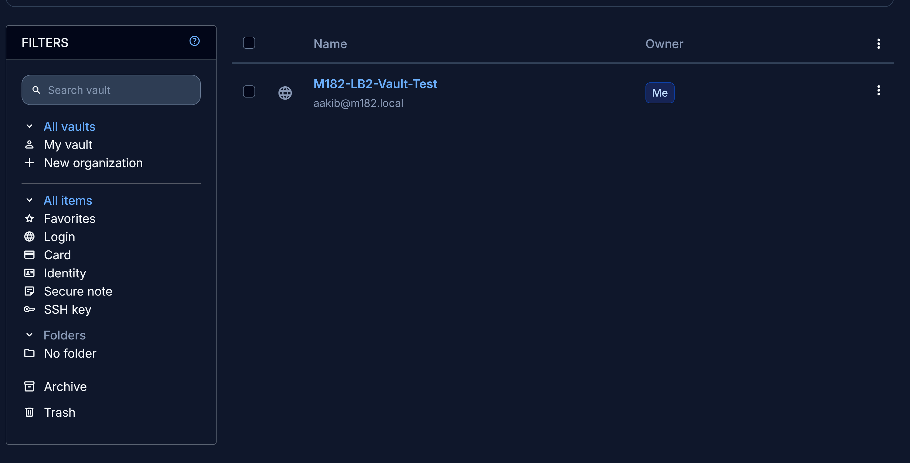

*Abbildung 4.23: Der Eintrag «M182-LB2-Vault-Test» erscheint im Tresor.*

Nachweis, dass die Container für Caddy und Vaultwarden laufen:

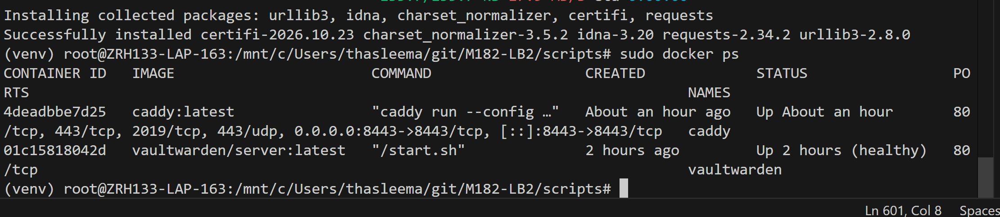

*Abbildung 4.24: `sudo docker ps` zeigt beide Container. Vaultwarden meldet den Status «healthy», Caddy leitet Port 8443 weiter.*

#### Warum ein Passwort-Manager so viel bringt

Nach dem Start wurde ein Account erstellt und der integrierte Passwort-Generator genutzt, um ein kryptografisch starkes, zufälliges Passwort zu erzeugen. Bitwarden bzw. Vaultwarden leitet den Schlüssel für die Verschlüsselung des Tresors aus dem Master-Passwort ab – wahlweise mit **PBKDF2-SHA256** (Standard: 600 000 Iterationen) oder mit **Argon2id** (Standard: 32 MiB Speicher, 6 Iterationen, Parallelität 4) [Q21]. Das ist genau die moderne, absichtlich langsame Hashing-Technik, die im praktischen Teil dieser Arbeit als widerstandsfähigster Algorithmus identifiziert wurde (siehe [Kapitel 03, Argon2-Vergleich](#4-angriff-auf-argon2)).

Ein 20-stelliges, zufälliges Passwort aus 95 Zeichen hat 95<sup>20</sup> ≈ 3,6 × 10<sup>39</sup> Kombinationen. Selbst mit MD5 und 400 MH/s würde eine Brute-Force-Suche rund 2,8 × 10<sup>23</sup> Jahre dauern.

**Erkenntnis:** Passwort-Manager lösen das Kernproblem, das viele der gezeigten Angriffe erst ermöglicht (schwache, wiederverwendete Passwörter), indem sie für jeden Dienst automatisch ein **einzigartiges, komplexes Passwort** generieren und verwalten. Man muss sich nur noch **ein** gutes Master-Passwort merken – und dieses sollte zusätzlich mit 2FA geschützt werden.

### 6. Abgleich mit Have I Been Pwned (HIBP)

Die NIST-Richtlinie verlangt, dass neue Passwörter gegen eine Liste bekannter, geleakter Passwörter geprüft werden (siehe [Kapitel 01](#7-passwort-policy-nach-aktuellem-stand)). Genau das haben wir mit einem eigenen Skript umgesetzt.

```bash
cd /mnt/c/Users/thasleema/git/M182-LB2/scripts
source venv/bin/activate
pip install requests
nano hibp_check.py
```

```python
import hashlib
import requests

def check_pwned(password):
    sha1 = hashlib.sha1(password.encode()).hexdigest().upper()
    prefix, suffix = sha1[:5], sha1[5:]

    url = f"https://api.pwnedpasswords.com/range/{prefix}"
    response = requests.get(url)

    hashes = (line.split(':') for line in response.text.splitlines())
    for h, count in hashes:
        if h == suffix:
            return int(count)
    return 0

pw = input("Passwort zum Pruefen eingeben: ")
count = check_pwned(pw)

if count:
    print(f"WARNUNG: Dieses Passwort wurde {count} mal in bekannten Datenlecks gefunden!")
else:
    print("Dieses Passwort wurde in keinem bekannten Leak gefunden.")
```

Ich habe das Skript ausgeführt und es funktioniert erfolgreich, siehe Bild:


*Abbildung 4.25: Das Passwort `sdc119` wurde 23-mal, `Stefan123!` sogar **2511-mal** in bekannten Datenlecks gefunden.*

Das Beispiel `Stefan123!` zeigt sehr schön, warum klassische Komplexitätsregeln nichts bringen: Es hat Grossbuchstaben, Kleinbuchstaben, Zahlen und ein Sonderzeichen – und ist trotzdem 2511-mal geleakt worden.

#### Wie bleibt das Passwort dabei geheim? (k-Anonymity)

Um reale Passwörter gegen bekannte Datenlecks zu prüfen, nutzt das Skript die «Have I Been Pwned»-API. Das Verfahren basiert auf **k-Anonymity**: Nur die **ersten 5 Zeichen des SHA-1-Hashes** werden an die API übertragen, das Passwort selbst verlässt **nie** den lokalen Rechner [Q24][Q25].

```
Passwort:  Stefan123!
SHA-1:     XXXXX YYYYYYYYYYYYYYYYYYYYYYYYYYYYYYYYYYY
           └─┬─┘ └──────────────┬──────────────────┘
          Präfix              Suffix
       wird gesendet     bleibt auf dem eigenen Rechner

API antwortet mit ALLEN Suffixen, die mit diesem Präfix beginnen (mehrere Hundert),
jeweils mit der Anzahl Funde. Der Vergleich passiert lokal.
```

Da es nur 16<sup>5</sup> = 1 048 576 mögliche Präfixe gibt, teilen sich jeweils mehrere Hundert geleakte Hashes denselben Präfix. Der Server kann deshalb nicht erkennen, welches Passwort genau geprüft wurde [Q25]. Die offizielle Dokumentation beschreibt das so:

> «Pwned Passwords works best when directly querying the k-anonymity API; it's fast, always up to date and enables anonymous queries without disclosing the password being searched for. However, all password hashes are also available for download as either SHA-1 or NTLM so they can be used without the API dependency.» – Have I Been Pwned, API v3 [Q24]

> [!TIP]
> Dieselbe Prüfung ist bereits in vielen Werkzeugen eingebaut. Unser Security-Audit hat gezeigt, dass Vaultwarden die Domains `haveibeenpwned.com` und `api.pwnedpasswords.com` in seiner Content-Security-Policy freigibt – der Passwort-Manager kann also selbst prüfen, ob gespeicherte Passwörter in Leaks vorkommen (siehe [Abschnitt 8](#8-security-audit-mit-testsslsh)).

### 7. Keycloak: alles zentral in einem System

> [!NOTE]
> **Über das Minimum hinaus:** Nachdem wir Rate-Limiting und 2FA einzeln selbst programmiert hatten, wollten wir zeigen, wie ein Unternehmen dieselben Schutzmechanismen in einem **professionellen Identity-Management-System** zentral umsetzt.

#### Was ist Keycloak?

Keycloak ist ein **Identity and Access Management (IAM) System** bzw. ein **Single-Sign-On-Server** [Q26]. Firmen nutzen es, damit sich Mitarbeitende einmal einloggen und danach automatisch Zugriff auf viele verschiedene Apps und Dienste haben (E-Mail, interne Tools, Cloud-Dienste), ohne sich überall einzeln anzumelden. Bekannte Alternativen sind Auth0, Okta und Microsoft Entra ID.

**Warum es zu unserem Thema passt:** Wir haben bisher **einzeln** gebaut: Rate-Limiting (eigenes Skript + Fail2Ban) und 2FA (eigenes TOTP-Skript). Keycloak zeigt, wie ein **echtes Unternehmen** das nicht selbst programmiert, sondern **fertig gebündelt** einsetzt:

| Unser Eigenbau | In Keycloak |
|---|---|
| `rate_limit_interactive.py`, Fail2Ban | Brute-Force-Schutz ist eingebaut |
| `totp_demo.py`, `totp_setup.py`, `totp_login.py` | 2FA/OTP ist eingebaut |
| Passwort-Policy (Theorie, Kapitel 01) | Passwort-Policies sind konfigurierbar |
| jede App verwaltet eigene Logins | zentrale Benutzerverwaltung |

#### Temporären Admin durch sicheren Admin ersetzen

Unter **https://127.0.0.1:8543** können wir nun das Interface öffnen:


*Abbildung 4.26: Die Login-Seite von Keycloak.*

Nun können wir uns mit Benutzername `admin` und Passwort `admin` einloggen:


*Abbildung 4.27: Keycloak weist selbst darauf hin, dass es sich um einen temporären Admin-Benutzer handelt.*

Nun sehen wir, dass Keycloak anzeigt, dass dies ein **temporärer Admin-User** ist. Damit die Sicherheit gehärtet wird, richten wir einen **permanenten Admin** ein. Dafür gehen wir in den Benutzerbereich:


*Abbildung 4.28 und 4.29: Ein neuer Benutzer wird im Bereich «Users» angelegt.*

Dann setzen wir ein sicheres Passwort:


*Abbildung 4.30: Ein sicheres Passwort wird gesetzt.*

«Temporary password» muss auf **Off** stehen, sonst müsste das Passwort beim ersten Login sofort wieder geändert werden:


*Abbildung 4.31: «Temporary» ist deaktiviert.*

Dann weisen wir dem neuen Admin-User die Admin-Rechte zu. Bevor wir den temporären Admin entfernen, testen wir den Login mit dem neuen Benutzer:


*Abbildung 4.32: Der Login mit dem neuen Admin «aakib diago» funktioniert (oben rechts).*


*Abbildung 4.33: Der neue Admin hat Zugriff auf die Administrationskonsole.*

Der Login hat geklappt, und wir können den temporären Admin nun deaktivieren:


*Abbildung 4.34: Der Benutzer `admin` ist deaktiviert («Disabled»), aktiv ist nur noch `m182-admin`.*

> [!TIP]
> Das ist das Prinzip **Least Privilege** und **Härtung von Standardkonten**: Standard-Zugangsdaten wie `admin/admin` gehören zu den ersten Dingen, die Angreifer ausprobieren. Sie sollten nach der Installation sofort ersetzt werden.

#### Eingebaute Brute-Force-Protection

Die eingebaute Brute-Force-Protection findet man links im Menü unter **«Realm settings» → Tab «Security defenses» → Unterbereich «Brute force detection»** [Q26]. Standardmässig ist sie **deaktiviert** – wir haben sie aktiviert und uns die Optionen angeschaut:


*Abbildung 4.35: Unsere Einstellungen für die Brute-Force-Erkennung.*

| Einstellung | Unser Wert | Bedeutung |
|---|---|---|
| **Max login failures** | 3 | Nach 3 Fehlversuchen wird das Konto gesperrt |
| **Maximum Secondary Authentication Failures** | 3 | gleicher Wert, betrifft 2FA-Fehlversuche |
| **Strategy to increase wait time** | Multiple | Standard: Die Wartezeit verdoppelt bzw. vervielfacht sich bei wiederholten Verstössen («exponentielles Backoff») |
| **Wait increment** | 1 Minute | Dauer der ersten Sperre |
| **Max wait** | 15 Minuten | Längste mögliche Sperre |
| **Failure reset time** | 12 Stunden | Nach dieser Zeit wird der Fehlerzähler zurückgesetzt |
| **Quick login check milliseconds** | 1000 (Standard) | Erkennt besonders schnelle, automatisierte Login-Versuche als verdächtig |
| **Minimum quick login wait** | 1 Minute | Sperrdauer bei zu schnellen Login-Versuchen |

Nun haben wir es getestet:


*Abbildung 4.36: Login-Versuche mit falschem Passwort.*

Ich habe das Passwort mehrmals falsch eingegeben und sehe nun diese Meldung:


*Abbildung 4.37: Keycloak sperrt das Konto vorübergehend.*

Da ich temporär gesperrt bin, klappt es auch **nicht mit dem aktuellen und korrekten Passwort**. Nach 3 Fehlversuchen wird der Account für 1 Minute gesperrt – und nach dieser Wartezeit konnte ich mich wieder einloggen:


*Abbildung 4.38: Nach Ablauf der Wartezeit funktioniert der Login wieder.*

**Erkenntnis:** Keycloak verhält sich genau wie unser eigenes Skript (auch das korrekte Passwort wird während der Sperre abgelehnt), geht aber weiter: Die Sperre wird bei wiederholten Angriffen **automatisch länger** (exponentielles Backoff bis 15 Minuten), und zu schnelle, automatisierte Login-Versuche werden zusätzlich erkannt. Anders als Fail2Ban sperrt Keycloak das **Konto** und nicht nur die IP-Adresse – damit hilft es auch gegen verteilte Angriffe aus vielen IPs.

#### 2FA/OTP in Keycloak

Jetzt aktivieren wir 2FA/OTP für den neuen Admin. Dazu setzen wir in den Benutzerdetails die **«Required user action» → «Configure OTP»**:


*Abbildung 4.39: Für den Benutzer `m182-admin` wird «Configure OTP» als Pflicht-Aktion gesetzt.*

Beim nächsten Login werde ich aufgefordert, diesen QR-Code für OTP zu scannen:


*Abbildung 4.40: Keycloak zeigt einen QR-Code zum Einrichten der Authenticator-App.*

Nun können wir den OTP aus der Authenticator-App eingeben:


*Abbildung 4.41: Das Keycloak-Konto in der Authenticator-App.*

Nachweis, dass nach der Registrierung bei **jedem Login** der OTP abgefragt wird – zuerst fragt Keycloak nach dem Passwort:


*Abbildung 4.42: Schritt 1 – Passwort.*

Danach wird der OTP abgefragt:


*Abbildung 4.43: Schritt 2 – der 6-stellige Code aus der App.*

Und der Login hat funktioniert. Damit ist der Admin-Zugang mit **zwei Faktoren** geschützt: Selbst wenn das Passwort geleakt würde, käme ein Angreifer ohne das Smartphone nicht hinein – und durch die Brute-Force-Protection kann er auch den 6-stelligen Code nicht einfach durchprobieren (nur 3 Fehlversuche bei «Maximum Secondary Authentication Failures»).

### 8. Security-Audit mit testssl.sh

> [!NOTE]
> **Über das Minimum hinaus:** Ein starkes Passwort und ein guter Hash nützen wenig, wenn das Passwort auf dem Weg zum Server mitgelesen werden kann. Deshalb haben wir zum Schluss die **Transportverschlüsselung** unserer beiden Server mit einem professionellen Audit-Werkzeug geprüft.

**testssl.sh** ist ein Open-Source-Werkzeug, das einen HTTPS-Server auf unterstützte Protokolle, Cipher-Suites, Zertifikat, Sicherheits-Header und bekannte Schwachstellen prüft [Q27]. Das Setup steht in [Kapitel 02](#testsslsh).

Scan gegen Keycloak und Vaultwarden:

```bash
./testssl.sh --quiet https://127.0.0.1:8543
./testssl.sh --quiet https://127.0.0.1:8443
```

#### Ergebnisse für Keycloak (https://127.0.0.1:8543)

| Kategorie | Ergebnis |
|---|---|
| Veraltete Protokolle (SSLv2/v3, TLS 1.0/1.1) | Nicht angeboten (gut) |
| TLS 1.2 / 1.3 | Beide unterstützt |
| Forward Secrecy | Verfügbar |
| Schlüsselgrösse | RSA 4096 Bit |
| Heartbleed, POODLE, FREAK, DROWN, BEAST, RC4 | Alle: nicht verwundbar |
| LUCKY13 | Potenziell verwundbar (CBC-Cipher-bedingt) |
| Gesamt-Bewertung | Grade T (durch selbstsigniertes Zertifikat bedingt) |

**Erkenntnis:** Die niedrige Gesamtnote («Grade T») resultiert ausschliesslich aus der fehlenden Zertifikatskette (selbstsigniertes Zertifikat für ein lokales Testsystem) – ein erwartetes und für diesen Zweck unproblematisches Ergebnis [Q30]. Die eigentliche kryptografische Konfiguration (unterstützte Protokolle, Cipher-Stärke, Schlüssellänge) erfüllt moderne Sicherheitsstandards und zeigt keine der klassischen, historisch bedeutsamen TLS-Schwachstellen. Der einzige inhaltliche Hinweis (**LUCKY13**, CBC-basiert [Q29]) betrifft ältere Cipher-Suites, die aus Kompatibilitätsgründen weiterhin angeboten werden, in der Praxis aber nur unter sehr spezifischen Bedingungen ausnutzbar sind.

#### Vergleich Keycloak und Vaultwarden

Ich habe das Tool testssl.sh benutzt, um zu prüfen, wie sicher die Verschlüsselung (TLS/HTTPS) bei Keycloak und bei Vaultwarden eingestellt ist. Beide verwenden dasselbe Zertifikat, trotzdem gibt es Unterschiede:

| Prüfpunkt | Keycloak (:8543) | Vaultwarden über Caddy (:8443) |
|---|---|---|
| SSLv2, SSLv3, TLS 1.0, TLS 1.1 | ✅ nicht angeboten | ✅ nicht angeboten |
| TLS 1.2 und TLS 1.3 | ✅ angeboten | ✅ angeboten |
| Veraltete CBC-Cipher | ⚠️ angeboten | ✅ nicht angeboten |
| Cipher **ohne** Forward Secrecy (RSA-Schlüsseltausch) | ⚠️ angeboten | ✅ nicht angeboten |
| LUCKY13 (CVE-2013-0169) | ⚠️ potenziell verwundbar | ✅ nicht verwundbar |
| Post-Quanten-Schlüsseltausch | – nicht angeboten | ✅ `X25519MLKEM768` |
| Sicherheits-Header | nur `X-Content-Type-Options`, `Referrer-Policy` | ✅ u. a. Content-Security-Policy, X-Frame-Options, Permissions-Policy, Cross-Origin-Resource-Policy |
| HTTP Strict Transport Security (HSTS) | – | ⚠️ nicht gesetzt |
| Heartbleed, CCS, POODLE, SWEET32, FREAK, DROWN, BEAST, RC4 | ✅ nicht verwundbar | ✅ nicht verwundbar |
| Zertifikat | RSA 4096 Bit, SAN `localhost` + `127.0.0.1` | identisch |
| Vertrauenskette | ❌ selbstsigniert | ❌ selbstsigniert |
| **Gesamtnote** | **T** | **T** |

- **Vaultwarden** ist etwas strenger eingestellt: Es bietet keine alten, unsicheren Verschlüsselungsmethoden (sogenannte **CBC-Cipher**) an. Dadurch ist es auch nicht anfällig für eine bekannte Schwachstelle namens **LUCKY13**.
- **Keycloak** bietet diese alten Methoden noch an (wahrscheinlich, damit sich auch ältere Programme verbinden können) und ist deshalb theoretisch für LUCKY13 anfällig.
- Vaultwarden schickt ausserdem viel mehr **Sicherheits-Header** mit (z. B. eine genaue Liste, welche externen Seiten überhaupt eingebunden werden dürfen – darunter sogar `haveibeenpwned.com`, das wir selbst für den HIBP-Check genutzt haben).
- Spannend: Caddy bietet bereits den **hybriden Post-Quanten-Schlüsseltausch** `X25519MLKEM768` an. Dieser soll Verbindungen auch gegen zukünftige Quantencomputer schützen («harvest now, decrypt later»).

Beide bekommen trotzdem die schlechteste Note («**Grade T**») von testssl.sh. Das liegt aber nur daran, dass wir ein selbstgemachtes Zertifikat benutzen, das keiner offiziellen Stelle gehört (kein «echtes», von einer Zertifizierungsstelle wie Let's Encrypt ausgestelltes Zertifikat). Mit einem echten Zertifikat würde die Note «T» wegfallen.

**Verbesserungsmöglichkeiten**, die sich aus dem Audit ergeben:

1. Keycloak: CBC-Cipher und Cipher ohne Forward Secrecy deaktivieren.
2. Vaultwarden/Caddy: HSTS-Header setzen, damit Browser nie mehr unverschlüsselt verbinden.
3. Für einen echten Betrieb: Zertifikat einer anerkannten Zertifizierungsstelle (z. B. Let's Encrypt) verwenden.

**Erkenntnis:** Dieser Audit demonstriert, dass Sicherheitsbewertung nicht nur die Anwendungs- und Passwort-Ebene betrifft, sondern dass auch die zugrundeliegende **Transportverschlüsselung** ein integraler Bestandteil der Gesamtsicherheit eines Systems ist. Mit **TLS 1.3** [Q28] und Forward Secrecy kann ein Angreifer, der den Datenverkehr aufzeichnet, die übertragenen Passwörter auch später nicht entschlüsseln – selbst wenn er irgendwann den privaten Schlüssel des Servers stiehlt.

---

### Selbsttest Kapitel 4

<details>
<summary><b>1. Warum lehnen unser Skript und Keycloak während der Sperre auch das richtige Passwort ab?</b></summary>

Sonst könnte ein Angreifer einfach weiterraten. Würde das richtige Passwort trotz Sperre akzeptiert, wäre die Sperre wirkungslos.
</details>

<details>
<summary><b>2. Was ist der Unterschied zwischen der Sperre von Fail2Ban und der von Keycloak?</b></summary>

Fail2Ban sperrt die **IP-Adresse** in der Firewall. Keycloak sperrt das **Benutzerkonto**. Gegen einen Angreifer mit vielen IP-Adressen hilft deshalb vor allem die Konto-Sperre.
</details>

<details>
<summary><b>3. Warum wurde beim TOTP-Test ein korrekt abgetippter Code abgelehnt?</b></summary>

Weil zwischen Anzeige und Eingabe mehr als 30 Sekunden vergangen sind. Der Code war abgelaufen. TOTP-Codes sind nur für ein kurzes Zeitfenster gültig.
</details>

<details>
<summary><b>4. Erfährt Have I Been Pwned, welches Passwort wir geprüft haben?</b></summary>

Nein. Es werden nur die ersten 5 Zeichen des SHA-1-Hashes gesendet (k-Anonymity). Der Vergleich mit den zurückgegebenen Suffixen passiert lokal.
</details>

<details>
<summary><b>5. Warum bekommen beide Server bei testssl.sh die Note «T», obwohl die Verschlüsselung gut ist?</b></summary>

Weil das Zertifikat selbstsigniert ist und keine Vertrauenskette zu einer anerkannten Zertifizierungsstelle hat. Die Note «T» steht für ein Vertrauensproblem (Trust), nicht für schwache Verschlüsselung.
</details>

---

## Kapitel 5 – Reflexion und Fazit

---

### 1. Angriff-Verteidigung-Matrix

Die folgende Matrix fasst zusammen, welche Verteidigung gegen welchen Angriff wirkt – und wo wir das in unserer Arbeit selbst nachgewiesen haben.

| Angriff ↓ / Verteidigung → | Langes, zufälliges Passwort | Salt | bcrypt / Argon2 | Rate-Limiting / Lockout | 2FA (TOTP) | Passwort-Manager | HIBP / Blocklist | TLS |
|---|---|---|---|---|---|---|---|---|
| **Dictionary-Attacke (offline)** | ✅ | ⚠️ | ✅ | – | – | ✅ | ✅ | – |
| **Brute-Force (offline)** | ✅ | ⚠️ | ✅ | – | – | ✅ | – | – |
| **Rainbow Table** | ⚠️ | ✅ | ✅ | – | – | – | – | – |
| **Online-Raten am Login** | ✅ | – | – | ✅ | ✅ | ✅ | ✅ | – |
| **Credential Stuffing** (geleakte Passwörter) | – | – | – | ⚠️ | ✅ | ✅ | ✅ | – |
| **Mitlesen im Netzwerk** | – | – | – | – | ⚠️ | – | – | ✅ |

✅ = wirksam · ⚠️ = hilft teilweise · – = hilft nicht

| Nachweis in dieser Arbeit | Kapitel |
|---|---|
| Langes Passwort widersteht Dictionary und Brute-Force (43 Mio. Jahre für 12 Zeichen) | [03](#2-brute-force-attacke-gegen-md5) |
| Salt verhindert Treffer in vorberechneter Tabelle | [03](#6-rainbow-table-angriff), [04](#1-salting-nachweis) |
| bcrypt (39 H/s) und Argon2 (10 H/s) statt ~400 Mio. H/s bei MD5 | [03](#5-geschwindigkeitsvergleich-aller-verfahren) |
| Lockout nach 3 Fehlversuchen (Skript, Fail2Ban, Keycloak) | [04](#2-rate-limiting-mit-eigenem-skript) |
| TOTP mit echter Authenticator-App (Skript und Keycloak) | [04](#4-zwei-faktor-authentifizierung-mit-totp) |
| Vaultwarden generiert 20-stellige Zufallspasswörter | [04](#5-passwort-manager-vaultwarden-selbst-hosten) |
| HIBP findet `Stefan123!` 2511-mal in Leaks | [04](#6-abgleich-mit-have-i-been-pwned-hibp) |
| TLS 1.2/1.3 mit Forward Secrecy, keine klassischen TLS-Schwachstellen | [04](#8-security-audit-mit-testsslsh) |

**Die wichtigste Erkenntnis aus der Matrix:** Es gibt **keine einzelne Massnahme**, die gegen alle Angriffe hilft. Erst die Kombination schliesst die Lücken.

### 2. Restrisiken: Was unsere Massnahmen nicht abdecken

Auch mit allen umgesetzten Massnahmen bleiben Risiken, die man kennen sollte:

| Restrisiko | Erklärung | Mögliche Gegenmassnahme |
|---|---|---|
| **Phishing** | Ein Benutzer gibt Passwort **und** TOTP-Code auf einer gefälschten Seite ein. Der Angreifer leitet beides in Echtzeit weiter. | Phishing-resistente Verfahren (Passkeys / FIDO2), Awareness-Schulungen |
| **Malware / Keylogger** | Schadsoftware auf dem Gerät liest Passwörter direkt bei der Eingabe mit – Hashing und TLS helfen dann nicht. | Aktuelle Systeme, Endpoint Protection, keine Software aus unbekannten Quellen |
| **Kompromittiertes Master-Passwort** | Beim Passwort-Manager hängt alles an einem einzigen Passwort. | Starkes Master-Passwort und 2FA für den Passwort-Manager |
| **Diebstahl des TOTP-Secrets** | Wer das Secret (z. B. `totp_secret.txt`) hat, kann selbst gültige Codes erzeugen. | Secrets verschlüsselt und mit minimalen Rechten speichern |
| **Verteilte Angriffe** | Botnetze mit Tausenden IPs umgehen IP-basierte Sperren wie Fail2Ban. | Konto-basierte Sperren (Keycloak), 2FA |
| **Denial of Service durch Lockout** | Ein Angreifer kann absichtlich falsche Passwörter eingeben, um ein fremdes Konto zu sperren. | Zeitlich begrenzte statt permanenter Sperren (wie bei uns: 1 Minute, exponentiell steigend) |
| **Selbstsignierte Zertifikate** | Benutzer gewöhnen sich daran, Zertifikatswarnungen wegzuklicken – das nutzen Man-in-the-Middle-Angreifer aus. | In Produktion nur Zertifikate einer anerkannten Zertifizierungsstelle |
| **Schwache Passwörter bei starkem Hash** | Auch Argon2 schützt `123456` nicht – es wurde in unserem Test trotzdem gefunden, nur langsamer. | Blocklist-Prüfung (HIBP) beim Setzen des Passworts |

### 3. Bezug zu den Sicherheitsprinzipien aus dem Modul

#### Defense in Depth (gestaffelte Verteidigung)

Unsere Arbeit ist ein gutes Beispiel für **Defense in Depth**: Jede Schicht fängt ab, was die vorherige nicht schafft.

```
Schicht 1  Benutzer       langes, einzigartiges Passwort (Passwort-Manager), HIBP-Check
Schicht 2  Transport      TLS 1.2/1.3 mit Forward Secrecy (testssl.sh geprüft)
Schicht 3  Login          Rate-Limiting / Lockout (Skript, Fail2Ban, Keycloak)
Schicht 4  Zweiter Faktor TOTP mit Authenticator-App
Schicht 5  Speicherung    Salt + Argon2id / bcrypt
```

Wird zum Beispiel die Hash-Datenbank gestohlen (Schicht 3 und 4 umgangen), bremst Schicht 5 den Angreifer aus. Wird ein Passwort trotzdem geknackt, hält Schicht 4 (2FA) ihn auf.

#### Awareness (Sensibilisierung)

Viele der gezeigten Angriffe funktionieren nur, weil **Menschen** schwache oder wiederverwendete Passwörter wählen. Unsere Tests liefern dafür konkrete, eindrückliche Zahlen, die sich gut für Schulungen eignen:

- `123456` ist in **unter einer Sekunde** geknackt.
- `Stefan123!` erfüllt alle klassischen Komplexitätsregeln und wurde trotzdem **2511-mal** geleakt.
- Ein zufälliges 12-Zeichen-Passwort würde selbst mit MD5 rund **43 Millionen Jahre** halten.

Technik allein reicht nicht – Benutzer müssen verstehen, **warum** Länge, Einzigartigkeit und 2FA wichtig sind.

#### Least Privilege (minimale Rechte)

- In Keycloak haben wir den **temporären Standard-Admin** (`admin/admin`) deaktiviert und durch einen eigenen Admin mit sicherem Passwort und 2FA ersetzt.
- Die Zertifikatsdateien wurden **schreibgeschützt** (`:ro`) in den Keycloak-Container eingebunden.
- Fail2Ban, Vaultwarden und Keycloak laufen getrennt in eigenen Containern bzw. Diensten – ein Fehler in einem System betrifft nicht automatisch die anderen.

### 4. Checkliste für die Praxis

**Für Benutzer:**

- [ ] Für jeden Dienst ein eigenes Passwort – mit einem Passwort-Manager
- [ ] Lieber lang als kompliziert: Passphrasen ab 15 Zeichen
- [ ] Überall, wo möglich, 2FA aktivieren
- [ ] Eigene Passwörter bei Have I Been Pwned prüfen

**Für Entwickler und Administratoren:**

- [ ] Passwörter nur mit **Argon2id** (oder bcrypt, Cost ≥ 10) speichern – nie mit MD5/SHA-1
- [ ] Salt verwenden (bei Argon2/bcrypt automatisch dabei)
- [ ] Fehlversuche begrenzen (Konto **und** IP), mit steigender Wartezeit
- [ ] 2FA anbieten, für Admins verpflichtend
- [ ] Neue Passwörter gegen eine Blocklist prüfen, keine Komplexitätsregeln und kein Zwangswechsel
- [ ] Standard-Zugangsdaten sofort ändern
- [ ] TLS 1.2/1.3 mit Forward Secrecy, regelmässig mit testssl.sh prüfen

### 5. Fazit

Zu Beginn dieser Arbeit stand die Frage, wie schnell ein Angreifer aus einem gestohlenen Hash wieder ein Passwort machen kann. Die Antwort hat uns selbst überrascht: Bei einem schwachen Passwort und einem schnellen Hash wie MD5 dauert es **weniger als eine Sekunde**. Unser Laptop hat dabei ohne Grafikkarte fast 400 Millionen Passwörter pro Sekunde ausprobiert.

Gleichzeitig hat sich gezeigt, dass die Verteidigung keine Raketenwissenschaft ist. Die zwei wichtigsten Hebel sind:

1. **Auf Seite der Benutzer:** lange, zufällige und für jeden Dienst einzigartige Passwörter. Unser starkes Testpasswort hat sowohl der Dictionary-Attacke als auch dem Brute-Force-Angriff standgehalten – sogar als MD5-Hash.
2. **Auf Seite der Systeme:** ein modernes, langsames Hash-Verfahren wie **Argon2id** mit Salt, kombiniert mit **Rate-Limiting** und **2FA**. Mit Argon2 sank die Angriffsgeschwindigkeit von Hunderten Millionen auf **10 Versuche pro Sekunde**.

Besonders spannend fanden wir den Schritt von den eigenen Skripten zu professionellen Werkzeugen. Nachdem wir Rate-Limiting und TOTP selbst programmiert hatten, haben wir bei **Keycloak** genau dieselben Mechanismen wiedererkannt – nur ausgereifter, zum Beispiel mit exponentiell steigenden Sperrzeiten. **Vaultwarden** hat gezeigt, wie ein Passwort-Manager das Problem schwacher Passwörter an der Wurzel löst, und der **testssl.sh-Audit** hat uns bewusst gemacht, dass auch der Transportweg zur Passwort-Sicherheit gehört.

Unser wichtigstes Learning: **Passwort-Sicherheit ist eine Kette, und sie ist nur so stark wie ihr schwächstes Glied.** Das beste Hash-Verfahren nützt nichts, wenn der Benutzer `123456` wählt – und das beste Passwort nützt wenig, wenn der Server es mit MD5 speichert oder es unverschlüsselt übertragen wird.

---

### Selbsttest Kapitel 5

<details>
<summary><b>1. Nenne drei Massnahmen, die gegen Credential Stuffing helfen.</b></summary>

2FA (das geleakte Passwort allein reicht nicht), ein Passwort-Manager (jeder Dienst hat ein eigenes Passwort) und eine Blocklist-Prüfung wie HIBP (geleakte Passwörter werden gar nicht erst akzeptiert).
</details>

<details>
<summary><b>2. Warum schützt TOTP nicht zuverlässig gegen Phishing?</b></summary>

Weil der Benutzer den Code auf einer gefälschten Seite eingeben kann und der Angreifer ihn innerhalb der 30 Sekunden sofort an den echten Dienst weiterleitet. Dagegen helfen phishing-resistente Verfahren wie Passkeys/FIDO2, die an die echte Domain gebunden sind.
</details>

<details>
<summary><b>3. Erkläre Defense in Depth am Beispiel einer gestohlenen Hash-Datenbank.</b></summary>

Rate-Limiting und 2FA helfen hier nicht, weil der Angreifer offline rät. Dann greift die nächste Schicht: Salt und Argon2 machen das Raten extrem langsam. Wird ein Passwort trotzdem geknackt, verhindert 2FA den Login, und weil jeder Dienst ein eigenes Passwort hat, sind andere Konten nicht betroffen.
</details>

---

## Kapitel 6 – Quellenverzeichnis

---

Alle Quellen sind im Fliesstext mit ihrer Nummer (z. B. **[Q1]**) referenziert. Die Spalte «Verwendet in» zeigt, in welchem Kapitel die Quelle genutzt wurde.

### Standards und Richtlinien

| Nr. | Quelle | Beschreibung | Verwendet in | Zugriff |
|---|---|---|---|---|
| Q1 | OWASP Foundation: *Password Storage Cheat Sheet*. <https://cheatsheetseries.owasp.org/cheatsheets/Password_Storage_Cheat_Sheet.html> | Empfehlungen für Argon2id, scrypt, bcrypt, PBKDF2, Salt und Pepper | 1, 5 | 30.10.2026 |
| Q2 | National Institute of Standards and Technology (NIST): *SP 800-63B-4 – Digital Identity Guidelines: Authentication and Authenticator Management*, 2025. <https://pages.nist.gov/800-63-4/sp800-63b.html> | Aktuelle Passwort-Policy (Länge, keine Komplexitätsregeln, Blocklist, Begrenzung der Fehlversuche) | 1, 4, 5 | 30.10.2026 |
| Q32 | OWASP Foundation: *Authentication Cheat Sheet*. <https://cheatsheetseries.owasp.org/cheatsheets/Authentication_Cheat_Sheet.html> | Schutz vor automatisierten Angriffen, Account-Lockout | 4 | 30.10.2026 |

### RFCs (Internet-Standards)

| Nr. | Quelle | Beschreibung | Verwendet in | Zugriff |
|---|---|---|---|---|
| Q3 | Rivest, R.: *RFC 1321 – The MD5 Message-Digest Algorithm*, 1992. <https://www.rfc-editor.org/rfc/rfc1321> | Spezifikation von MD5 | 1 | 30.10.2026 |
| Q4 | Turner, S.; Chen, L.: *RFC 6151 – Updated Security Considerations for the MD5 Message-Digest and the HMAC-MD5 Algorithms*, 2011. <https://www.rfc-editor.org/rfc/rfc6151> | Warum MD5 für Sicherheitszwecke nicht mehr verwendet werden soll | 1 | 30.10.2026 |
| Q7 | Biryukov, A.; Dinu, D.; Khovratovich, D.; Josefsson, S.: *RFC 9106 – Argon2 Memory-Hard Function for Password Hashing and Proof-of-Work Applications*, 2021. <https://www.rfc-editor.org/rfc/rfc9106> | Spezifikation von Argon2, Varianten und Parameter | 1, 2, 3 | 27.10.2026 |
| Q16 | M'Raihi, D. et al.: *RFC 6238 – TOTP: Time-Based One-Time Password Algorithm*, 2011. <https://www.rfc-editor.org/rfc/rfc6238> | Funktionsweise von TOTP, 30-Sekunden-Intervall, Zeit-Toleranz | 4 | 30.10.2026 |
| Q17 | M'Raihi, D. et al.: *RFC 4226 – HOTP: An HMAC-Based One-Time Password Algorithm*, 2005. <https://www.rfc-editor.org/rfc/rfc4226> | Grundlage von TOTP (HMAC-basierte Einmalpasswörter) | 4 | 30.10.2026 |
| Q28 | Rescorla, E.: *RFC 8446 – The Transport Layer Security (TLS) Protocol Version 1.3*, 2018. <https://www.rfc-editor.org/rfc/rfc8446> | TLS 1.3 und Forward Secrecy | 4 | 30.10.2026 |
| Q31 | Rescorla, E.: *RFC 2818 – HTTP Over TLS*, 2000. <https://www.rfc-editor.org/rfc/rfc2818> | Prüfung des Hostnamens über den Subject Alternative Name (SAN) | 2 | 30.10.2026 |

### Wissenschaftliche Arbeiten und Hintergrund

| Nr. | Quelle | Beschreibung | Verwendet in | Zugriff |
|---|---|---|---|---|
| Q5 | Stevens, M. et al. (CWI Amsterdam / Google): *SHAttered – The first collision for full SHA-1*, 2017. <https://shattered.io> | Erste praktische SHA-1-Kollision | 1 | 30.10.2026 |
| Q6 | Provos, N.; Mazières, D.: *A Future-Adaptable Password Scheme*, USENIX Annual Technical Conference, 1999. <https://www.usenix.org/legacy/events/usenix99/provos/provos.pdf> | Originalpublikation von bcrypt | 1 | 30.10.2026 |
| Q8 | *Password Hashing Competition*. <https://www.password-hashing.net> | Wettbewerb, den Argon2 im Juli 2015 gewonnen hat | 1 | 30.10.2026 |
| Q12 | Wikipedia: *Rainbow Table*. <https://de.wikipedia.org/wiki/Rainbow_Table> | Funktionsweise von Rainbow Tables (Ketten, Reduktionsfunktionen, Oechslin 2003) | 3 | 30.10.2026 |
| Q14 | Wikipedia: *RockYou*. <https://en.wikipedia.org/wiki/RockYou> | Herkunft der Wordlist rockyou.txt (Datenleck 2009) | 2 | 30.10.2026 |
| Q25 | Ali, J. (Cloudflare): *Validating Leaked Passwords with k-Anonymity*, 21.02.2018. <https://blog.cloudflare.com/validating-leaked-passwords-with-k-anonymity/> | Erklärung des k-Anonymity-Verfahrens der Pwned-Passwords-API | 4 | 30.10.2026 |
| Q29 | AlFardan, N. J.; Paterson, K. G. (Royal Holloway, University of London): *Lucky Thirteen: Breaking the TLS and DTLS Record Protocols*, 2013. <https://www.isg.rhul.ac.uk/tls/Lucky13.html> | Timing-Angriff auf CBC-Cipher in TLS | 4 | 30.10.2026 |
| Q30 | Qualys SSL Labs: *SSL Server Rating Guide*. <https://github.com/ssllabs/research/wiki/SSL-Server-Rating-Guide> | Bewertungsschema, das testssl.sh verwendet (Note «T» bei Vertrauensproblemen) | 4 | 29.10.2026 |

### Offizielle Tool-Dokumentationen

| Nr. | Quelle | Beschreibung | Verwendet in | Zugriff |
|---|---|---|---|---|
| Q9 | Hashcat: *Example Hashes* (Hashcat-Wiki). <https://hashcat.net/wiki/doku.php?id=example_hashes> | Hash-Modi (0, 100, 120, 3200, 34000) und Hash-Formate | 2, 3 | 27.10.2026 |
| Q10 | Hashcat: *Release v7.0.0*, GitHub, 01.08.2025. <https://github.com/hashcat/hashcat/releases/tag/v7.0.0> | Neue Hash-Typen in Version 7.0.0, darunter Argon2 | 2, 3 | 27.10.2026 |
| Q11 | Openwall: *John the Ripper jumbo*, GitHub. <https://github.com/openwall/john> | Argon2-Unterstützung in der Jumbo-Version (`--format=argon2`) | 2, 3 | 27.10.2026 |
| Q13 | CrackStation: *Free Password Hash Cracker*. <https://crackstation.net> | Beispiel für einen öffentlichen Lookup-Dienst mit vorberechneten Hashes | 3 | 27.10.2026 |
| Q15 | Fail2Ban, GitHub. <https://github.com/fail2ban/fail2ban> | Funktionsweise und Konfiguration von Fail2Ban (Jails, maxretry, findtime, bantime) | 2, 4 | 27.10.2026 |
| Q18 | PyOTP: *The Python One-Time Password Library*. <https://pyauth.github.io/pyotp/> | TOTP in Python, `verify()` und `valid_window` | 2, 4 | 30.10.2026 |
| Q19 | Google Authenticator: *Key Uri Format*, GitHub-Wiki. <https://github.com/google/google-authenticator/wiki/Key-Uri-Format> | Aufbau der `otpauth://`-URI für QR-Codes | 4 | 30.10.2026 |
| Q20 | Vaultwarden, GitHub. <https://github.com/dani-garcia/vaultwarden> | Open-Source-Implementierung des Bitwarden-Servers | 2, 4 | 28.10.2026 |
| Q21 | Bitwarden: *Encryption Key Derivation* (Hilfe-Center). <https://bitwarden.com/help/kdf-algorithms/> | PBKDF2- und Argon2id-Einstellungen für das Master-Passwort | 4 | 30.10.2026 |
| Q22 | MDN Web Docs (Mozilla): *Secure contexts*. <https://developer.mozilla.org/en-US/docs/Web/Security/Secure_Contexts> | Warum die Web Crypto API nur über HTTPS verfügbar ist | 2 | 30.10.2026 |
| Q23 | Caddy: *Caddyfile Concepts* (Dokumentation). <https://caddyserver.com/docs/caddyfile> | Konfiguration von Caddy als Reverse-Proxy mit eigenem Zertifikat | 2 | 28.10.2026 |
| Q24 | Have I Been Pwned: *API v3*. <https://haveibeenpwned.com/API/v3> | Pwned-Passwords-Range-API und k-Anonymity | 2, 4 | 28.10.2026 |
| Q26 | Keycloak: *Server Administration Guide* (Version 26.8.1). <https://www.keycloak.org/docs/latest/server_admin/index.html> | Brute-Force-Detection, OTP-Policies, Benutzerverwaltung | 2, 4 | 29.10.2026 |
| Q27 | testssl.sh, GitHub. <https://github.com/testssl/testssl.sh> | Werkzeug für das TLS-Security-Audit | 2, 4 | 29.10.2026 |

### Hinweis zu Bildern und Daten

Alle Screenshots, Messwerte, Skripte und Konfigurationen in dieser Dokumentation stammen aus unserer eigenen Testumgebung und wurden von uns selbst erstellt. Die verwendeten Passwörter sind ausschliesslich Testpasswörter.

---

## Kapitel 7 – Glossar

---

Alphabetisch sortiert. Die Kapitelnummer zeigt, wo der Begriff in dieser Dokumentation vorkommt.

| Begriff | Erklärung | Kapitel |
|---|---|---|
| **2FA / MFA** | Zwei- bzw. Mehr-Faktor-Authentifizierung. Für den Login braucht es mindestens zwei verschiedene Faktoren, z. B. etwas, das man weiss (Passwort), und etwas, das man besitzt (Smartphone). | 1, 4 |
| **AEAD** | *Authenticated Encryption with Associated Data*. Moderne Verschlüsselungsart (z. B. AES-GCM, ChaCha20-Poly1305), die Daten gleichzeitig verschlüsselt und gegen Veränderung schützt. | 4 |
| **Argon2 / Argon2id** | Modernes, speicherintensives Passwort-Hash-Verfahren, Gewinner der Password Hashing Competition 2015, standardisiert in RFC 9106. Argon2id ist die empfohlene Variante. | 1, 3 |
| **Authenticator-App** | App auf dem Smartphone (z. B. Microsoft oder Google Authenticator), die TOTP-Codes erzeugt. | 4 |
| **bcrypt** | Passwort-Hash-Verfahren von 1999 auf Basis von Blowfish, mit eingebautem Salt und einstellbarem Work-Factor. Verarbeitet maximal 72 Byte. | 1, 3 |
| **Blocklist** | Liste verbotener Passwörter (häufige, geleakte oder vorhersehbare). NIST verlangt, neue Passwörter dagegen zu prüfen. | 1, 4 |
| **Brute-Force** | Angriff, bei dem systematisch alle möglichen Zeichenkombinationen ausprobiert werden. | 3 |
| **CBC-Cipher** | *Cipher Block Chaining*. Ältere Betriebsart von Blockchiffren in TLS, die für Timing-Angriffe wie LUCKY13 anfällig sein kann. Wird heute durch AEAD-Cipher ersetzt. | 4 |
| **Cipher-Suite** | Kombination aus Verfahren für Schlüsselaustausch, Verschlüsselung und Integrität, die Client und Server für eine TLS-Verbindung aushandeln. | 4 |
| **Credential Stuffing** | Angreifer probieren Benutzername-Passwort-Kombinationen aus einem Datenleck bei vielen anderen Diensten aus. Funktioniert, weil viele Menschen Passwörter wiederverwenden. | 1, 5 |
| **Defense in Depth** | Sicherheitsprinzip der gestaffelten Verteidigung: mehrere unabhängige Schutzschichten, damit der Ausfall einer Schicht nicht zum Totalschaden führt. | 5 |
| **Dictionary-Attacke** | Wörterbuchangriff: Es werden nur Passwörter aus einer Liste (Wordlist) ausprobiert, z. B. aus rockyou.txt. | 3 |
| **Docker / Container** | Technik, um Anwendungen isoliert mit allen Abhängigkeiten in sogenannten Containern auszuführen. | 2 |
| **Fail2Ban** | Programm, das Log-Dateien überwacht und IP-Adressen nach zu vielen Fehlversuchen automatisch in der Firewall sperrt. | 4 |
| **findtime / bantime / maxretry** | Fail2Ban-Einstellungen: Nach `maxretry` Fehlversuchen innerhalb von `findtime` Sekunden wird die IP für `bantime` Sekunden gesperrt. | 4 |
| **Forward Secrecy** | Eigenschaft einer TLS-Verbindung: Auch wenn der private Schlüssel des Servers später gestohlen wird, können früher aufgezeichnete Verbindungen nicht entschlüsselt werden, weil für jede Sitzung ein temporärer Schlüssel ausgehandelt wird. | 4 |
| **H/s, MH/s** | Hashes pro Sekunde bzw. Millionen Hashes pro Sekunde. Mass für die Geschwindigkeit eines Cracking-Angriffs. | 3 |
| **Hash / Hash-Funktion** | Einwegfunktion, die aus einer beliebigen Eingabe einen Wert fester Länge berechnet. Aus dem Hash kann man die Eingabe nicht zurückrechnen. | 1 |
| **Hashcat** | Bekanntes Open-Source-Werkzeug zum Knacken von Hashes, unterstützt Hunderte Hash-Verfahren und mehrere Angriffsmodi. | 2, 3 |
| **HIBP (Have I Been Pwned)** | Dienst von Troy Hunt, der Milliarden Datensätze aus Datenlecks sammelt und prüfbar macht, ob ein Passwort oder eine E-Mail-Adresse betroffen ist. | 4 |
| **HMAC** | *Hash-based Message Authentication Code*. Verfahren, das aus einem geheimen Schlüssel und einer Nachricht mit einer Hash-Funktion einen Prüfwert berechnet. Grundlage von TOTP. | 4 |
| **HSTS** | *HTTP Strict Transport Security*. Header, der dem Browser vorschreibt, eine Seite nur noch über HTTPS aufzurufen. | 4 |
| **IAM** | *Identity and Access Management*. System zur zentralen Verwaltung von Benutzern, Rollen und Zugriffsrechten, z. B. Keycloak. | 4 |
| **John the Ripper** | Weiteres bekanntes Werkzeug zum Knacken von Passwort-Hashes. Die «Jumbo»-Version unterstützt besonders viele Formate. | 2 |
| **k-Anonymity** | Datenschutz-Verfahren, bei dem eine Anfrage in einer Gruppe von mindestens k gleich aussehenden Anfragen «untergeht». Bei HIBP wird nur ein 5-stelliger Hash-Präfix gesendet, den sich Hunderte Hashes teilen. | 4 |
| **Keycloak** | Open-Source-IAM- und Single-Sign-On-Server mit eingebautem Brute-Force-Schutz, 2FA und Passwort-Policies. | 4 |
| **Keyspace / Suchraum** | Anzahl aller möglichen Kombinationen, die ein Brute-Force-Angriff durchprobieren muss (z. B. 95<sup>12</sup> bei 12 Zeichen aus 95 möglichen). | 3 |
| **Least Privilege** | Prinzip der minimalen Rechte: Jeder Benutzer und jedes Programm erhält nur die Rechte, die es unbedingt braucht. | 5 |
| **Lockout / Account-Sperre** | Vorübergehende oder dauerhafte Sperre eines Kontos nach zu vielen Fehlversuchen. | 4 |
| **LUCKY13** | Timing-Angriff auf TLS-Verbindungen mit CBC-Cipher (CVE-2013-0169). Kann unter bestimmten Bedingungen Teile verschlüsselter Daten verraten. | 4 |
| **MD5** | Schnelle Hash-Funktion von 1992 (128 Bit). Für Sicherheitszwecke und Passwörter gebrochen und ungeeignet. | 1, 3 |
| **Memory-hard** | Eigenschaft eines Verfahrens, für jede Berechnung viel Arbeitsspeicher zu benötigen. Bremst Angriffe mit Grafikkarten und Spezial-Hardware aus. | 1, 3 |
| **otpauth-URI** | Standardisiertes Format (`otpauth://totp/...`), das Secret, Kontoname und Dienst enthält und als QR-Code an Authenticator-Apps übergeben wird. | 4 |
| **Passkey / FIDO2** | Moderne, phishing-resistente Anmeldeverfahren ohne Passwort, bei denen ein kryptografischer Schlüssel an die echte Domain gebunden ist. | 4, 5 |
| **Passwort-Manager** | Programm, das für jeden Dienst ein zufälliges, einzigartiges Passwort erzeugt und verschlüsselt speichert. Beispiel: Bitwarden/Vaultwarden. | 4 |
| **Passwort-Policy** | Regeln, die festlegen, wie Passwörter aussehen müssen und wie mit ihnen umgegangen wird (Länge, Blocklist, Wechsel usw.). | 1 |
| **PBKDF2** | *Password-Based Key Derivation Function 2*. Älteres, iteriertes Verfahren zur Ableitung von Schlüsseln aus Passwörtern. | 1, 4 |
| **Pepper** | Geheimer Zusatzwert, der für alle Passwörter gleich ist und – anders als der Salt – getrennt von der Datenbank gespeichert wird. | 1 |
| **Post-Quanten-Kryptografie** | Verfahren, die auch gegen Angriffe mit zukünftigen Quantencomputern sicher sein sollen, z. B. der hybride Schlüsseltausch `X25519MLKEM768`. | 4 |
| **Rainbow Table** | Vorberechnete Tabelle, mit der man zu einem Hash das passende Passwort nachschlagen kann. Nutzt Ketten aus Hash- und Reduktionsfunktionen, um Speicher zu sparen. Wirkungslos gegen gesalzene Hashes. | 3 |
| **Rate-Limiting** | Begrenzung der Anzahl Versuche pro Zeiteinheit, z. B. maximal 3 Login-Versuche pro Minute. | 4 |
| **Reverse-Proxy** | Server, der Anfragen von aussen entgegennimmt und intern an eine Anwendung weiterleitet, z. B. Caddy vor Vaultwarden. Übernimmt oft die TLS-Verschlüsselung. | 2, 4 |
| **rockyou.txt** | Wordlist mit rund 14,3 Millionen echten Passwörtern aus einem Datenleck der Firma RockYou von 2009. | 2, 3 |
| **SAN (Subject Alternative Name)** | Feld in einem Zertifikat, das festlegt, für welche Hostnamen und IP-Adressen das Zertifikat gilt. Wird von modernen Browsern statt des Common Name geprüft. | 2 |
| **Salt** | Zufälliger, pro Passwort einzigartiger Wert, der vor dem Hashen an das Passwort angehängt und mit dem Hash gespeichert wird. Verhindert Rainbow-Table-Angriffe. | 1, 4 |
| **Secret (TOTP)** | Geheimer Schlüssel, den Server und Authenticator-App teilen und aus dem die TOTP-Codes berechnet werden. | 4 |
| **Selbstsigniertes Zertifikat** | Zertifikat, das nicht von einer anerkannten Zertifizierungsstelle, sondern vom Ersteller selbst unterschrieben wurde. Für Tests geeignet, im Internet nicht vertrauenswürdig. | 2, 4 |
| **SHA-1** | Hash-Funktion mit 160 Bit. Seit 2017 praktisch gebrochen (SHAttered) und für Passwörter ungeeignet. | 1, 4 |
| **Single Sign-On (SSO)** | Einmal anmelden und danach ohne erneute Anmeldung Zugriff auf mehrere Anwendungen erhalten. | 4 |
| **testssl.sh** | Kommandozeilen-Werkzeug, das die TLS-Konfiguration eines Servers auf Schwachstellen prüft. | 4 |
| **TLS** | *Transport Layer Security*. Protokoll zur Verschlüsselung von Verbindungen im Internet (das «S» in HTTPS). Aktuell sind die Versionen 1.2 und 1.3. | 4 |
| **TOTP** | *Time-based One-Time Password* (RFC 6238). Einmalpasswort, das aus einem Secret und der aktuellen Uhrzeit berechnet wird und meistens 30 Sekunden gültig ist. | 4 |
| **venv** | Virtuelle Python-Umgebung, in der Pakete isoliert vom System installiert werden. | 2 |
| **Vaultwarden** | Schlanke Open-Source-Implementierung des Bitwarden-Servers zum Selbst-Hosten. | 2, 4 |
| **Web Crypto API** | Browser-Schnittstelle für kryptografische Funktionen. Nur in sicheren Kontexten (HTTPS) verfügbar. | 2 |
| **Wordlist** | Textdatei mit möglichen Passwörtern, eines pro Zeile, für Dictionary-Attacken. | 3 |
| **Work-Factor / Cost** | Einstellbarer Aufwand eines Passwort-Hash-Verfahrens. Bei bcrypt verdoppelt jede Erhöhung um 1 die Rechenzeit. | 1, 3 |
| **WSL2** | *Windows Subsystem for Linux*. Ermöglicht es, ein Linux-System (hier Ubuntu) direkt unter Windows zu betreiben. | 2 |

---

