# Projektplanung – LB2 Passwort-Sicherheit

| | |
|---|---|
| **Projekt** | Passwort-Sicherheit – Angriffe auf Hashing und mögliche Verteidigungsstrategien (Salt, moderne Verfahren wie bcrypt oder Argon2, Passwort-Policy, Rate-Limiting, 2FA) |
| **Gruppe** | Thasleem Aakib, Schubert Diago |
| **Klasse** | PE23F |
| **Modul** | M182 – Systemsicherheit implementieren |
| **Lehrperson** | Kemper Stefan |
| **Art der Projektarbeit** | Dokumentation |
| **Umfang** | ca. 20 Lektionen pro Person, total ca. 40 Lektionen |
| **Zwischengespräch** | 19.10.2026 |

Dieses Dokument richtet sich an die Lehrperson. Die Lernressource für die Klasse ist ein separates Dokument: [Dokumentation-Klasse/Dokumentation.md](../Dokumentation-Klasse/Dokumentation.md). Die Troubleshooting-Historie steht in [Kapitel 14](#troubleshooting) dieses Dokuments.

---

## Inhalt

1. [Ausgangslage und Thema](#1-ausgangslage-und-thema)
2. [Abgrenzung](#2-abgrenzung)
3. [Ziele](#3-ziele)
4. [Bezug zu den Handlungszielen des Moduls](#4-bezug-zu-den-handlungszielen-des-moduls)
5. [Vorgehen in Phasen](#5-vorgehen-in-phasen)
6. [Arbeitspakete](#6-arbeitspakete)
7. [Zeitplan und Arbeitsjournal](#7-zeitplan-und-arbeitsjournal)
8. [Arbeitsteilung](#8-arbeitsteilung)
9. [Zwischengespräch mit der Lehrperson](#9-zwischengespräch-mit-der-lehrperson)
10. [Umsetzung der Bewertungskriterien](#10-umsetzung-der-bewertungskriterien)
11. [Risiken und Massnahmen](#11-risiken-und-massnahmen)
12. [Eingesetzte Hilfsmittel](#12-eingesetzte-hilfsmittel)
13. [Projektreflexion](#13-projektreflexion)
14. [Troubleshooting-Historie](#troubleshooting)

---

## 1. Ausgangslage und Thema

Passwörter sind trotz neuer Verfahren wie Passkeys noch immer die häufigste Form der Authentifizierung. Werden Passwort-Datenbanken gestohlen, entscheidet die Art der Speicherung (Hash-Verfahren, Salt) darüber, wie schnell Angreifer die Passwörter wiederherstellen können. Gleichzeitig entscheiden Massnahmen wie Rate-Limiting und 2FA darüber, ob Angriffe direkt am Login Erfolg haben.

Wir wollten dieses Thema nicht nur theoretisch beschreiben, sondern **selbst messen**: Wie schnell fallen Passwörter bei MD5, SHA-1, bcrypt und Argon2? Und wie wirksam sind die Gegenmassnahmen in der Praxis?

## 2. Abgrenzung

| Im Projekt enthalten | Nicht im Projekt enthalten |
|---|---|
| Angriffe auf **selbst erstellte** Test-Hashes in einer isolierten, lokalen Testumgebung (WSL2) | Angriffe auf fremde Systeme oder echte Benutzerdaten |
| Offline-Angriffe: Dictionary, Brute-Force, Rainbow Table (Prinzip) | Social Engineering, Phishing, Keylogger (eigene Themen anderer Gruppen) |
| Verteidigung: Salt, bcrypt, Argon2, Passwort-Policy, Rate-Limiting, Fail2Ban, 2FA/TOTP, Passwort-Manager, Leak-Prüfung, IAM | Allgemeine Server-Härtung (z. B. SSH-Hardening, Firewall-Konzepte) |
| TLS-Audit als Ergänzung, weil Passwörter über das Netzwerk übertragen werden | Netzwerk-Monitoring und Malware-Analyse |
| CPU-basiertes Cracking | GPU-Cluster, Cloud-Cracking |

## 3. Ziele

| Nr. | Ziel | Messkriterium | Erreicht |
|---|---|---|---|
| Z1 | Hash-Verfahren (MD5, SHA-1, SHA-1 mit Salt, bcrypt, Argon2) praktisch vergleichen | Für jedes Verfahren eine gemessene Angriffsgeschwindigkeit | ✅ |
| Z2 | Wirkung von Passwortstärke nachweisen | Dictionary-Attacke gegen schwaches und starkes Passwort, Brute-Force mit Hochrechnung | ✅ |
| Z3 | Wirkung von Salt nachweisen | Vergleich gesalzen/ungesalzen, Rainbow-Table-Demo | ✅ |
| Z4 | Rate-Limiting umsetzen | Eigenes Skript und Fail2Ban sperren nach 3 Fehlversuchen | ✅ |
| Z5 | 2FA umsetzen | TOTP-Login mit echter Authenticator-App | ✅ |
| Z6 | Passwort-Policy nach aktuellem Stand erarbeiten | Empfehlung nach NIST SP 800-63B-4 und OWASP, HIBP-Prüfung | ✅ |
| Z7 (Zusatz) | Praxisbezug zu Unternehmenswerkzeugen | Vaultwarden mit HTTPS, Keycloak mit Brute-Force-Schutz und OTP | ✅ |
| Z8 (Zusatz) | Transportverschlüsselung prüfen | Audit beider Server mit testssl.sh | ✅ |
| Z9 | Lernressource für die Klasse | Dokumentation mit Theorie, Praxis, Selbsttests, Glossar und Quellen | ✅ |

## 4. Bezug zu den Handlungszielen des Moduls

Das Thema deckt folgende Bereiche des Moduls M182 ab:

- **Bedrohungen erkennen:** Analyse von Angriffen auf gespeicherte Passwörter (Dictionary, Brute-Force, Rainbow Table) und auf den Login-Prozess.
- **Sicherheitsmassnahmen umsetzen:** Salt, moderne Hash-Verfahren, Rate-Limiting, Fail2Ban, 2FA, Passwort-Manager, IAM mit Keycloak.
- **Wirksamkeit überprüfen:** Messung der Angriffsgeschwindigkeiten, Lockout-Tests, TLS-Audit mit testssl.sh.
- **Sicherheitsprinzipien anwenden:** Defense in Depth, Awareness und Least Privilege (siehe Kapitel 05 der Dokumentation).

## 5. Vorgehen in Phasen

```
Phase 0          Phase 1               Phase 2                  Phase 3                 Phase 4
Planung    ──►   Testumgebung &   ──►  Verteidigung        ──►  Praxis-Werkzeuge   ──►  Reflexion &
                 Angriffe              (Skripte)                & Audit                 Dokumentation
21.09.           28.09. – 27.10.       19.10. – 27.10.          27.10. – 29.10.         26.10. – 30.10.
```

| Phase | Inhalt | Ergebnis |
|---|---|---|
| **0 – Planung** | Themenwahl, Abgrenzung, Ziele, Arbeitspakete | Projektplanung, Thema freigegeben |
| **1 – Testumgebung und Angriffe** | WSL2, Python-venv, Hash-Generierung, Hashcat/John, Wordlist; Dictionary-, Brute-Force-, bcrypt-, Argon2- und Rainbow-Table-Tests | Messwerte für alle Hash-Verfahren |
| **2 – Verteidigung mit eigenen Skripten** | Salting-Nachweis, Rate-Limiting-Skript, Fail2Ban, TOTP-Skripte mit QR-Code | Funktionierende Schutzmechanismen mit Nachweis |
| **3 – Praxis-Werkzeuge und Audit** | Vaultwarden mit Caddy/HTTPS, HIBP-Check, Keycloak mit Brute-Force-Schutz und OTP, testssl.sh | Professionelle Umsetzung und Audit-Ergebnisse |
| **4 – Reflexion und Dokumentation** | Theorie mit Quellen, Angriff-Verteidigung-Matrix, Restrisiken, Glossar, Selbsttests | Abgabefertige Dokumentation (zwei getrennte Pakete) |

## 6. Arbeitspakete

| AP | Arbeitspaket | Phase | Verantwortlich |
|---|---|---|---|
| AP01 | Themenwahl, Abgrenzung, Projektplanung | 0 | gemeinsam |
| AP02 | Testumgebung aufbauen (WSL2, venv, Hashcat, John, rockyou.txt) und pflegen | 1 | Schubert Diago |
| AP03 | Hash-Generierung (`generate_hashes.py`) | 1 | gemeinsam |
| AP04 | Dictionary-Attacke gegen MD5 (schwach/stark) | 1 | Schubert Diago |
| AP05 | Brute-Force-Attacke gegen MD5 inkl. Hochrechnung | 1 | Schubert Diago |
| AP06 | Rainbow-Table-Prinzip (`rainbow_demo.py`) | 1 | Schubert Diago |
| AP07 | Hash-Cracking-Vergleich bcrypt/Argon2 inkl. Upgrade auf Hashcat 7.0 | 1 | Thasleem Aakib |
| AP08 | Salting-Nachweis (SHA-1 gesalzen/ungesalzen) | 2 | Thasleem Aakib |
| AP09 | Rate-Limiting mit eigenem Skript | 2 | Thasleem Aakib |
| AP10 | Fail2Ban unter WSL2 | 2 | Thasleem Aakib |
| AP11 | TOTP/2FA mit QR-Code und echter Authenticator-App | 2 | Thasleem Aakib |
| AP12 | Vaultwarden mit Caddy und TLS (inkl. Zertifikat mit SAN) | 3 | Thasleem Aakib |
| AP13 | HIBP-Integration (`hibp_check.py`) | 3 | Schubert Diago |
| AP14 | Keycloak mit PostgreSQL, Admin-Härtung, Brute-Force-Schutz, OTP | 3 | Thasleem Aakib |
| AP15 | Security-Audit mit testssl.sh | 3 | Schubert Diago |
| AP16 | Theorie-Recherche, Quellen, Glossar | 4 | gemeinsam |
| AP17 | Reflexion, Fazit, Angriff-Verteidigung-Matrix | 4 | gemeinsam |
| AP18 | Zusammenführung und Finalisierung beider Dokumente | 4 | gemeinsam |

## 7. Zeitplan und Arbeitsjournal

### Lektionen im Unterricht (gemäss Stundenplan)

| Datum | Phase | Tätigkeit | Lektionen | Wer |
|---|---|---|---|---|
| 21.09.2026 | 0 | Themenwahl, Projektplanung | 4 | gemeinsam |
| 28.09.2026 | 1 | Start Phase 1: Testumgebung, erste Hash-Generierung | 4 | gemeinsam |
| 19.10.2026 | 2 | Phase 2: Rate-Limiting, **Arbeitszwischenstand mit Lehrperson besprochen** | 4 | gemeinsam |
| 26.10.2026 | 4 | Schlussspurt: Reflexion, Dokumentation | 4 | gemeinsam |
| | | **Total Unterrichtszeit** | **16** | |

Da wir beide in allen Unterrichtslektionen am Projekt gearbeitet haben, ergeben die 16 Lektionen bereits **32 Personen-Lektionen**.

### Zusätzliche Arbeitszeit ausserhalb des Unterrichts

| Wann | Wer | Schwerpunkt |
|---|---|---|
| Mi 21.10.2026 | Thasleem Aakib | Hash-Cracking-Vergleich |
| Do 22.10.2026 | Thasleem Aakib | Hash-Cracking-Vergleich (bcrypt), Salting-Nachweis |
| Fr 23.10.2026 (Abend) | Schubert Diago | Dictionary-, Brute-Force- und Rainbow-Table-Angriffe, Testumgebung |
| Di 27.10.2026 | Thasleem Aakib | Argon2 mit Hashcat 7.0, Rate-Limiting, Fail2Ban inkl. WSL-Troubleshooting, TOTP/2FA |
| Mi 28.10.2026 | Thasleem Aakib | Vaultwarden mit Caddy, mehrstufige TLS-Konfiguration, Zertifikats-Debugging |
| Do 29.10.2026 und Donnerstagabend | Thasleem Aakib | Keycloak (Setup, Admin-Härtung, Brute-Force-Schutz, OTP) |
| mehrfach in der Woche 26.–30.10.2026 | Schubert Diago | Pflege der Testumgebung, HIBP-Integration, Security-Audit mit testssl.sh |
| Fr 30.10.2026 | gemeinsam | Zusammenführung und Finalisierung der gesamten Dokumentation |

Zusammen mit den 32 Personen-Lektionen im Unterricht liegt der Gesamtaufwand damit **über den geforderten 40 Lektionen**. Der zusätzliche Aufwand entstand vor allem durch die freiwilligen Zusatzziele Z7 und Z8 (Vaultwarden, Keycloak, testssl.sh) und das dabei nötige Troubleshooting (siehe [Kapitel 14](#troubleshooting)).

## 8. Arbeitsteilung

| Person | Schwerpunkte |
|---|---|
| **Thasleem Aakib** | Hash-Cracking-Vergleich bcrypt/Argon2 (inkl. Hashcat-Upgrade auf 7.0), Salting-Nachweis, Rate-Limiting-Skript, Fail2Ban (inkl. WSL-Troubleshooting), TOTP/2FA mit echter Authenticator-App (inkl. Idee mit dem QR-Code), Vaultwarden mit Caddy und mehrstufiger TLS-Konfiguration, Keycloak-Setup mit Zertifikats-Debugging |
| **Schubert Diago** | Aufbau und Pflege der Testumgebung, Dictionary-, Brute-Force- und Rainbow-Table-Angriffe, HIBP-Integration, abschliessender Security-Audit mit testssl.sh |
| **Gemeinsam** | Themenwahl und Planung, Hash-Generierung, Theorie und Quellen, Reflexion, Glossar, Zusammenführung und Finalisierung der Dokumentation |

## 9. Zwischengespräch mit der Lehrperson

**Datum:** 19.10.2026 (damit mehr als zwei Wochen vor der finalen Abgabe)

**Feedback der Lehrperson und unsere Umsetzung:**

| Feedback | Umsetzung |
|---|---|
| Formale Vorgabe: **zwei Dokumente**. Die Projektplanung und alles Administrative müssen **getrennt** von der Dokumentation für die Klasse abgegeben werden. | Zwei getrennte Dokumente: `Dokumentation-Klasse/Dokumentation.md` (Lernressource) und `Projektplanung-Lehrperson/Projektplanung.md` (Planung und Troubleshooting) |
| Das Dokument für die Lernenden muss **spannend** sein. Das Administrative interessiert die Klassenkameraden nicht, ist aber für die Lehrperson relevant. | Klassen-Doku ohne Fehlversuche und Setup-Probleme, dafür mit Ergebnistabellen, Abbildungen, Selbsttests und Praxis-Checkliste. Alle Probleme stehen in Kapitel 14 der Projektplanung. |
| **Komplexität** soll 20 Lektionen pro Person entsprechen, also 40 Lektionen bei einer Zweiergruppe. Die vollen Punkte gibt es, wenn die Lektionen effizient genutzt bzw. mehr Zeit investiert wird. | Pflichtteil um freiwillige Zusatzziele erweitert (Vaultwarden, Keycloak, testssl.sh), zusätzliche Arbeitszeit ausserhalb des Unterrichts (siehe Kapitel 7) |
| **Quellen:** im Quellenverzeichnis referenzieren oder im Fliesstext mit Link erwähnen. | Beides umgesetzt: Nummerierte Verweise [Q1] bis [Q32] im Fliesstext, Quellenverzeichnis mit Link und Zugriffsdatum |
| **Engagement:** Wer etwas Spezielles, Kreatives oder eine interaktive Dokumentation macht, bekommt die Engagement-Punkte. | Aufklappbare Selbsttests in jedem Kapitel, Navigation zwischen den Kapiteln, Praxis-Checkliste; eigene Server-Infrastruktur mit Vaultwarden, Keycloak und TLS-Audit |

## 10. Umsetzung der Bewertungskriterien

| Kriterium | Wo erfüllt |
|---|---|
| Theoretische Hintergründe | Dokumentation, Kapitel 1, sowie Theorieteile in Kapitel 3 und 4 |
| Praxisorientierte Beispiele und Demos | Dokumentation, Kapitel 2 bis 4, 9 eigene Skripte, 69 Abbildungen |
| Für Lernende aufbereitet | Lernziele, Ergebnisse auf einen Blick, Selbsttests, Glossar, Checkliste |
| Quellen | Dokumentation, Kapitel 6 (32 Quellen), und Verweise im Fliesstext |
| Zwei getrennte Dokumente | `Dokumentation-Klasse/Dokumentation.md` und `Projektplanung-Lehrperson/Projektplanung.md` |
| Projektplanung und Administratives | dieses Dokument |
| Nachvollziehbarkeit der Arbeit | Kapitel 14 (Troubleshooting) mit 8 Fällen und 13 Abbildungen |
| Engagement | Zusatzziele Z7 und Z8, interaktive Elemente |

## 11. Risiken und Massnahmen

| Risiko | Auswirkung | Massnahme | Eingetreten? |
|---|---|---|---|
| Rechtliche Probleme durch Cracking | hoch | Ausschliesslich eigene Test-Hashes, lokale Umgebung | nein |
| Firmen-Laptop blockiert Werkzeuge oder Webseiten | mittel | Alternativen lokal umsetzen | ja – CrackStation durch Endpoint Protection blockiert, Prinzip mit eigenem Skript simuliert |
| Werkzeuge unterstützen ein Verfahren nicht | mittel | Neuere Versionen oder eigene Skripte | ja – Argon2 erst ab Hashcat 7.0 |
| WSL2 verhält sich anders als ein echter Linux-Server | mittel | Konfiguration anpassen, Ursachen dokumentieren | ja – Fail2Ban, HTTP/3, siehe Troubleshooting |
| Zeitmangel | hoch | Pflichtziele zuerst, Zusatzziele optional | nein – Zusatzziele zusätzlich umgesetzt |
| Datenverlust | mittel | Projekt in einem Git-Repository | nein |

## 12. Eingesetzte Hilfsmittel

| Hilfsmittel | Einsatz |
|---|---|
| Offizielle Dokumentationen und Standards | Hashcat-Wiki, OWASP, NIST, RFCs, Keycloak-, Caddy- und Vaultwarden-Dokumentation (siehe Quellenverzeichnis) |
| KI-Assistent | Unterstützung bei der Fehlersuche im Troubleshooting (u. a. Caddy/TLS, Keycloak-Zertifikate) sowie bei der sprachlichen Überarbeitung und Strukturierung der Dokumentation. Alle Tests, Messungen, Screenshots und Konfigurationen haben wir selbst durchgeführt und überprüft. |
| Git | Versionsverwaltung des Projekts |

## 13. Projektreflexion

**Was gut lief:**

- Die Arbeitsteilung nach Schwerpunkten (Angriffe/Testumgebung bzw. Verteidigung/Infrastruktur) hat gut funktioniert. So konnten wir parallel arbeiten.
- Durch die eigenen Messungen konnten wir die Theorie mit konkreten Zahlen belegen, z. B. 39 H/s bei bcrypt gegenüber rund 400 Millionen H/s bei MD5.
- Das Zwischengespräch am 19.10.2026 hat uns früh die formalen Vorgaben (zwei Dokumente) klargemacht.

**Was schwierig war:**

- Die Server-Werkzeuge unter WSL2 (Fail2Ban, Caddy/TLS, Keycloak) haben deutlich mehr Zeit gekostet als geplant. Das systematische Troubleshooting hat uns aber viel über TLS, Zertifikate und Docker beigebracht.
- Einzelne Messwerte mussten wir kritisch einordnen, z. B. dass die MD5-Geschwindigkeit bei einer sehr kurzen Dictionary-Attacke nicht die volle Leistung zeigt.

**Was wir nächstes Mal anders machen würden:**

- Mehr Pufferzeit für die Infrastruktur einplanen.
- Den Salting-Test direkt mit `--hex-salt` durchführen, um zusätzlich zu zeigen, dass ein bekannter Salt eine Dictionary-Attacke gegen schwache Passwörter nicht verhindert.
- Messwerte für den Geschwindigkeitsvergleich einheitlich unter Volllast (Benchmark-Modus `hashcat -b`) erheben.

---

<a id="troubleshooting"></a>

## 14. Troubleshooting-Historie

Dieses Dokument enthält alle Probleme, die während der Umsetzung aufgetreten sind, im Format **Symptom → Diagnose → Lösung → Erkenntnis**. Die fertigen, funktionierenden Konfigurationen stehen in der [Dokumentation für die Klasse](../Dokumentation-Klasse/Dokumentation.md).

---

### Übersicht

| Nr. | Datum | Bereich | Problem | Status |
|---|---|---|---|---|
| [T1](#t1-pip-install-blockiert-pep-668) | Phase 1 | Python | `pip install` systemweit blockiert | ✅ gelöst |
| [T2](#t2-argon2-wird-von-hashcat-626-und-john-nicht-unterstützt) | 27.10.2026 | Hashcat | Argon2 nicht unterstützt | ✅ gelöst |
| [T3](#t3-crackstation-durch-endpoint-protection-blockiert) | 27.10.2026 | Rainbow Table | Webseite durch Endpoint Protection blockiert | ✅ umgangen |
| [T4](#t4-fail2ban-unter-wsl2-erkennt-keine-fehlversuche) | 27.10.2026 | Fail2Ban | Keine Fehlversuche erkannt | ✅ gelöst |
| [T5](#t5-vaultwarden-über-http-nicht-nutzbar) | 28.10.2026 | Vaultwarden | «Insecure URL not allowed» | ✅ gelöst |
| [T6](#t6-caddytls--secure-connection-failed) | 28.10.2026 | Caddy / TLS | Browser lehnt HTTPS-Verbindung ab | ✅ gelöst |
| [T7](#t7-keycloak-kann-zertifikat-nicht-lesen) | 29.10.2026 | Keycloak | Zertifikatsdateien nicht lesbar | ✅ gelöst |
| [T8](#t8-totp-code-wird-trotz-korrekter-eingabe-abgelehnt) | Phase 2 | TOTP | Korrekter Code abgelehnt | ✅ erklärt |

---

### T1: `pip install` blockiert (PEP 668)

**Phase:** 1 · **Bereich:** Python-Umgebung für `generate_hashes.py`

**Symptom:** Nach `sudo apt install python3-pip -y` und `pip3 install bcrypt argon2-cffi` brach die Installation mit `error: externally-managed-environment` ab. Das Skript `generate_hashes.py` meldete danach `ModuleNotFoundError: No module named 'argon2'`, und `hashes.json` wurde nicht erzeugt.

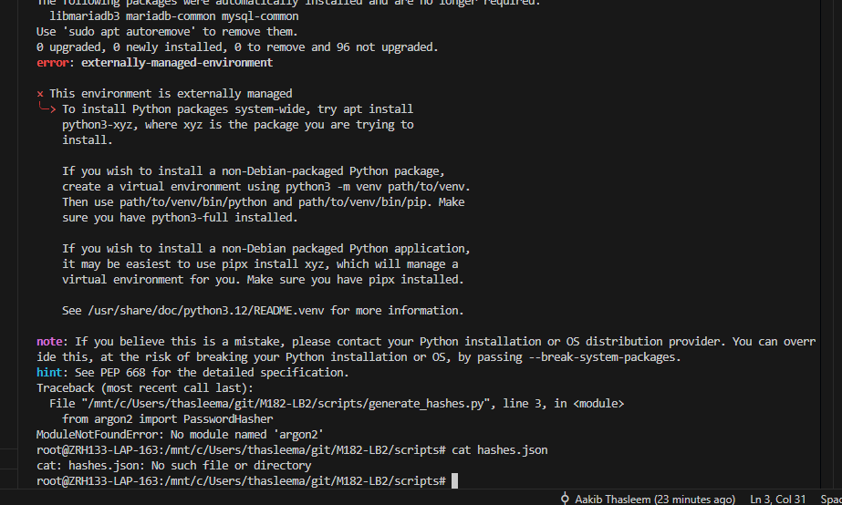

*Abbildung 1: Fehlermeldung von pip und ModuleNotFoundError.*

**Diagnose:** Ubuntu blockiert ab Version 23 (auch in WSL) `pip install` systemweit, um Konflikte mit den Python-Paketen des Betriebssystems zu vermeiden (PEP 668, <https://peps.python.org/pep-0668/>, Zugriff 30.10.2026).

**Lösung:** Eine virtuelle Umgebung (venv) erstellen und die Pakete dort installieren:

```bash
cd /mnt/c/Users/thasleema/git/M182-LB2/scripts
sudo apt install python3-venv -y
python3 -m venv venv
source venv/bin/activate
pip install bcrypt argon2-cffi
python3 generate_hashes.py
```

**Erkenntnis:** venv ist eine isolierte «Sandbox» für Python-Pakete, die genau dieses Problem umgeht, ohne das System zu gefährden. Für alle weiteren Skripte (pyotp, qrcode, requests) haben wir dieselbe venv verwendet.

---

### T2: Argon2 wird von Hashcat 6.2.6 und John nicht unterstützt

**Datum:** 27.10.2026 · **Bereich:** Hash-Cracking-Vergleich

**Symptom:** Der Versuch, den Argon2-Hash mit der installierten Hashcat-Version anzugreifen, schlug fehl:

```bash
hashcat -m 19300 -a 0 argon2_schwach.txt ../rockyou.txt
```

Der Modus 19300 ist kein Argon2-Modus, und Hashcat 6.2.6 bietet gar keinen Argon2-Modus an. Auch John the Ripper in der Version aus den Ubuntu-Paketen (6.x) unterstützte Argon2 nicht.

**Diagnose:** Recherche in der offiziellen Dokumentation:

- **Hashcat:** unterstützt Argon2 nativ erst ab Version 7.0.0 über den Hash-Modus `-m 34000` (optimiert für GPUs).
- **John the Ripper:** unterstützt Argon2 nur in der Jumbo-Version über `--format=argon2` (optimiert für CPUs).

Quellen: Hashcat-Wiki (<https://hashcat.net/wiki/doku.php?id=example_hashes>), John the Ripper (<https://github.com/openwall/john>), RFC 9106 (<https://www.rfc-editor.org/rfc/rfc9106>), alle Zugriff 27.10.2026.

**Lösung (zweigleisig):**

1. Eigenes Python-Skript `crack_argon2.py`, das das Prinzip der Dictionary-Attacke mit `ph.verify()` nachbildet.
2. Hashcat auf Version 7.0.0 aktualisiert und den Angriff mit dem richtigen Modus ausgeführt:

```bash
./hashcat.bin -m 34000 -a 0 /mnt/c/Users/thasleema/git/M182-LB2/scripts/argon2_schwach.txt /mnt/c/Users/thasleema/git/M182-LB2/rockyou.txt
```

**Ergebnis:** Status «Cracked» mit 10 H/s und 512 MB reserviertem Arbeitsspeicher (siehe Dokumentation, Kapitel 3).

**Erkenntnis:** Nicht jedes Werkzeug unterstützt jedes Verfahren. Vor einem Test sollte man in der offiziellen Dokumentation prüfen, welcher Modus und welche Version nötig sind.

---

### T3: CrackStation durch Endpoint Protection blockiert

**Datum:** 27.10.2026 · **Bereich:** Rainbow-Table-Demo

**Symptom:** Für die Rainbow-Table-Demo wollten wir zuerst den öffentlichen Lookup-Dienst <https://crackstation.net> im Browser verwenden. Firefox konnte keine Verbindung aufbauen, und Windows-Sicherheit meldete: «Dieser Inhalt wird von Ihrem IT-Administrator blockiert».

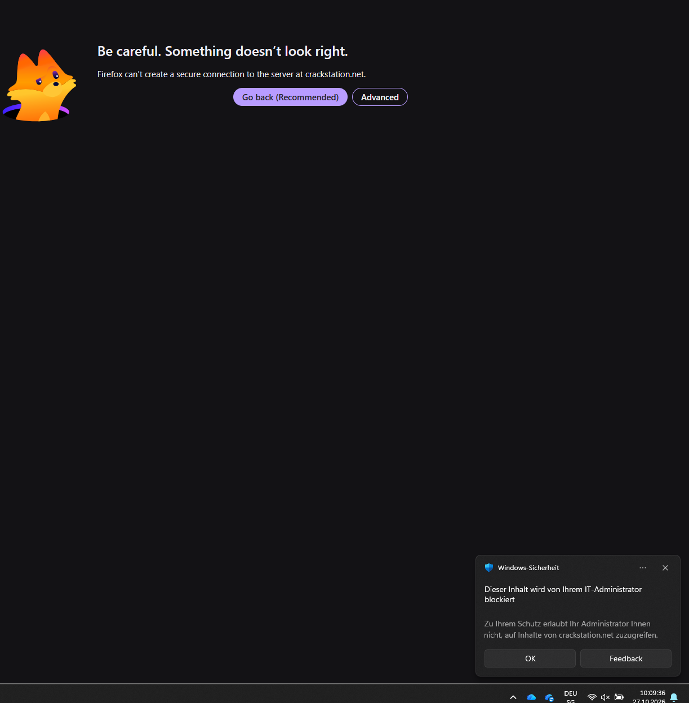

*Abbildung 2: CrackStation wird von der Endpoint Protection des Geräts blockiert.*

**Diagnose:** Die Endpoint-Protection-Richtlinie auf dem verwendeten Gerät blockiert Webseiten der Kategorie «Hacking-Tools». Das ist eine bewusste Sicherheitsmassnahme und kein technischer Fehler.

**Lösung:** Das Rainbow-Table-Prinzip wurde selbst in WSL mit dem Skript `rainbow_demo.py` simuliert (vorberechnete MD5-Lookup-Tabelle aus den ersten 10'000 Einträgen von rockyou.txt).

**Erkenntnis:** Die Blockierung ist selbst ein gutes Beispiel für eine Schutzmassnahme (Web-Filter als Teil von Defense in Depth). Das eigene Skript hat zudem den Vorteil, dass man das Prinzip besser versteht als bei einem fertigen Online-Dienst.

---

### T4: Fail2Ban unter WSL2 erkennt keine Fehlversuche

**Datum:** 27.10.2026 · **Bereich:** Rate-Limiting auf Systemebene

**Symptom:** Fail2Ban lief und das Jail `sshd` war aktiv, aber nach mehreren falschen SSH-Logins auf `root@127.0.0.1` blieb `Currently failed` auf 0. Im ersten Status war als Quelle `Journal matches: _SYSTEMD_UNIT=sshd.service + _COMM=sshd` angegeben.

**Diagnose:**

1. Ein Blick in das Fail2Ban-Log (`sudo tail -50 /var/log/fail2ban.log`) zeigte die Ursache: Es ist eine Regel definiert, die localhost (127.0.0.1) ignoriert – `[sshd] Ignore 127.0.0.1 by ignoreself rule`. Da wir den Angriff vom selben Rechner aus simuliert haben, wurden alle Fehlversuche absichtlich ignoriert.
2. Zusätzlich las Fail2Ban standardmässig aus dem systemd-Journal. Unter WSL2 werden die SSH-Logins aber in `/var/log/auth.log` geschrieben.

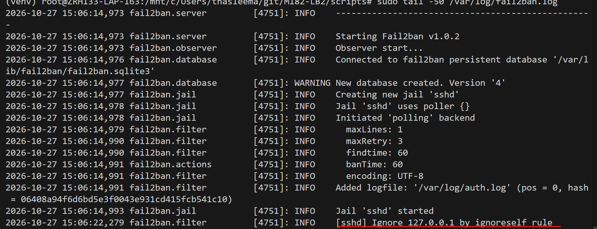

*Abbildung 3: Das Fail2Ban-Log zeigt, dass 127.0.0.1 durch die ignoreself-Regel ignoriert wird.*

**Lösung:** Anpassung von `/etc/fail2ban/jail.local`:

```bash
sudo nano /etc/fail2ban/jail.local
```

```ini
[DEFAULT]
ignoreself = false
banaction = nftables-multiport

[sshd]
enabled = true
backend = polling
logpath = /var/log/auth.log
maxretry = 3
bantime = 60
findtime = 60
```

- `ignoreself = false` entfernt die Ausnahme für den eigenen Rechner.
- `backend = polling` und `logpath = /var/log/auth.log` lassen Fail2Ban direkt die Log-Datei lesen statt des Journals.
- `banaction = nftables-multiport` setzt die Sperre über nftables um, das in Ubuntu 24.04 standardmässig als Firewall-Backend verwendet wird.

**Ergebnis:** Danach wurde der erste Fehlversuch erkannt (`Currently failed: 1`, `File list: /var/log/auth.log`), und nach 3 Fehlversuchen wurde die IP gesperrt (siehe Dokumentation, Kapitel 4).

**Erkenntnis:** `ignoreself` ist in Produktion sinnvoll, damit sich ein Administrator nicht selbst aussperrt. Für einen lokalen Test muss die Regel aber deaktiviert werden. Ausserdem muss man immer prüfen, **aus welcher Quelle** ein Überwachungswerkzeug seine Daten liest.

---

### T5: Vaultwarden über HTTP nicht nutzbar

**Datum:** 28.10.2026 · **Bereich:** Passwort-Manager

**Symptom:** Vaultwarden war über `http://localhost:8080` erreichbar, beim Erstellen eines Accounts erschien aber die Meldung «An error has occurred. Insecure URL not allowed. All URLs must use HTTPS.»

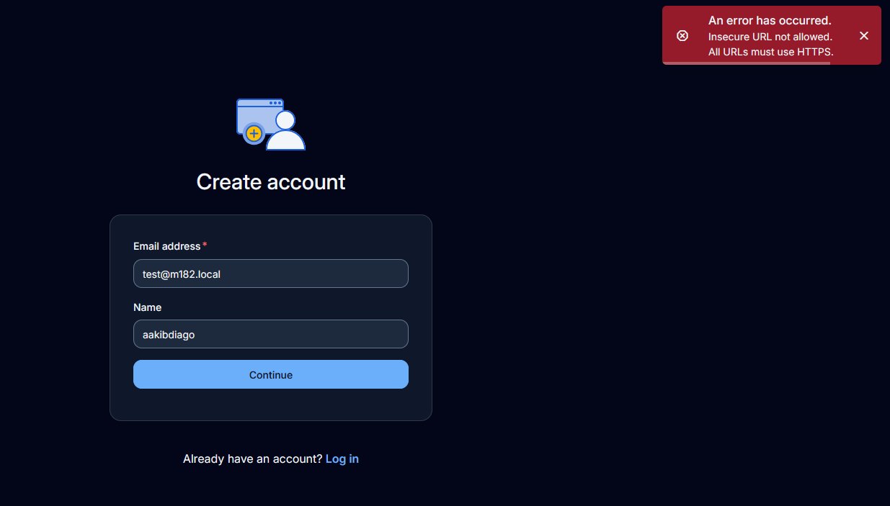

*Abbildung 4: Vaultwarden verweigert die Account-Erstellung über HTTP.*

**Diagnose:** Das ist der Web-Crypto-Sicherheitsmechanismus von Vaultwarden. Für die Passwort-Verschlüsselung braucht der Browser eine sichere Umgebung. HTTP ohne TLS reicht nicht, ausser der Browser erkennt die Seite selbst als «sicher» (normalerweise nur bei `localhost`). Quelle: MDN, *Secure contexts* (<https://developer.mozilla.org/en-US/docs/Web/Security/Secure_Contexts>, Zugriff 28.10.2026).

**Lösung:** Vaultwarden ohne direkt veröffentlichten Port neu starten und einen Reverse-Proxy (Caddy) mit eigenem Zertifikat davorschalten:

```bash
sudo docker stop vaultwarden
sudo docker rm vaultwarden
sudo docker run -d --name vaultwarden -v vw-data:/data vaultwarden/server:latest

mkdir -p ~/vaultwarden-ssl
cd ~/vaultwarden-ssl
openssl req -x509 -newkey rsa:4096 -keyout key.pem -out cert.pem -days 7 -nodes -subj "/CN=localhost"
```

Die Einrichtung von Caddy führte zum nächsten Problem (T6).

**Erkenntnis:** Moderne Webanwendungen setzen HTTPS oft zwingend voraus. TLS ist keine optionale Zusatzfunktion, sondern Voraussetzung für die Sicherheitsfunktionen im Browser.

---

### T6: Caddy/TLS – «Secure Connection Failed»

**Datum:** 28.10.2026 · **Bereich:** HTTPS für Vaultwarden

Das aufwändigste Problem des Projekts. Es hatte mehrere ineinandergreifende Ursachen, die wir Schritt für Schritt eingegrenzt haben.

#### Symptom

Browser (Firefox und Chrome) lehnten die HTTPS-Verbindung zu Caddy mit kryptischen TLS-Fehlern ab (`SSL_ERROR_INTERNAL_ERROR_ALERT`, `ERR_SSL_PROTOCOL_ERROR`), obwohl der Port erreichbar war (`Test-NetConnection` erfolgreich).

Erste Konfiguration:

```bash
cat > ~/vaultwarden-ssl/Caddyfile << 'EOF'
localhost:8443 {
    tls /data/cert.pem /data/key.pem
    reverse_proxy vaultwarden:80
}
EOF

sudo docker run -d --name caddy \
  --link vaultwarden:vaultwarden \
  -p 8443:8443 \
  -v ~/vaultwarden-ssl/Caddyfile:/etc/caddy/Caddyfile \
  -v ~/vaultwarden-ssl/cert.pem:/data/cert.pem \
  -v ~/vaultwarden-ssl/key.pem:/data/key.pem \
  caddy:latest
```

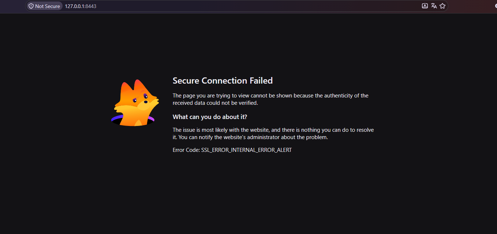

*Abbildung 5: «Secure Connection Failed» beim ersten Versuch.*

#### Diagnose und Lösungsschritte

**Schritt 1 – Caddy-Logs prüfen (`sudo docker logs caddy`):**
Caddy hatte das Zertifikat erfolgreich geladen («skipping automatic certificate management because one or more matching certificates are already loaded») und lief auf Port 8443. Auffällig waren zwei Einträge:

- `"enabling HTTP/3 listener"` und `"protocols":["h1","h2","h3"]` – Caddy aktiviert automatisch HTTP/3 (QUIC über UDP).
- `"failed to sufficiently increase receive buffer size (was: 208 kiB, wanted: 7168 kiB, got: 416 kiB)"` – ein Hinweis auf Probleme mit UDP/QUIC in der WSL2-Netzwerkumgebung.

**Schritt 2 – HTTP/3 deaktivieren (erster Versuch):** Die Zeile `protocols h1 h2` direkt im Site-Block führte dazu, dass der Container sofort beendet wurde. Die Logs endeten nach «using config from file». Grund: `protocols` ist an dieser Stelle keine gültige Direktive.

**Schritt 3 – Konfiguration validieren:** Wir haben die Caddyfile mit einem eigenen Prüf-Container validiert, bevor wir sie produktiv starteten:

```bash
sudo docker run --rm \
  -v ~/vaultwarden-ssl/Caddyfile:/etc/caddy/Caddyfile \
  caddy:latest caddy validate --config /etc/caddy/Caddyfile
```

Ein Test mit `protocols tls1.2 tls1.3` innerhalb des `tls`-Blocks war zwar gültig, änderte aber nichts am Fehler.

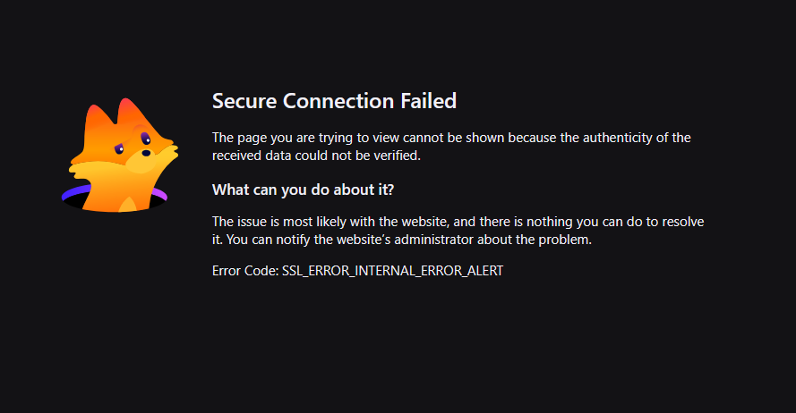

*Abbildung 6: Der Fehler bleibt nach der Anpassung der TLS-Versionen bestehen.*

**Schritt 4 – HTTP/3 global deaktivieren:** Richtig ist die globale Option `servers { protocols h1 h2 }`:

```bash
cat > ~/vaultwarden-ssl/Caddyfile << 'EOF'
{
    servers {
        protocols h1 h2
    }
}

localhost:8443 {
    tls /data/cert.pem /data/key.pem
    reverse_proxy vaultwarden:80
}
EOF
```

**Schritt 5 – Schlüsseldatei prüfen:** `file ~/vaultwarden-ssl/key.pem` ergab `OpenSSH private key (no password)`. OpenSSL hatte den Schlüssel im OpenSSH-Format statt im klassischen PEM-Format erzeugt, das Caddy für TLS erwartet. Lösung: Schlüssel explizit im klassischen Format neu erzeugen:

```bash
cd ~/vaultwarden-ssl
rm -f cert.pem key.pem
openssl genrsa -traditional -out key.pem 4096
```

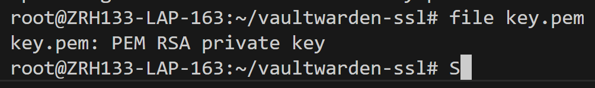

*Abbildung 7: Der Schlüssel wird jetzt als «PEM RSA private key» erkannt und nicht mehr als OpenSSH-Schlüssel.*

Danach wurde das Zertifikat neu erstellt:

```bash
openssl req -x509 -new -key key.pem -out cert.pem -days 7 -subj "/CN=localhost"
```

Der Browser zeigte trotzdem weiterhin den Fehler an:

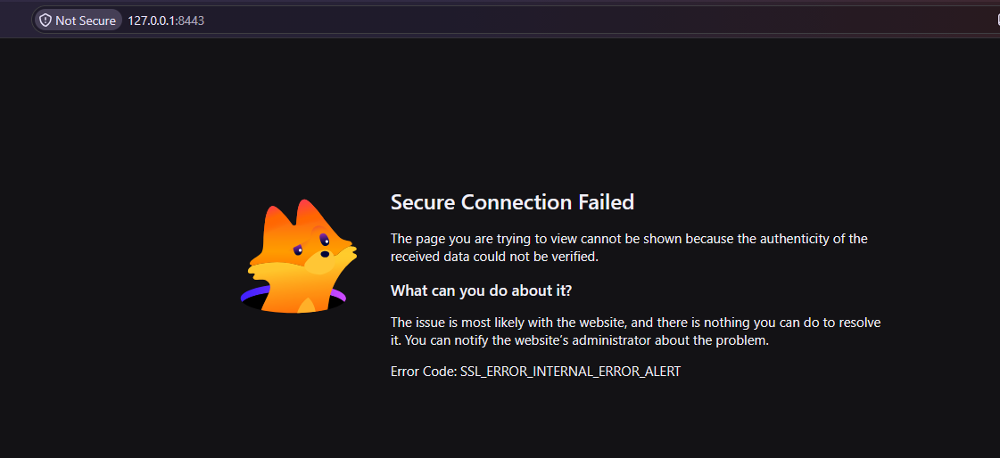

*Abbildung 8: Auch mit korrektem Schlüsselformat bleibt der Fehler im Browser bestehen.*

**Schritt 6 – TLS-Handshake direkt testen:** Mit `openssl s_client` haben wir den Handshake ohne Browser geprüft – und er war **erfolgreich**:

- Protocol: TLSv1.3 ✓
- Cipher: TLS_AES_128_GCM_SHA256 ✓
- Verify return code: 18 (self-signed certificate) – erwartet

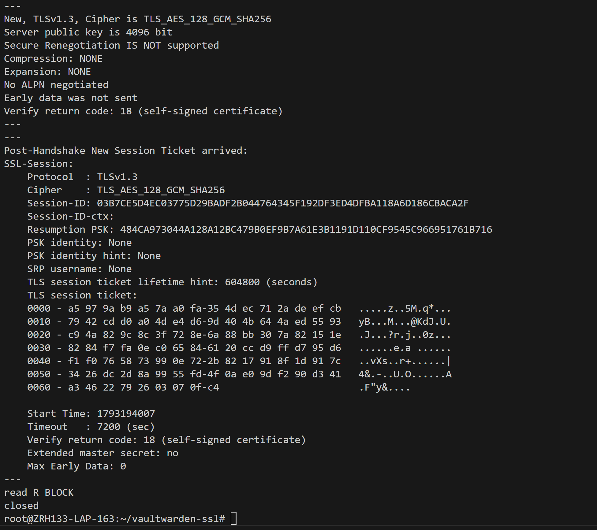

*Abbildung 9: Der TLS-Handshake funktioniert. Das Problem liegt also nicht am Server selbst, sondern daran, was der Browser verlangt.*

**Schritt 7 – Zertifikat mit SAN:** Moderne Browser akzeptieren Zertifikate nicht mehr, die den Hostnamen nur im *Common Name* (CN) enthalten. Sie prüfen den **Subject Alternative Name (SAN)** (RFC 2818, Abschnitt 3.1). Unser Zertifikat war nur mit `-subj "/CN=localhost"` erstellt worden, also **ohne SAN**. Lösung:

```bash
cd ~/vaultwarden-ssl
rm -f cert.pem key.pem
cat > san.cnf << 'EOF'
[req]
distinguished_name = req_distinguished_name
x509_extensions = v3_req
prompt = no
[req_distinguished_name]
CN = localhost
[v3_req]
subjectAltName = @alt_names
[alt_names]
DNS.1 = localhost
IP.1 = 127.0.0.1
EOF

openssl genrsa -traditional -out key.pem 4096
openssl req -x509 -new -key key.pem -out cert.pem -days 7 -config san.cnf -extensions v3_req
openssl x509 -in cert.pem -text -noout | grep -A1 "Subject Alternative Name"
```

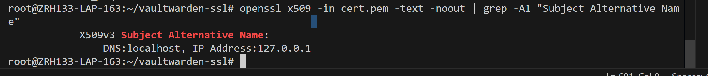

*Abbildung 10: Das neue Zertifikat enthält die SAN-Einträge `DNS:localhost` und `IP Address:127.0.0.1`.*

**Schritt 8 – Hostnamen-Filter entfernen:** Die Caddyfile war auf den Hostnamen `localhost` beschränkt (`localhost:8443`). Verbindungen über die IP `127.0.0.1` senden aber kein passendes SNI (Server Name Indication), wodurch Caddy keine passende TLS-Konfiguration fand. Lösung: `:8443` statt `localhost:8443`, damit Caddy auf jede eingehende Verbindung an diesem Port reagiert. Danach wurde der Container neu erstellt.

#### Lösung (Zusammenfassung)

| Ursache | Lösung |
|---|---|
| OpenSSL erzeugte standardmässig ein OpenSSH-Key-Format statt klassischem PEM, das Caddy nicht korrekt laden konnte | Private Key mit `openssl genrsa -traditional` im kompatiblen PEM-Format erzeugt |
| HTTP/3 (QUIC) verursachte Verbindungsabbrüche in der WSL2-Netzwerkumgebung | HTTP/3 global deaktiviert (`servers { protocols h1 h2 }`) |
| Zertifikat ohne Subject Alternative Name | Zertifikat mit SAN für `localhost` und `127.0.0.1` neu erstellt |
| Caddyfile auf den Hostnamen `localhost` beschränkt, Verbindungen über `127.0.0.1` ohne passendes SNI | Hostnamen-Filter entfernt (`:8443` statt `localhost:8443`) |

**Nachweis:** `curl -v -k https://127.0.0.1:8443` lieferte `HTTP/2 200` mit vollständigem Vaultwarden-HTML. Im Browser erschien danach nur noch die **erwartete** Warnung für ein selbstsigniertes Zertifikat (`MOZILLA_PKIX_ERROR_SELF_SIGNED_CERT`). Nach dem Bestätigen war Vaultwarden erreichbar.

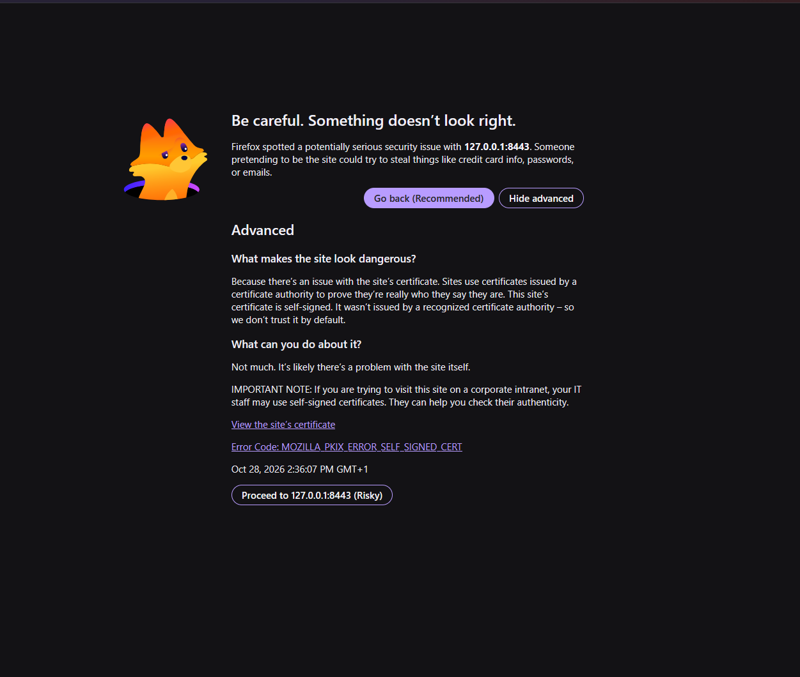

*Abbildung 11: Die erwartete Warnung für ein selbstsigniertes Zertifikat. Der TLS-Fehler ist behoben.*

#### Erkenntnis

- **Systematisch eingrenzen:** Erst mit `openssl s_client` und `curl -v` wurde klar, dass der Server-Handshake funktioniert und das Problem bei den Anforderungen des Browsers liegt.
- **Konfiguration validieren**, bevor man einen Container neu startet (`caddy validate`).
- **Mehrere Ursachen gleichzeitig** sind möglich. Darum hat keine einzelne Änderung allein den Fehler behoben.
- Für die spätere Keycloak-Installation konnten wir das korrekte Zertifikat direkt wiederverwenden.

---

### T7: Keycloak kann Zertifikat nicht lesen

**Datum:** 29.10.2026 · **Bereich:** Keycloak im Produktionsmodus

**Symptom:** Nach dem Start des Keycloak-Containers mit dem Vaultwarden-Zertifikat beendete sich Keycloak sofort mit:
`ERROR: Failed to start server in (production) mode` – `Invalid key/certificate pair configuration` – `Unable to read file /opt/keycloak/conf/server.key.pem`

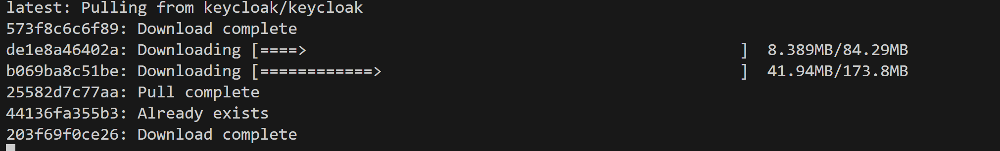

*Abbildung 12: Das Keycloak-Image wird heruntergeladen und der Container gestartet.*

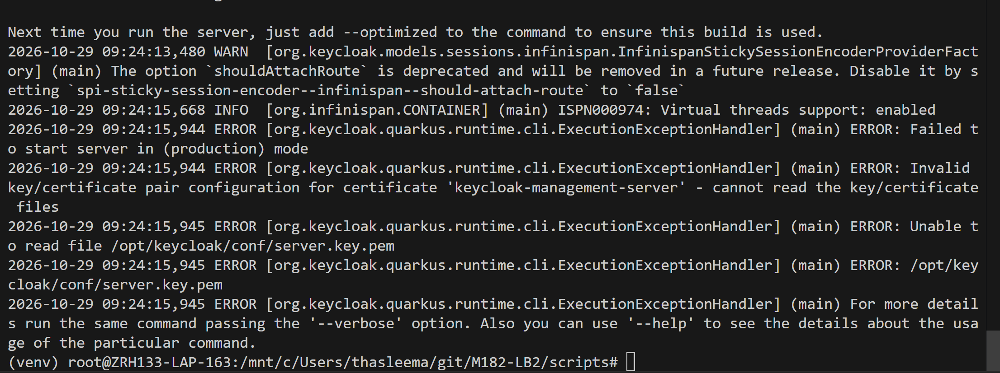

*Abbildung 13: Keycloak kann die Schlüsseldatei nicht lesen.*

**Diagnose:** Ähnliches Muster wie beim Caddy-Problem: Keycloak kann die Zertifikatsdateien nicht lesen. Die Datei `key.pem` hatte die Berechtigung `-rw-------` (nur root darf lesen, siehe `ls -la` in T6). Keycloak läuft im Container aber **nicht** als root, sondern als eigener Benutzer – und durfte die eingebundene Datei deshalb nicht lesen.

**Lösung:**

```bash
sudo docker stop keycloak
sudo docker rm keycloak

chmod 644 ~/vaultwarden-ssl/cert.pem ~/vaultwarden-ssl/key.pem
ls -la ~/vaultwarden-ssl/cert.pem ~/vaultwarden-ssl/key.pem
```

Danach Keycloak neu gestartet, mit explizit schreibgeschützten Mounts (`:ro`):

```bash
sudo docker run -d --name keycloak \
  --network keycloak-net \
  -p 8543:8443 \
  -e KEYCLOAK_ADMIN=admin \
  -e KEYCLOAK_ADMIN_PASSWORD=admin \
  -e KC_DB=postgres \
  -e KC_DB_URL=jdbc:postgresql://keycloak-db:5432/keycloak \
  -e KC_DB_USERNAME=keycloak \
  -e KC_DB_PASSWORD=keycloak_secure_pw \
  -e KC_HOSTNAME=localhost \
  -v ~/vaultwarden-ssl/cert.pem:/opt/keycloak/conf/server.crt.pem:ro \
  -v ~/vaultwarden-ssl/key.pem:/opt/keycloak/conf/server.key.pem:ro \
  quay.io/keycloak/keycloak:latest start \
  --https-certificate-file=/opt/keycloak/conf/server.crt.pem \
  --https-certificate-key-file=/opt/keycloak/conf/server.key.pem
```

**Ergebnis:** «Keycloak 26.8.1 … started in 21.629s. Listening on: https://0.0.0.0:8443» und «Profile prod activated».

**Erkenntnis:** Bei Docker-Mounts gelten die Dateiberechtigungen des Hosts. Läuft der Container als normaler Benutzer, müssen die Dateien für diesen lesbar sein.

> [!WARNING]
> `chmod 644` auf einem privaten Schlüssel ist nur in unserer lokalen Testumgebung vertretbar. In Produktion sollte der Schlüssel nur für den Benutzer lesbar sein, unter dem Keycloak läuft (z. B. passender Besitzer mit `chown` und `chmod 600`), oder über einen Secrets-Mechanismus eingebunden werden (Least Privilege).

---

### T8: TOTP-Code wird trotz korrekter Eingabe abgelehnt

**Phase:** 2 · **Bereich:** 2FA

**Symptom:** Beim ersten Test von `totp_demo.py` wurde der angezeigte Code 279127 exakt eingegeben, trotzdem meldete das Skript «2FA fehlgeschlagen – falscher oder abgelaufener Code». Auch beim Test mit der Authenticator-App wurde ein abgelesener Code (425777) abgelehnt.

**Diagnose:** Zwischen Codeanzeige und Eingabe verstrich mehr Zeit, als das 30-Sekunden-Gültigkeitsfenster erlaubt. `pyotp` akzeptiert mit `totp.verify(code)` standardmässig nur den Code des aktuellen Zeitfensters (`valid_window=0`). Quelle: PyOTP-Dokumentation (<https://pyauth.github.io/pyotp/>, Zugriff 30.10.2026).

**Lösung:** Kein Fehler im Code, sondern das gewünschte Sicherheitsverhalten. Mit einem aktuellen Code (256183 bzw. 743340) funktionierte der Login sofort. Für einen produktiven Einsatz könnte man mit `totp.verify(code, valid_window=1)` ein Zeitfenster Toleranz erlauben, wie es RFC 6238 für Zeitabweichungen vorsieht.

**Zusätzliche Verbesserung:** Das Secret war zu lang, um es bequem in Microsoft Authenticator einzutippen (Input von Thasleem Aakib). Deshalb wurde `totp_setup.py` um die Ausgabe eines QR-Codes (`otpauth://`-URI) erweitert.

**Erkenntnis:** Fehlschläge in einem Test bedeuten nicht immer einen Fehler. Hier hat der Test gerade bewiesen, dass die Zeitbindung von TOTP funktioniert.
